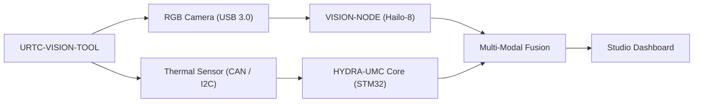

<p align="center">
  
</p>

# 👁️ URTC-VISION-TOOL

<p align="center">🇺🇸 <b>English</b> | <a href="README_spa.md">🇪🇸 Español</a> | <a href="README_fra.md">🇫🇷 Français</a> | <a href="README_ita.md">🇮🇹 Italiano</a> | <a href="README_deu.md">🇩🇪 Deutsch</a> | <a href="README_zho.md">🇨🇳 简体中文</a> | <a href="README_jpn.md">🇯🇵 日本語</a> | <a href="README_por.md">🇵🇹 Português</a></p>

### 🔬 Integrated End-Effector Combining Thermal and RGB Perception

<p align="center">
  
  
  
  
</p>

---

**Honesty check - what actually runs today:** the firmware-side sensor protocol (`sensor_frame.c`, `sensor_reading.c`, `rate_limiter.c`, `sensor_freshness.c`, `sensor_diagnostics.c`, `vision_sensor_link.c`) is real, pure C backed by 190 passing `TEST_ASSERT` checks (`tests/test_*.c`, compiled and run against the host's own C compiler), and this repo's own CI genuinely runs it: `.github/workflows/ci.yml`'s firmware step invokes `build_firmware.sh`, whose step 2 always compiles and runs `tests/` before touching the STM32 build. The host-side `vision_companion` package (`alignment.py`, `cli.py`) is likewise real and backed by 183 passing pytest cases, and CI runs that suite too (its own step installs `src/vision_companion/requirements.txt` and runs `pytest tests/` there), so a regression in either half fails the build. As the README's own intro already says: no PCB/schematic exists for this board yet, so nothing here has ever read a real MLX9064x sensor or RGB camera, or driven a real CAN transceiver - `main.c`/`startup_stm32_minimal.c` only prove the Cortex-M4F cross-compile and link succeed against a placeholder linker script. See `CHANGELOG.md` for exactly what has shipped so far.

---

> **Safety and security status:** this ecosystem is not a certified safety system, and no populated URTC board exists yet. The bootloaders check firmware images with CRC32 and a shared-key HMAC-SHA256, not with an asymmetric signature (planned); the published application images are signed with the public development key (`signing_key_kind: dev`), so anyone can produce an image the bootloader accepts; nothing has been transmitted to a real board. Read the [security baseline](https://github.com/JuanenRac/URTC-DOCS/blob/main/docs/SECURITY_BASELINE.md) and the [threat model](https://github.com/JuanenRac/URTC-DOCS/blob/main/docs/THREAT_MODEL.md) before relying on any statement here for the safety of a person.

## 📋 At a glance

| | |
|---|---|
| Version | `0.1.6` |
| Maturity | Functional |
| Tests | 183 (`pytest`) |
| Stack | C / STM32 / Python vision companion |
| Target | A microcontroller board (the firmware); built on a PC |
| On real hardware | Not yet: no run on real hardware is recorded for this version |

**Jump to:** [Overview](#-overview) · [Architecture](#-architecture) · [Features](#-features) · [Security](#-security--safety) · [Interfaces](#-interfaces) · [Quick start](#-quick-start) · [Testing](#-testing) · [Structure](#-repository-structure) · [Related](#-related-projects)

<!-- urtc-section:status_vision_tool -->
## 🚦 Project status

🟢 done and verified · 🟡 works, with known limits · 🟠 half done or not verified · 🔴 not done or not working. Nothing is green if it never ran on real hardware.

| Part | Status | What the repository can show |
| --- | :---: | --- |
| Software | 🟡 | Works on a PC and against the simulator; never run against a real board. |
| Tests | 🟢 | The test suite passes in the CI on every push. |
| Real hardware | 🟠 | No run on a real board yet: the bench test is still pending. |
| Documentation | 🟡 | README in eight languages and reference documents; the translations were not reviewed by native speakers. |

<!-- /urtc-section:status_vision_tool -->

## 🎯 Overview

**URTC-VISION-TOOL** is a specialized robot tool head that merges visual and thermal perception into a single URTC-compatible effector. It is designed for advanced QA, thermal inspection of PCBs, and high-precision Pick-and-Place alignment.

Equipped with an RGB global shutter camera and an MLX9064x-family thermal sensor, it provides the Vision AI Node with dual-modal data, allowing it to detect not only the presence of a component but also its operating temperature or solder heat dissipation.

No PCB/schematic exists for this board yet (see `hardware/`), so nothing below can drive real thermal/RGB sensors - but the firmware toolchain and the host-side vision processing pipeline (synthetic frame generation, false-color rendering, RGB->thermal ROI alignment and temperature-stats extraction, all pytest-covered) are real and working today.

### Key Features:
* 🔬 **Dual-Modal Perception** — synchronized Thermal and RGB image capture. *(the processing pipeline both frames feed is real - see below; synchronized real capture needs the PCB and sensors.)*
* 🌡️ **High-Precision Thermal** — integrated MLX90640/41/42 sensor support. *(false-color rendering and per-region stats extraction are real - see below; reading a real MLX9064x over I2C needs the PCB.)*
* 🎯 **Eye-in-Hand Alignment** — sub-millimetric PnP and AOI (Automated Optical Inspection). *(the RGB->thermal ROI coordinate mapping and temperature-stats extraction are real and tested - see `vision_companion/alignment.py` below; sub-millimetric precision needs a real calibrated camera.)*
* 📡 **URTC integration** — decided: this head is a URTC tool head and reuses URTC's thermal inspection tool (tool profile 22, MLX90640/90641/90642) and its CAN messages `0x250`-`0x255` (trigger, status, raw and calibrated pixel chunks, documented in URTC's `docs/CANBUS.TXT`) instead of a second protocol. The host side of that exchange is real and tested without hardware (`urtc_thermal.py`, with a simulated head); the head's firmware, a CAN transceiver and a populated board do not exist yet, so none of it has run on a bus. *(The sensor-side frame protocol of this repository, below, is a separate host-tested building block; it does not carry the thermal image.)*
* 🔒 **Sensor Protocol Range Checks** — versioned framing with a CRC8 checksum, measurement-range validation, rate limiting, frame freshness checks (sequence and timestamp), and dedicated error/latency/bus-reset diagnostics counters. Frame version 2: every multi-byte value (the timestamp and the thermal reading) is big-endian, like the bus, and a version 1 frame is refused. *(implemented as pure C and tested on a PC only; never run on a board or with a real sensor, and not a safety function)*
* ✅ **Cortex-M4F firmware toolchain** — a real bare-metal image that cross-compiles and links with `arm-none-eabi-gcc`, same toolchain as sibling repos URTC and URTC-SMART-RACK. *(implemented — see BUILD below)*
* ✅ **`vision_companion` processing pipeline** — a real, working Python package: synthetic thermal+RGB frame generation, false-color thermal rendering, RGB->thermal ROI alignment + temperature-stats extraction, stats reporting, all covered by 183 real pytest cases, runs end-to-end with no hardware attached. *(implemented — see VISION COMPANION below)*

## 🧩 Role in URTC

URTC-VISION-TOOL is a tool head that merges an RGB camera and an MLX9064x thermal sensor, for quality inspection, thermal inspection of PCBs and the alignment of a pick-and-place head. It is a URTC tool head: it reuses URTC's thermal inspection tool and its CAN messages `0x250` to `0x255` instead of a second protocol, and it gives the vision node (Hailo-8) and the HYDRA-UMC controller data of two kinds, so that a component can be judged not only by its presence but by its temperature. What is real today is the sensor protocol of the firmware and the host-side vision companion, both tested on a computer; no board exists yet. It is a complementary tool, not a child of URTC.

## 🏛️ Architecture

<p align="center">
  
</p>

How the parts of this repository fit together: who uses it, what it holds and what it depends on. The picture is drawn from `docs/architecture.json` and checked against the code.

<details>
<summary>Text version of the diagram (Mermaid)</summary>



</details>

### ARCHITECTURE & DESIGN DECISIONS

* **Why this project has 2 independent version tracks.** `src/firmware_common.h` (the STM32-side firmware) and `src/vision_companion/vision_companion/__init__.py` (a separate host-side Python package) are versioned independently - they run on different hardware (MCU vs. host CM5/PC) and ship on different schedules.
* **Why it isn't a child of URTC itself.** Same reasoning as URTC-SMART-RACK's own README - a Complementary Tool that shares URTC's firmware conventions, not part of its integration hierarchy.
* **Why a host-side companion package at all.** Thermal/RGB dual-modal capture needs real image processing (numpy/Pillow) that has no place running on the STM32 itself - the companion package is where that actually happens. It has no bus access of its own, but it speaks the thermal inspection messages of URTC (`urtc_thermal.py`): it builds the requests, puts the 16-pixel chunks back together into an image and hands the messages to whatever carries the bus.
* **Why `alignment.py` assumes a shared field of view rather than a real homography.** Both sensors sit on the same rigid tool head, so a per-axis linear rescale between RGB-space and thermal-space pixel coordinates is a reasonable v0 approximation - a real per-pixel calibration (checkerboard, lens distortion) needs actual cameras to calibrate against, which don't exist yet.
* **How this fits the rest of the ecosystem.** Belongs to URTC's own tool ecosystem (it reuses URTC's thermal inspection tool and its CAN messages, see above), and is a natural pairing with HYDRA-UMC-DETECTION-HEF for the same visual-recognition role URTC-SMART-RACK also serves.
* **Why the sensor frame protocol carries its own timestamp field.** A real sensor-side millisecond timestamp lets a caller know *when* a reading was actually taken, independent of whenever the MCU happens to get around to parsing the frame - real historian/diagnostic value that a bare "just arrived" assumption would lose.
* **Why diagnostics counters (`sensor_diagnostics.c`) never make an accept/reject decision themselves.** Only `sensor_frame.c` (framing), `sensor_reading.c` (range) and `rate_limiter.c` (throttling) decide whether a frame is trusted - diagnostics only records what they decided. Keeping that boundary strict means a diagnostics bug can never accidentally let bad data through, the diagnosis notes' own "separar diagnostico de salida de control".

## ✨ Features

**Thermal inspection by region, series export, sensor drift and rack check (host-tested only):** `inspect` judges each component of a plan by the temperature rule of its kind and can export the minimum, maximum and mean of every region as samples for the HYDRA-UMC datalake, as JSON lines or as OPC-UA node values; `drift-check` compares frames of a reference scene with a baseline (dead pixels, offset drift) and can write a calibration file; `rack-check` judges the tips of the tool rack from a thermal frame. `rack-watch` follows the tips while the rack heats and says when each slot reached its target and whether a swap is allowed, `rack-simulate` writes the frames of a simulated rack (healthy or with a fault) to try it without a camera, and the rack commands print in eight languages (`--lang`). See [the CLI reference](docs/CLI_REFERENCE.md). Run on synthetic frames only; no camera or board has been used.

**Thermal capture over a serial CAN adapter (new, played against a simulated adapter and head only):** `capture --port PORT` reads one calibrated image from a URTC head that carries the thermal inspection tool, through an SLCAN adapter (a serial port or a pyserial URL), with the exchange of `0x250` to `0x255`, and saves it as `.npy` and false-colour PNG, ready for `inspect`, `drift-check` and `rack-check`. A head that reports an error, never becomes ready or leaves a chunk unanswered ends the command with a clear message (exit code 1), and a port that cannot be opened ends it with code 2. It has not been run against a real adapter, bus or head.

## 🔒 Security & Safety

| Threat | Defence |
|---|---|
| A corrupted or old frame from the sensor | A versioned frame with a CRC-8 (`sensor_frame.c`); in version 2 every multi-byte value, the timestamp and the thermal reading included, is big-endian like the bus, and a version 1 frame is refused |
| A reading the sensor cannot have made | `sensor_reading.c` decodes the thermal reading and refuses what is out of range |
| A flood of frames | `rate_limiter.c` holds frames back by a minimum interval |
| A replayed frame or a stuck sensor | `sensor_freshness.c` checks the sequence and the sensor's own timestamp |
| A bug in the counters letting bad data through | `sensor_diagnostics.c` only records what the other modules decided (errors, latency, bus resets); it never accepts or rejects a frame |

All of this is pure C tested on a computer; it has never run on a board or with a real sensor, and it is not a safety function.

## 🔌 Interfaces

* **The thermal inspection messages of URTC** (`0x250` to `0x255`: trigger, status, raw and calibrated pixel chunks, documented in `docs/CANBUS.TXT` of URTC): the host side of that exchange is `urtc_thermal.py`, tested without hardware against a simulated head. `capture --port PORT` runs it through an SLCAN adapter (a serial port or a pyserial URL) and saves the image as `.npy` and a false-colour PNG; a head that reports an error, never becomes ready or leaves a chunk unanswered ends the command with exit code 1, and a port that cannot be opened with code 2.
* **The sensor frame of the firmware:** version 2, big-endian, CRC-8 (`sensor_frame.c`); it is a separate, host-tested building block and does not carry the thermal image.
* **The command line `vision-companion`:** `version`, `selftest`, `analyze-roi`, `capture`, `inspect`, `drift-check`, `rack-check`, `rack-watch` and `rack-simulate`, with every flag and exit code in [docs/CLI_REFERENCE.md](docs/CLI_REFERENCE.md).
* **Exports:** the readings of `inspect` as JSON Lines, as OPC UA node values or as samples for the HYDRA-UMC datalake.

## 🚀 Quick start

Requires the ARM GNU Toolchain (`arm-none-eabi-gcc`, `arm-none-eabi-objcopy`, `arm-none-eabi-size`) and Python 3.

```bash
# Linux/macOS
chmod +x build_firmware.sh   # one-time
./build_firmware.sh

# Windows
build_firmware.bat
```

### VISION COMPANION (host-side Python)

This part runs today, fully, with no hardware attached:

```bash
cd src/vision_companion
python3 -m venv .venv
# Linux/macOS:
.venv/bin/pip install -r requirements.txt
.venv/bin/python -m vision_companion selftest

# Windows:
.venv\Scripts\pip install -r requirements.txt
.venv\Scripts\python -m vision_companion selftest
```

`selftest` generates a synthetic MLX9064x-shaped thermal frame (32x24, with a soldering-tip-like hotspot) and a synthetic RGB color-bar test pattern, renders/saves both as real files, and prints their stats — proof the numpy/Pillow processing pipeline genuinely works, independent of the real sensor capture step that lands once hardware exists.

`analyze-roi X0 Y0 X1 Y1` maps an RGB-space bounding box into thermal-space and reports real temperature stats for that region — the alignment logic behind the README's Eye-in-Hand Alignment feature, real today:

```bash
.venv/bin/python -m vision_companion analyze-roi 280 210 360 270
```

Real example output:

```text
RGB ROI (280,210)-(360,270) in a 640x480 frame
  -> thermal stats: min=75.67C max=78.97C mean=77.69C p95=78.70C (16 thermal px)
```

183 real pytest cases cover `cli.py`, `alignment.py` and the other modules of the package:

```bash
pip install -e ".[dev]"
pytest
```

See `src/vision_companion/README.md` for the full companion documentation, and [`docs/CLI_REFERENCE.md`](docs/CLI_REFERENCE.md) for every command, flag and exit code with real captured output.

<!-- urtc-section:compatibility -->
### Requirements & compatibility

Which versions of the URTC programs work together, and which protocol version each one speaks, is listed in the compatibility table that URTC-COMMON generates: [docs/COMPATIBILITY.md](https://github.com/JuanenRac/URTC/blob/main/docs/COMPATIBILITY.md).
<!-- /urtc-section:compatibility -->

## 🧪 Testing

Two suites. The firmware side is C in `tests/` (190 `TEST_ASSERT` checks): the sensor frame, the reading, the rate limiter, the diagnostics, the freshness, the scenarios of the whole link, robustness against bad input and the shared vectors of URTC-COMMON, compiled and run with the computer's own C compiler and, in CI, with AddressSanitizer, UBSan and a coverage floor. The host side is the `vision_companion` package, with 183 pytest cases (`cd src/vision_companion && pytest`) that run the whole pipeline with no hardware: synthetic frames, false colour, alignment, calibration, the thermal capture against a simulated head, inspection, drift and the rack check. Four Python test files check the build scripts, the release assets and the version files. `bash build_firmware.sh` runs the C tests before the cross-compile and fails when one assertion fails. The receive path an interrupt will use (`sensor_rx.c`: the interrupt only puts the byte in a ring, the main loop finds the frames, resynchronises after a damaged one and drops a half frame that waited too long) is pure logic too, played byte by byte in the tests.

## 🏗️ Build & Release

The build first compiles and runs `tests/` against the *host's own* C compiler (never `arm-none-eabi-gcc`: these are pure-logic tests, no MCU registers touched) and fails the whole build if any assertion fails. Only then does it compile `main.c` and `startup_stm32_minimal.c` for Cortex-M4F, link them against the placeholder `STM32_MINIMAL.ld` memory map, and publish versioned `.elf`/`.bin`/`.hex` files to `firmware/`. Building never changes the version.

Every module under `src/` is also compiled for Cortex-M4F, and all of them are linked together as a check (no C library is available on the target), even though the image only contains `main.c` and the start-up file today. With `URTC_CI=1` nothing tracked is touched.

There is nothing to flash to real hardware yet — no PCB exists to confirm the target STM32 part, pinout, MLX9064x wiring, or the RGB camera interface.

The firmware images (`.bin`, `.hex`, `.elf`) are not versioned in git: a release build writes `firmware/URTC_VISION_TOOL_FIRMWARE_v<version>.*` (git-ignored; `build/firmware` in CI mode, `URTC_CI=1`) and they are published only as assets of the GitHub release of each version. `python tools/publish_release_assets.py` checks the files, writes the missing `.sha256` sidecar and prints the exact `gh release create` command with the files to attach.

See [`CHANGELOG.md`](CHANGELOG.md) for the full version history; each version has its own entry there.

## 📂 Repository Structure

<p align="center">
  
</p>

<details>
<summary>Text version of the tree</summary>

```text
URTC-VISION-TOOL/
├── src/                                               the firmware (pure C sensor protocol, checked copies of URTC-COMMON, entry point, placeholder linker script) and the Python companion
├── tests/                                             host C tests (190 checks) and Python checks of the build scripts
├── docs/                                              CLI_REFERENCE.md: every command and exit code
├── hardware/                                          no schematic or PCB yet
├── tools/                                             build, coverage, release tools
├── images/                                            banner and the pictures of this README
├── .github/                                           CI workflow, issue and pull-request templates
├── build-test.sh build-test.bat                       build and test scripts that change nothing in the repository
├── test.sh test.bat                                   run the tests
├── urtc.project.json                                  manifest: version, role, maturity and build command
├── CHANGELOG.md                                       what changed in each version
├── SECURITY.md SUPPORT.md LICENSE                     security policy, support and license
├── CONTRIBUTING.md CODE_OF_CONDUCT.md                 how to contribute and the code of conduct
├── .gitattributes .gitignore                          Git settings
├── build_firmware.sh build_firmware.bat               host tests, cross-compile, publish
├── bump.py bump_version.py bump_manifest_version.py   scripts that raise the version
└── LICENSE.md ruff.toml                               documentation license and lint settings
```

</details>

The annotated list of every source file, one line each, is in [docs/SOURCE_MAP.md](docs/SOURCE_MAP.md).

## 🗺️ Roadmap & Known limits

**Known limits today**

* No PCB or schematic exists for this board yet (see `hardware/`): nothing here has ever read a real MLX9064x over I2C, an RGB camera or a CAN transceiver. `main.c` and the start-up file only prove that the Cortex-M4F cross-compile and link succeed against a placeholder linker script.
* The head's firmware does not exist yet: the host side of the thermal exchange is tested against a simulated head and a simulated SLCAN adapter only.
* `alignment.py` assumes a shared field of view and rescales each axis linearly; a real per-pixel calibration (checkerboard, lens distortion) needs real cameras.
* Sub-millimetric precision, synchronized real capture and the thermal limits of the inspection rules are untried on real parts.

**Next**

* Design the board, pin the STM32 part and the camera interface, write the sensor and camera drivers, and run the thermal capture against a real head on a bench.

## 🌍 Languages

README and texts exist in English, Spanish, French, Italian, German, Chinese, Japanese and European Portuguese.

## 🔗 Related Projects

URTC is made of independent repositories, each with its own version, tests and README. This is the family, by group:

* **URTC Tool Platform:**
  * [URTC](https://github.com/JuanenRac/URTC) - firmware of the tool-head board (25 tool profiles, CAN bootloader) and the CAN protocol reference.
  * [URTC-COMMON](https://github.com/JuanenRac/URTC-COMMON) - the CAN protocol written once as data (specification, generated tables, conformance vectors) and the code the programs share.
  * [URTC-FLASHER](https://github.com/JuanenRac/URTC-FLASHER) - desktop tool that updates the board firmware over CAN or over SWD/JTAG.
  * [URTC-GATEWAY](https://github.com/JuanenRac/URTC-GATEWAY) - gateway in front of the CAN bus: lets only listed identifiers through, limits their rate and asks for a session key.
  * [URTC-SMART-RACK](https://github.com/JuanenRac/URTC-SMART-RACK) - hardware-independent C logic and command protocol for a tool rack with pre-heating and lifecycle tracking.
  * [URTC-TESTER](https://github.com/JuanenRac/URTC-TESTER) - desktop live CAN-bus tester that shows the controls and telemetry of the tool profile a board reports.
  * **URTC-VISION-TOOL** (this repository) - sensor-frame protocol in C and a Python thermal/RGB companion for an inspection tool head.
  * [URTC-WEB-STUDIO](https://github.com/JuanenRac/URTC-WEB-STUDIO) - browser app that flashes and tests the board over Web Serial and SLCAN, with nothing to install.
* **Ecosystem Operations:**
  * [URTC-DEVTOOLS](https://github.com/JuanenRac/URTC-DEVTOOLS) - the shared repository tools of the family as one versioned set, with a lock file that tells a copy that was edited from one that fell behind.
  * [URTC-DOCS](https://github.com/JuanenRac/URTC-DOCS) - architecture, interfaces, security baseline and generated catalogue of the ecosystem, plus the tools that compare all repositories.
  * [URTC-UPDATER](https://github.com/JuanenRac/URTC-UPDATER) - desktop tool that detects, installs and updates the repositories of the URTC family, one explicit action at a time.

**Sister projects (independent, with the same base and tools):**

* **[HYDRA-UMC-DOCS](https://github.com/JuanenRac/HYDRA-UMC-DOCS)** - sister project: the documentation hub of HYDRA-UMC, an independent ecosystem that shares this one's base and tools
* **[ARMOR-DOCS](https://github.com/JuanenRac/ARMOR-DOCS)** - sister project: the documentation hub of A.R.M.O.R., the security ecosystem, also independent and on the same base
* **[JuanenRac](https://github.com/JuanenRac/JuanenRac)** - the profile and the status dashboard of all the ecosystems

## 📚 Documentation

- **[CONTRIBUTING.md](CONTRIBUTING.md)** — tech stack and coding guidelines for a pull request.
- **[CODE_OF_CONDUCT.md](CODE_OF_CONDUCT.md)** — the standards of behavior expected in this community.
- **[SECURITY.md](SECURITY.md)** — how to report a vulnerability, and this project's own real security focus areas.
- **[SUPPORT.md](SUPPORT.md)** — where to ask questions and report bugs.
- **[LICENSE.md](LICENSE.md)** — this project's own license.

## 🤝 Contributing & Community

* Before a pull request run `URTC_CI=1 python tools/ci_validate.py`: it must pass. See [CONTRIBUTING.md](CONTRIBUTING.md) and the [code of conduct](CODE_OF_CONDUCT.md).
* The README exists in eight languages: a change to the text is made in all eight files, and the sections shared with other repositories are written by `tools/readme_sections.py` of URTC-COMMON.
* A change to the CAN protocol starts in URTC-COMMON (`spec/can_protocol.json`) and reaches this repository through the checked copy.
* Do not describe as working on a board what has only been built.
* Report a vulnerability privately: [SECURITY.md](SECURITY.md). Questions, ideas and reports: electrohobby3d@gmail.com ([SUPPORT.md](SUPPORT.md)).

## 👤 AUTHOR

**JuanenRac** (Electro Hobby 3D)
📧 electrohobby3d@gmail.com
📺 [youtube.com/@electrohobby3d](https://youtube.com/@electrohobby3d)

## 📜 LICENSE

GPL-3.0-or-later - See LICENSE for details.
