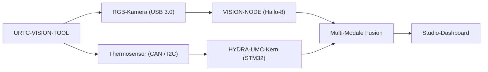

<p align="center">
  
</p>

# 👁️ URTC-VISION-TOOL

<p align="center"><a href="README.md">🇺🇸 English</a> | <a href="README_spa.md">🇪🇸 Español</a> | <a href="README_fra.md">🇫🇷 Français</a> | <a href="README_ita.md">🇮🇹 Italiano</a> | 🇩🇪 <b>Deutsch</b> | <a href="README_zho.md">🇨🇳 简体中文</a> | <a href="README_jpn.md">🇯🇵 日本語</a> | <a href="README_por.md">🇵🇹 Português</a></p>

### 🔬 Integrierter Werkzeugkopf mit Thermal- und RGB-Wahrnehmung

<p align="center">
  
  
  
  
</p>

---

**Ehrlichkeitscheck - was heute wirklich funktioniert:** das firmwareseitige Sensorprotokoll (`sensor_frame.c`, `sensor_reading.c`, `rate_limiter.c`, `sensor_freshness.c`, `sensor_diagnostics.c`, `vision_sensor_link.c`) ist echtes, reines C, abgesichert durch 190 bestandene `TEST_ASSERT`-Prüfungen (`tests/test_*.c`, mit dem C-Compiler des Hosts kompiliert und ausgeführt), und die CI dieses Repos führt sie wirklich aus: der Firmware-Schritt von `.github/workflows/ci.yml` ruft `build_firmware.sh` auf, dessen Schritt 2 immer `tests/` kompiliert und ausführt, bevor der STM32-Build beginnt. Das hostseitige Paket `vision_companion` (`alignment.py`, `cli.py`) ist ebenfalls echt und durch 183 bestandene pytest-Fälle abgesichert, und die CI führt auch diese Suite aus (ein eigener Schritt installiert `src/vision_companion/requirements.txt` und führt dort `pytest tests/` aus), sodass eine Regression in einer der beiden Hälften den Build scheitern lässt. Wie die Einleitung der README schon sagt: für diese Platine gibt es noch keine Leiterplatte/keinen Schaltplan, daher hat nichts hiervon je einen echten MLX9064x-Sensor oder eine RGB-Kamera gelesen oder einen echten CAN-Transceiver angesteuert - `main.c`/`startup_stm32_minimal.c` belegen nur, dass Cross-Compile und Linken für Cortex-M4F mit einem Platzhalter-Linkerskript gelingen. Siehe `CHANGELOG.md` für den genauen Stand.

---

> **Stand von Sicherheit (Safety) und Security:** Dieses Ökosystem ist kein zertifiziertes Sicherheitssystem, und es existiert noch keine bestückte URTC-Platine. Die Bootloader prüfen Firmware-Images mit CRC32 und einem HMAC-SHA256 mit gemeinsamem Schlüssel, nicht mit einer asymmetrischen Signatur (geplant); die veröffentlichten Anwendungs-Images sind mit dem öffentlichen Entwicklungsschlüssel signiert (`signing_key_kind: dev`), sodass jeder ein vom Bootloader akzeptiertes Image erzeugen kann; an eine echte Platine wurde noch nichts gesendet. Lesen Sie die [Sicherheitsbasis](https://github.com/JuanenRac/URTC-DOCS/blob/main/docs/SECURITY_BASELINE.md) und das [Bedrohungsmodell](https://github.com/JuanenRac/URTC-DOCS/blob/main/docs/THREAT_MODEL.md), bevor Sie sich für die Sicherheit einer Person auf eine Aussage hier verlassen.

## 📋 Auf einen Blick

| | |
|---|---|
| Version | `0.1.5` |
| Reifegrad | Funktionsfähig |
| Tests | 183 (`pytest`) |
| Technik | C / STM32 / Python vision companion |
| Ziel | Eine Mikrocontroller-Platine (die Firmware); wird auf einem PC gebaut |
| Auf echter Hardware | Noch nicht: für diese Version ist kein Lauf auf echter Hardware vermerkt |

**Springe zu:** [Überblick](#-überblick) · [Architektur](#-architektur) · [Funktionen](#-funktionen) · [Sicherheit](#-sicherheit-und-schutz) · [Schnittstellen](#-schnittstellen) · [Schnellstart](#-schnellstart) · [Tests](#-tests) · [Struktur](#-struktur-des-repositorys) · [Verwandte](#-verwandte-projekte)

<!-- urtc-section:status_vision_tool -->
## 🚦 Projektstatus

🟢 fertig und überprüft · 🟡 funktioniert, mit bekannten Grenzen · 🟠 halb fertig oder nicht überprüft · 🔴 nicht gemacht oder funktioniert nicht. Nichts ist grün, wenn es nie auf echter Hardware lief.

| Teil | Status | Was das Repository belegen kann |
| --- | :---: | --- |
| Software | 🟡 | Läuft am PC und gegen den Simulator; nie an einer echten Platine ausgeführt. |
| Tests | 🟢 | Die Testsuite besteht bei jedem Push in der CI. |
| Echte Hardware | 🟠 | Noch kein Lauf an einer echten Platine: der Bankversuch steht noch aus. |
| Dokumentation | 🟡 | README in acht Sprachen und Referenzdokumente; die Übersetzungen wurden nicht von Muttersprachlern geprüft. |

<!-- /urtc-section:status_vision_tool -->

## 🎯 Überblick

**URTC-VISION-TOOL** ist ein spezialisierter Roboter-Werkzeugkopf, der visuelle und thermische Wahrnehmung in einem einzigen URTC-kompatiblen Effektor vereint. Konzipiert für fortgeschrittene QS, thermische PCB-Inspektion und hochpräzise Pick-and-Place-Ausrichtung.

Ausgestattet mit einer RGB-Global-Shutter-Kamera und einem Thermosensor der MLX9064x-Familie liefert er dem Vision AI Node dual-modale Daten und ermöglicht es, nicht nur die Anwesenheit eines Bauteils, sondern auch dessen Betriebstemperatur oder die Wärmeabfuhr einer Lötstelle zu erkennen.

Für diese Platine existiert noch keine PCB/kein Schaltplan (siehe `hardware/`), also kann nichts davon echte Thermal-/RGB-Sensoren ansteuern - aber die Firmware-Toolchain und die hostseitige Vision-Pipeline (synthetische Frame-Erzeugung, Falschfarben-Rendering, RGB->Thermal-ROI-Ausrichtung und Temperaturstatistik-Extraktion, alles mit pytest abgedeckt) sind real und funktionieren heute.

### Hauptmerkmale:
* 🔬 **Dual-Modale Wahrnehmung** — synchronisierte Thermal- und RGB-Bildaufnahme. *(die Verarbeitungspipeline, die beide Frames speist, ist real - siehe unten; die echte synchronisierte Erfassung benötigt die PCB und die Sensoren.)*
* 🌡️ **Hochpräzise Thermik** — integrierte Unterstützung für MLX90640/41/42-Sensoren. *(das Falschfarben-Rendering und die Statistik-Extraktion pro Region sind real - siehe unten; einen echten MLX9064x über I2C auszulesen benötigt die PCB.)*
* 🎯 **Eye-in-Hand-Ausrichtung** — submillimetergenaues PnP und AOI (automatische optische Inspektion). *(die RGB->Thermal-ROI-Koordinatenzuordnung und die Temperaturstatistik-Extraktion sind real und getestet - siehe `vision_companion/alignment.py` unten; submillimetergenaue Präzision benötigt eine echte kalibrierte Kamera.)*
* 📡 **URTC-Integration** — entschieden: Dieser Kopf ist ein URTC-Werkzeugkopf und nutzt das Wärmebild-Inspektionswerkzeug von URTC (Werkzeugprofil 22, MLX90640/90641/90642) mit seinen CAN-Nachrichten `0x250`-`0x255` (Auslösen, Status, Roh- und kalibrierte Pixelblöcke, dokumentiert in `docs/CANBUS.TXT` von URTC) statt eines zweiten Protokolls. Die Hostseite dieses Austauschs ist real und ohne Hardware getestet (`urtc_thermal.py`, mit einem simulierten Kopf); die Firmware des Kopfes, ein CAN-Transceiver und eine bestückte Platine gibt es noch nicht, daher lief nichts davon auf einem Bus. *(Das sensorseitige Frame-Protokoll dieses Repositorys, siehe unten, ist ein eigener, auf dem Host getesteter Baustein; es transportiert nicht das Wärmebild.)*
* 🔒 **Bereichsprüfungen des Sensorprotokolls** — versioniertes Framing mit CRC8-Prüfsumme, Messbereichsvalidierung, Ratenbegrenzung, Aktualitätsprüfung der Frames (Sequenz und Zeitstempel) und dedizierte Diagnosezähler für Fehler/Latenz/Bus-Resets. Rahmenversion 2: Jeder Mehrbytewert (Zeitstempel und Thermalmesswert) ist Big-Endian wie beim Bus, und ein Rahmen der Version 1 wird abgelehnt. *(als reines C implementiert und nur auf einem PC getestet; nie auf einer Platine oder mit einem echten Sensor ausgeführt und keine Sicherheitsfunktion)*
* ✅ **Cortex-M4F-Firmware-Toolchain** — ein echtes Bare-Metal-Image, das mit `arm-none-eabi-gcc` wirklich kompiliert und gelinkt wird, dieselbe Toolchain wie die Schwester-Repositories URTC und URTC-SMART-RACK. *(implementiert — siehe BUILD unten)*
* ✅ **`vision_companion`-Verarbeitungspipeline** — ein echtes, funktionierendes Python-Paket: synthetische Thermal+RGB-Frame-Erzeugung, thermisches Falschfarben-Rendering, RGB->Thermal-ROI-Ausrichtung + Temperaturstatistik-Extraktion, Statistikbericht, alles abgedeckt durch 183 echte pytest-Fälle, läuft Ende-zu-Ende ohne angeschlossene Hardware. *(implementiert — siehe VISION-COMPANION unten)*

## 🧩 Rolle in URTC

URTC-VISION-TOOL ist ein Werkzeugkopf, der eine RGB-Kamera und einen thermischen MLX9064x-Sensor vereint, für die Qualitätsprüfung, die thermische Prüfung von Leiterplatten und die Ausrichtung eines Bestückkopfes. Er ist ein URTC-Werkzeugkopf: Er nutzt das thermische Prüfwerkzeug von URTC und dessen CAN-Nachrichten `0x250` bis `0x255` statt eines zweiten Protokolls und liefert dem Bildverarbeitungsknoten (Hailo-8) und der HYDRA-UMC-Steuerung Daten zweierlei Art, sodass ein Bauteil nicht nur nach seiner Anwesenheit, sondern auch nach seiner Temperatur beurteilt werden kann. Real ist heute das Sensorprotokoll der Firmware und der hostseitige Vision-Companion, beide auf einem Computer getestet; eine Platine gibt es noch nicht. Er ist ein ergänzendes Werkzeug, kein Kind von URTC.

## 🏛️ Architektur

<p align="center">
  
</p>

Wie die Teile dieses Repositorys zusammenpassen: wer es nutzt, was es enthält und wovon es abhängt. Das Bild wird aus `docs/architecture.json` gezeichnet und gegen den Code geprüft.

<details>
<summary>Textversion des Diagramms (Mermaid)</summary>



</details>

### ARCHITEKTUR & DESIGNENTSCHEIDUNGEN

* **Warum dieses Projekt 2 unabhängige Versionsspuren hat.** `src/firmware_common.h` (die STM32-seitige Firmware) und `src/vision_companion/vision_companion/__init__.py` (ein separates hostseitiges Python-Paket) werden unabhängig versioniert - sie laufen auf unterschiedlicher Hardware (MCU gegen Host-CM5/PC) und werden nach unterschiedlichen Zeitplänen ausgeliefert.
* **Warum es kein Kind von URTC selbst ist.** Gleicher Grund wie im eigenen README von URTC-SMART-RACK - ein ergänzendes Werkzeug, das die Firmware-Konventionen von URTC teilt, ohne Teil seiner Integrationshierarchie zu sein.
* **Warum überhaupt ein hostseitiges Companion-Paket.** Die duale thermische/RGB-Erfassung benötigt echte Bildverarbeitung (numpy/Pillow), die auf dem STM32 selbst keinen Platz hat - das Companion-Paket ist der Ort, an dem das tatsächlich geschieht. Es hat keinen eigenen Buszugang, spricht aber die Wärmebild-Inspektionsnachrichten von URTC (`urtc_thermal.py`): es baut die Anfragen, setzt die 16-Pixel-Blöcke wieder zu einem Bild zusammen und gibt die Nachrichten an das weiter, was den Bus befördert.
* **Warum `alignment.py` ein gemeinsames Sichtfeld annimmt statt einer echten Homografie.** Beide Sensoren sitzen auf demselben starren Werkzeugkopf, daher ist eine achsenweise lineare Neuskalierung zwischen Pixelkoordinaten im RGB-Raum und im Thermal-Raum eine vernünftige v0-Näherung - eine echte pixelgenaue Kalibrierung (Schachbrett, Objektivverzerrung) benötigt echte Kameras, gegen die kalibriert werden kann, die es noch nicht gibt.
* **Wie sich das ins restliche Ökosystem einfügt.** Gehört zum Werkzeug-Ökosystem von URTC (es nutzt das Wärmebild-Inspektionswerkzeug von URTC und dessen CAN-Nachrichten, siehe oben) und bildet ein natürliches Paar mit HYDRA-UMC-DETECTION-HEF für dieselbe visuelle Erkennungsrolle, die auch URTC-SMART-RACK erfüllt.
* **Warum das Sensor-Frame-Protokoll ein eigenes Zeitstempelfeld trägt.** Ein echter sensorseitiger Zeitstempel in Millisekunden lässt einen Aufrufer wissen, *wann* eine Messung tatsächlich vorgenommen wurde, unabhängig davon, wann die MCU dazu kommt, den Frame zu parsen - ein echter Wert für Historisierung/Diagnose, den eine bloße „gerade eben angekommen"-Annahme verlieren würde.
* **Warum Diagnosezähler (`sensor_diagnostics.c`) niemals selbst eine Annahme-/Ablehnungsentscheidung treffen.** Nur `sensor_frame.c` (Framing), `sensor_reading.c` (Bereich) und `rate_limiter.c` (Ratenbegrenzung) entscheiden, ob einem Frame vertraut wird - Diagnose zeichnet nur auf, was sie entschieden haben. Diese Grenze strikt einzuhalten bedeutet, dass ein Diagnose-Bug niemals versehentlich schlechte Daten durchlassen kann, das eigene "separar diagnostico de salida de control" der Diagnosenotizen.

## ✨ Funktionen

**Thermische Inspektion nach Region, Serienexport, Sensordrift und Rack-Prüfung (nur auf dem Host getestet):** `inspect` beurteilt jedes Bauteil eines Plans nach der Temperaturregel seiner Art und kann Minimum, Maximum und Mittelwert jeder Region als Messwerte für den HYDRA-UMC-Datalake exportieren, als JSON-Zeilen oder als OPC-UA-Knotenwerte; `drift-check` vergleicht Bilder einer Referenzszene mit einer Basis (tote Pixel, Offset-Drift) und kann eine Kalibrierdatei schreiben; `rack-check` beurteilt die Spitzen des Werkzeug-Racks anhand eines Wärmebildes. `rack-watch` verfolgt die Spitzen, während das Rack aufheizt, und zeigt, wann jedes Fach sein Ziel erreicht hat und ob das Werkzeug gewechselt werden darf; `rack-simulate` schreibt die Bilder eines simulierten Racks (gesund oder mit einem Fehler), um es ohne Kamera auszuprobieren; die Rack-Befehle geben ihre Texte in acht Sprachen aus (`--lang`). Siehe [die CLI-Referenz](docs/CLI_REFERENCE.md). Nur mit synthetischen Bildern ausgeführt; weder Kamera noch Platine wurden benutzt.

**Thermische Aufnahme über einen seriellen CAN-Adapter (neu, nur gegen einen simulierten Adapter und Kopf gespielt):** `capture --port PORT` liest ein kalibriertes Bild von einem URTC-Kopf mit dem Werkzeug für thermische Inspektion durch einen SLCAN-Adapter (eine serielle Schnittstelle oder eine pyserial-URL) mit dem Austausch von `0x250` bis `0x255` und speichert es als `.npy` und Falschfarben-PNG, bereit für `inspect`, `drift-check` und `rack-check`. Ein Kopf, der einen Fehler meldet, nie bereit wird oder einen Block unbeantwortet lässt, beendet den Befehl mit einer klaren Meldung (Exit-Code 1); ein Port, der sich nicht öffnen lässt, beendet ihn mit Code 2. Mit einem echten Adapter, Bus oder Kopf wurde es nicht ausgeführt.

## 🔒 Sicherheit und Schutz

| Bedrohung | Abwehr |
|---|---|
| Ein beschädigter oder alter Frame vom Sensor | Ein versionierter Frame mit CRC-8 (`sensor_frame.c`); in Version 2 ist jeder Mehrbytewert, auch Zeitstempel und Wärmemesswert, Big-Endian wie der Bus, und ein Frame der Version 1 wird abgelehnt |
| Ein Messwert, den der Sensor nicht haben kann | `sensor_reading.c` dekodiert den Wärmemesswert und lehnt ab, was außerhalb des Bereichs liegt |
| Eine Flut von Frames | `rate_limiter.c` hält Frames mit einem Mindestabstand zurück |
| Ein wiederholter Frame oder ein hängender Sensor | `sensor_freshness.c` prüft die Sequenz und den eigenen Zeitstempel des Sensors |
| Ein Fehler in den Zählern, der schlechte Daten durchlässt | `sensor_diagnostics.c` zeichnet nur auf, was die anderen Module entschieden haben (Fehler, Latenz, Bus-Resets); es nimmt nie einen Frame an oder lehnt ihn ab |

All das ist reines C, auf einem Computer getestet; es lief nie auf einer Platine oder mit einem echten Sensor und ist keine Sicherheitsfunktion.

## 🔌 Schnittstellen

* **Die Wärmeprüf-Nachrichten von URTC** (`0x250` bis `0x255`: Auslöser, Status, rohe und kalibrierte Pixelblöcke, dokumentiert in `docs/CANBUS.TXT` von URTC): Die Host-Seite dieses Austauschs ist `urtc_thermal.py`, ohne Hardware gegen einen simulierten Kopf getestet. `capture --port PORT` führt ihn über einen SLCAN-Adapter aus (ein serieller Port oder eine pyserial-URL) und speichert das Bild als `.npy` und als Falschfarben-PNG; ein Kopf, der einen Fehler meldet, nie bereit wird oder einen Block unbeantwortet lässt, beendet den Befehl mit Exit-Code 1, ein Port, der sich nicht öffnen lässt, mit Code 2.
* **Der Sensor-Frame der Firmware:** Version 2, Big-Endian, CRC-8 (`sensor_frame.c`); er ist ein eigener, auf dem Host getesteter Baustein und trägt nicht das Wärmebild.
* **Die Befehlszeile `vision-companion`:** `version`, `selftest`, `analyze-roi`, `capture`, `inspect`, `drift-check`, `rack-check`, `rack-watch` und `rack-simulate`, mit jeder Option und jedem Exit-Code in [docs/CLI_REFERENCE.md](docs/CLI_REFERENCE.md).
* **Exporte:** die Messwerte von `inspect` als JSON Lines, als OPC-UA-Knotenwerte oder als Proben für den HYDRA-UMC-Datensee.

## 🚀 Schnellstart

Erfordert die ARM-GNU-Toolchain (`arm-none-eabi-gcc`, `arm-none-eabi-objcopy`, `arm-none-eabi-size`) und Python 3.

```bash
# Linux/macOS
chmod +x build_firmware.sh   # einmalig
./build_firmware.sh

# Windows
build_firmware.bat
```

### VISION-COMPANION (Python, hostseitig)

Dieser Teil funktioniert heute vollständig, ohne jegliche angeschlossene Hardware:

```bash
cd src/vision_companion
python3 -m venv .venv
# Linux/macOS:
.venv/bin/pip install -r requirements.txt
.venv/bin/python -m vision_companion selftest

# Windows:
.venv\Scripts\pip install -r requirements.txt
.venv\Scripts\python -m vision_companion selftest
```

`selftest` erzeugt einen synthetischen, MLX9064x-förmigen Thermal-Frame (32x24, mit einem lötspitzenartigen Hotspot) und ein synthetisches RGB-Farbbalken-Testmuster, rendert/speichert beide als echte Dateien und gibt deren Statistiken aus - Beweis dafür, dass die numpy/Pillow-Verarbeitungspipeline wirklich funktioniert, unabhängig vom echten Sensor-Erfassungsschritt, der kommt, sobald Hardware existiert.

`analyze-roi X0 Y0 X1 Y1` bildet eine Bounding-Box im RGB-Raum auf den Thermal-Raum ab und meldet echte Temperaturstatistiken für diesen Bereich - die Ausrichtungslogik hinter dem README-Feature Eye-in-Hand Alignment, heute real:

```bash
.venv/bin/python -m vision_companion analyze-roi 280 210 360 270
```

Echte Beispielausgabe:

```text
RGB ROI (280,210)-(360,270) in a 640x480 frame
  -> thermal stats: min=75.67C max=78.97C mean=77.69C p95=78.70C (16 thermal px)
```

183 echte pytest-Fälle decken `cli.py`, `alignment.py` und die übrigen Module des Pakets ab:

```bash
pip install -e ".[dev]"
pytest
```

Siehe `src/vision_companion/README.md` für die vollständige Companion-Dokumentation, und [`docs/CLI_REFERENCE.md`](docs/CLI_REFERENCE.md) für jeden Befehl, jede Option und jeden Exit-Code mit real erfasster Ausgabe.

<!-- urtc-section:compatibility -->
### Voraussetzungen und Kompatibilität

Welche Versionen der URTC-Programme zusammenarbeiten und welche Protokollversion jede spricht, steht in der Kompatibilitätstabelle, die URTC-COMMON erzeugt: [docs/COMPATIBILITY.md](https://github.com/JuanenRac/URTC/blob/main/docs/COMPATIBILITY.md).
<!-- /urtc-section:compatibility -->

## 🧪 Tests

Es gibt zwei Suiten. Die Firmware-Seite ist C in `tests/` (190 `TEST_ASSERT`-Prüfungen): der Sensor-Frame, der Messwert, der Ratenbegrenzer, die Diagnose, die Aktualität, die Szenarien der ganzen Verbindung, Robustheit gegen fehlerhafte Eingaben und die gemeinsamen Vektoren von URTC-COMMON, kompiliert und ausgeführt mit dem C-Compiler des Rechners selbst und in der CI mit AddressSanitizer, UBSan und einer Abdeckungsschwelle. Die Host-Seite ist das Paket `vision_companion` mit 183 pytest-Fällen (`cd src/vision_companion && pytest`), die die ganze Pipeline ohne Hardware ausführen: synthetische Bilder, Falschfarben, Ausrichtung, Kalibrierung, die Wärmeaufnahme gegen einen simulierten Kopf, die Prüfung, die Drift und die Rack-Prüfung. Vier Python-Testdateien prüfen die Build-Skripte, die Release-Dateien und die Versionsdateien. `bash build_firmware.sh` führt die C-Tests vor dem Cross-Kompilieren aus und bricht ab, wenn eine Prüfung fehlschlägt. Auch der Empfangsweg, den ein Interrupt nutzen wird (`sensor_rx.c`: der Interrupt legt das Byte nur in einen Ring, die Hauptschleife findet die Frames, synchronisiert sich nach einem beschädigten neu und verwirft einen halben Frame, der zu lange wartete), ist reine Logik und wird in den Tests Byte für Byte abgespielt.

## 🏗️ Build und Veröffentlichung

Der Build kompiliert und führt zuerst `tests/` mit dem C-Compiler *des Rechners selbst* aus (nie `arm-none-eabi-gcc`: Es sind reine Logiktests ohne MCU-Register) und bricht ganz ab, wenn eine Prüfung fehlschlägt. Erst danach kompiliert er `main.c` und `startup_stm32_minimal.c` für Cortex-M4F, linkt sie gegen die vorläufige Speicherkarte `STM32_MINIMAL.ld` und legt versionierte `.elf`/`.bin`/`.hex`-Dateien in `firmware/` ab. Das Bauen ändert nie die Version.

Jedes Modul unter `src/` wird auch für Cortex-M4F kompiliert und alle werden als Prüfung zusammengelinkt (auf dem Ziel gibt es keine C-Bibliothek), obwohl das Image heute nur `main.c` und die Startdatei enthält. Mit `URTC_CI=1` wird keine versionierte Datei angefasst.

Es gibt noch nichts, was auf echte Hardware geflasht werden könnte - es existiert keine PCB, die das Ziel-STM32-Modell, das Pinout, die MLX9064x-Verkabelung oder die RGB-Kameraschnittstelle bestätigt.

Die Firmware-Images (`.bin`, `.hex`, `.elf`) werden nicht in git versioniert: ein Release-Build schreibt `firmware/URTC_VISION_TOOL_FIRMWARE_v<Version>.*` (von git ignoriert; `build/firmware` im CI-Modus, `URTC_CI=1`), und sie werden nur als Assets des GitHub-Releases der jeweiligen Version veröffentlicht. `python tools/publish_release_assets.py` prüft die Dateien, schreibt die fehlende `.sha256`-Datei und gibt den genauen `gh release create`-Befehl mit den anzuhängenden Dateien aus.

Den vollständigen Versionsverlauf findest du in [`CHANGELOG.md`](CHANGELOG.md); jede Version hat dort ihren eigenen Eintrag.

## 📂 Struktur des Repositorys

<p align="center">
  
</p>

<details>
<summary>Textversion des Baums</summary>

```text
URTC-VISION-TOOL/
├── src/                                               die Firmware (reines C-Sensorprotokoll, geprüfte Kopien von URTC-COMMON, Einstiegspunkt, vorläufiges Linker-Skript) und der Python-Companion
├── tests/                                             C-Host-Tests (190 Prüfungen) und Python-Prüfungen der Build-Skripte
├── docs/                                              CLI_REFERENCE.md: jeder Befehl und Exit-Code
├── hardware/                                          noch kein Schaltplan, keine Leiterplatte
├── tools/                                             Build-, Abdeckungs- und Release-Werkzeuge
├── images/                                            Banner und Bilder dieses READMEs
├── .github/                                           CI-Workflow sowie Vorlagen für Issues und Pull Requests
├── build-test.sh build-test.bat                       Build- und Testskripte, die im Repository nichts ändern
├── test.sh test.bat                                   führen die Tests aus
├── urtc.project.json                                  Manifest: Version, Rolle, Reifegrad und Build-Befehl
├── CHANGELOG.md                                       was sich in jeder Version geändert hat
├── SECURITY.md SUPPORT.md LICENSE                     Sicherheitsrichtlinie, Support und Lizenz
├── CONTRIBUTING.md CODE_OF_CONDUCT.md                 wie man mitwirkt, und der Verhaltenskodex
├── .gitattributes .gitignore                          Git-Einstellungen
├── build_firmware.sh build_firmware.bat               Host-Tests, Cross-Kompilierung, Veröffentlichung
├── bump.py bump_version.py bump_manifest_version.py   Skripte, die die Version erhöhen
└── LICENSE.md ruff.toml                               Dokumentationslizenz und Lint-Einstellungen
```

</details>

Die kommentierte Liste jeder Quelldatei, eine Zeile je Datei, steht in [docs/SOURCE_MAP.md](docs/SOURCE_MAP.md).

## 🗺️ Roadmap und bekannte Grenzen

**Bekannte Grenzen heute**

* Für diese Platine gibt es noch keine Leiterplatte und keinen Schaltplan (siehe `hardware/`): Nichts davon hat je einen echten MLX9064x über I2C, eine RGB-Kamera oder einen CAN-Transceiver gelesen. `main.c` und die Startdatei beweisen nur, dass Cross-Kompilieren und Linken für Cortex-M4F mit einem vorläufigen Linker-Skript gelingen.
* Die Firmware des Kopfes gibt es noch nicht: Die Host-Seite des Wärmeaustauschs ist nur gegen einen simulierten Kopf und einen simulierten SLCAN-Adapter getestet.
* `alignment.py` nimmt ein gemeinsames Sichtfeld an und skaliert jede Achse linear; eine echte pixelweise Kalibrierung (Schachbrett, Linsenverzerrung) braucht echte Kameras.
* Submillimetergenauigkeit, synchronisierte echte Aufnahme und die thermischen Grenzen der Prüfregeln sind an echten Teilen nicht erprobt.

**Als Nächstes**

* Die Platine entwerfen, das STM32-Bauteil und die Kameraschnittstelle festlegen, die Sensor- und Kameratreiber schreiben und die Wärmeaufnahme auf einem Prüfstand gegen einen echten Kopf ausführen.

## 🌍 Sprachen

README und Texte gibt es auf Englisch, Spanisch, Französisch, Italienisch, Deutsch, Chinesisch, Japanisch und europäischem Portugiesisch.

## 🔗 Verwandte Projekte

URTC besteht aus unabhängigen Repositories mit jeweils eigener Version, eigenen Tests und eigenem README. Das ist die Familie, nach Gruppen:

* **URTC Tool Platform:**
  * [URTC](https://github.com/JuanenRac/URTC) - Firmware der Werkzeugkopf-Platine (25 Werkzeugprofile, CAN-Bootloader) und die Referenz des CAN-Protokolls.
  * [URTC-COMMON](https://github.com/JuanenRac/URTC-COMMON) - das CAN-Protokoll einmal als Daten geschrieben (Spezifikation, erzeugte Tabellen, Konformitätsvektoren) und der Code, den die Programme teilen.
  * [URTC-FLASHER](https://github.com/JuanenRac/URTC-FLASHER) - Desktop-Werkzeug, das die Platinen-Firmware über CAN oder über SWD/JTAG aktualisiert.
  * [URTC-GATEWAY](https://github.com/JuanenRac/URTC-GATEWAY) - Gateway vor dem CAN-Bus: lässt nur gelistete Kennungen durch, begrenzt ihre Rate und verlangt einen Sitzungsschlüssel.
  * [URTC-SMART-RACK](https://github.com/JuanenRac/URTC-SMART-RACK) - hardwareunabhängige C-Logik und Befehlsprotokoll für eine Werkzeugablage mit Vorheizen und Lebenszyklusverfolgung.
  * [URTC-TESTER](https://github.com/JuanenRac/URTC-TESTER) - Desktop-Live-Tester für den CAN-Bus, der die Bedienelemente und die Telemetrie des von einer Platine gemeldeten Werkzeugprofils zeigt.
  * **URTC-VISION-TOOL** (dieses Repository) - Sensorrahmen-Protokoll in C und ein Python-Thermo-/RGB-Begleiter für einen Inspektions-Werkzeugkopf.
  * [URTC-WEB-STUDIO](https://github.com/JuanenRac/URTC-WEB-STUDIO) - Browser-App, die die Platine über Web Serial und SLCAN flasht und testet, ohne Installation.
* **Ecosystem Operations:**
  * [URTC-DOCS](https://github.com/JuanenRac/URTC-DOCS) - Architektur, Schnittstellen, Sicherheitsbasis und erzeugter Katalog des Ökosystems sowie die Werkzeuge, die alle Repositories vergleichen.
  * [URTC-UPDATER](https://github.com/JuanenRac/URTC-UPDATER) - Desktop-Werkzeug, das die Repositories der URTC-Familie erkennt, installiert und aktualisiert, jeweils eine ausdrückliche Aktion.

**Schwesterprojekte (unabhängig, mit derselben Basis und denselben Werkzeugen):**

* **[HYDRA-UMC-DOCS](https://github.com/JuanenRac/HYDRA-UMC-DOCS)** - Schwesterprojekt: das Dokumentationszentrum von HYDRA-UMC, einem unabhängigen Ökosystem, das Basis und Werkzeuge mit diesem teilt
* **[ARMOR-DOCS](https://github.com/JuanenRac/ARMOR-DOCS)** - Schwesterprojekt: das Dokumentationszentrum von A.R.M.O.R., dem Sicherheits-Ökosystem, ebenfalls unabhängig und auf derselben Basis
* **[JuanenRac](https://github.com/JuanenRac/JuanenRac)** - das Profil und das Status-Dashboard aller Ökosysteme

## 📚 Dokumentation

- **[CONTRIBUTING.md](CONTRIBUTING.md)** — Technologie-Stack und Coding-Richtlinien für einen Pull Request.
- **[CODE_OF_CONDUCT.md](CODE_OF_CONDUCT.md)** — die in dieser Community erwarteten Verhaltensstandards.
- **[SECURITY.md](SECURITY.md)** — wie man eine Schwachstelle meldet, und die echten Sicherheitsschwerpunkte dieses Projekts.
- **[SUPPORT.md](SUPPORT.md)** — wo man Fragen stellt und Fehler meldet.
- **[LICENSE.md](LICENSE.md)** — die eigene Lizenz dieses Projekts.

## 🤝 Mitwirken und Community

* Führe vor einem Pull Request `URTC_CI=1 python tools/ci_validate.py` aus: es muss bestehen. Siehe [CONTRIBUTING.md](CONTRIBUTING.md) und den [Verhaltenskodex](CODE_OF_CONDUCT.md).
* Das README gibt es in acht Sprachen: Eine Textänderung wird in allen acht Dateien vorgenommen, und die mit anderen Repositorys geteilten Abschnitte schreibt `tools/readme_sections.py` von URTC-COMMON.
* Eine Änderung am CAN-Protokoll beginnt in URTC-COMMON (`spec/can_protocol.json`) und gelangt über die geprüfte Kopie in dieses Repository.
* Beschreibe nichts als auf einer Platine funktionierend, was nur gebaut wurde.
* Melde eine Schwachstelle privat: [SECURITY.md](SECURITY.md). Fragen, Ideen und Meldungen: electrohobby3d@gmail.com ([SUPPORT.md](SUPPORT.md)).

## 👤 AUTOR

**JuanenRac** (Electro Hobby 3D)
📧 electrohobby3d@gmail.com
📺 [youtube.com/@electrohobby3d](https://youtube.com/@electrohobby3d)

## 📜 LIZENZ

GPL-3.0-or-later - Siehe LICENSE für Details.
