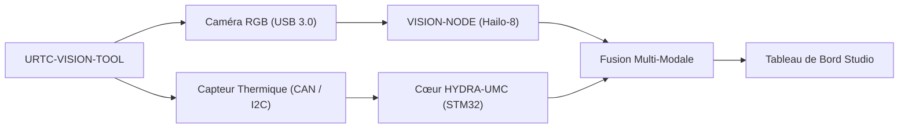

<p align="center">
  
</p>

# 👁️ URTC-VISION-TOOL

<p align="center"><a href="README.md">🇺🇸 English</a> | <a href="README_spa.md">🇪🇸 Español</a> | 🇫🇷 <b>Français</b> | <a href="README_ita.md">🇮🇹 Italiano</a> | <a href="README_deu.md">🇩🇪 Deutsch</a> | <a href="README_zho.md">🇨🇳 简体中文</a> | <a href="README_jpn.md">🇯🇵 日本語</a> | <a href="README_por.md">🇵🇹 Português</a></p>

### 🔬 Tête d'Outil Intégrée Combinant Perception Thermique et RGB

<p align="center">
  
  
  
  
</p>

**Vérification d'honnêteté - ce qui fonctionne réellement aujourd'hui :** le protocole capteurs côté firmware (`sensor_frame.c`, `sensor_reading.c`, `rate_limiter.c`, `sensor_freshness.c`, `sensor_diagnostics.c`, `vision_sensor_link.c`) est du vrai C pur couvert par 165 vérifications `TEST_ASSERT` qui passent (`tests/test_*.c`, compilées et exécutées avec le compilateur C de l'hôte), et la CI de ce dépôt les exécute réellement : l'étape firmware de `.github/workflows/ci.yml` appelle `build_firmware.sh`, dont l'étape 2 compile et exécute toujours `tests/` avant de toucher au build STM32. Le paquet `vision_companion` côté hôte (`alignment.py`, `cli.py`) est lui aussi réel et couvert par 135 cas pytest qui passent, et la CI exécute aussi cette suite (une étape dédiée installe `src/vision_companion/requirements.txt` et y lance `pytest tests/`), donc une régression dans l'une ou l'autre moitié fait échouer le build. Comme le dit déjà l'introduction du README : il n'existe pas encore de PCB/schéma pour cette carte, donc rien ici n'a jamais lu un vrai capteur MLX9064x ou une caméra RGB, ni piloté un vrai transceiver CAN - `main.c`/`startup_stm32_minimal.c` prouvent seulement que la compilation croisée et l'édition de liens Cortex-M4F réussissent avec un script d'édition de liens provisoire. Voir `CHANGELOG.md` pour ce qui a réellement été publié.

---

> **État de la sûreté et de la cybersécurité :** cet écosystème n'est pas un système de sécurité certifié et aucune carte URTC assemblée n'existe encore. Les bootloaders contrôlent les images de firmware par CRC32 et un HMAC-SHA256 à clé partagée, pas par une signature asymétrique (prévue) ; les images d'application publiées sont signées avec la clé publique de développement (`signing_key_kind: dev`), si bien que n'importe qui peut produire une image acceptée par le bootloader ; rien n'a été transmis à une carte réelle. Lisez la [base de sécurité](https://github.com/JuanenRac/URTC-DOCS/blob/main/docs/SECURITY_BASELINE.md) et le [modèle de menaces](https://github.com/JuanenRac/URTC-DOCS/blob/main/docs/THREAT_MODEL.md) avant de vous fier à une affirmation d'ici pour la sécurité d'une personne.

## 📋 En un coup d'œil

| | |
|---|---|
| Version | `0.1.4` |
| Maturité | Fonctionnel |
| Technologie | C / STM32 / Python vision companion |
| Cible | Une carte à microcontrôleur (le firmware) ; compilé sur un PC |
| Sur matériel réel | Pas encore : aucune exécution sur du matériel réel n'est consignée pour cette version |

## 1. 🛠️ APERÇU TECHNIQUE

**URTC-VISION-TOOL** est une tête d'outil robotique spécialisée qui fusionne la perception visuelle et thermique en un seul effecteur compatible URTC. Conçue pour le contrôle qualité avancé, l'inspection thermique de PCB et l'alignement Pick-and-Place haute précision.

Équipée d'une caméra RGB à obturateur global et d'un capteur thermique de la famille MLX9064x, elle fournit au Vision AI Node des données à double modalité, lui permettant de détecter non seulement la présence d'un composant mais aussi sa température de fonctionnement ou la dissipation thermique d'une soudure.

Aucun PCB/schéma n'existe encore pour cette carte (voir `hardware/`), donc rien ci-dessous ne peut piloter de vrais capteurs thermiques/RGB - mais la chaîne d'outils firmware et le pipeline de vision côté hôte (génération synthétique de trames, rendu en fausses couleurs, alignement de ROI RGB->thermique et extraction de statistiques de température, le tout couvert par pytest) sont réels et fonctionnent aujourd'hui.

### Fonctionnalités Clés :
* 🔬 **Perception Double-Modale** — capture synchronisée d'images Thermique et RGB. *(le pipeline de traitement alimenté par les deux trames est réel - voir ci-dessous ; la capture synchronisée réelle nécessite le PCB et les capteurs.)*
* 🌡️ **Thermique Haute Précision** — prise en charge intégrée des capteurs MLX90640/41/42. *(le rendu en fausses couleurs et l'extraction de statistiques par région sont réels - voir ci-dessous ; lire un vrai MLX9064x par I2C nécessite le PCB.)*
* 🎯 **Alignement Eye-in-Hand** — PnP et AOI (Inspection Optique Automatisée) sub-millimétrique. *(le mappage de coordonnées ROI RGB->thermique et l'extraction de statistiques de température sont réels et testés - voir `vision_companion/alignment.py` ci-dessous ; la précision sub-millimétrique nécessite une vraie caméra calibrée.)*
* 📡 **Intégration à URTC** — décidée : cette tête est une tête d'outil URTC et réutilise l'outil d'inspection thermique d'URTC (profil d'outil 22, MLX90640/90641/90642) et ses messages CAN `0x250`-`0x255` (déclenchement, état, blocs de pixels bruts et calibrés, documentés dans `docs/CANBUS.TXT` d'URTC) au lieu d'un second protocole. Le côté hôte de cet échange est réel et testé sans matériel (`urtc_thermal.py`, avec une tête simulée) ; le firmware de la tête, un transceiver CAN et une carte montée n'existent pas encore, donc rien de tout cela n'a tourné sur un bus. *(Le protocole de trames côté capteur de ce dépôt, ci-dessous, est une brique distincte testée sur l'hôte ; il ne transporte pas l'image thermique.)*
* 🔒 **Contrôles de Plage du Protocole Capteur** — trame versionnée avec somme de contrôle CRC8, validation de plage de mesure, limitation de débit, contrôle de fraîcheur des trames (séquence et horodatage) et compteurs de diagnostic dédiés d'erreurs/latence/réinitialisations de bus. Trame en version 2 : toute valeur sur plusieurs octets (l'horodatage et la mesure thermique) est en big-endian, comme le bus, et une trame de version 1 est refusée. *(implémenté en C pur et testé uniquement sur un PC ; jamais exécuté sur une carte ni avec un vrai capteur, et pas une fonction de sécurité)*
* ✅ **Chaîne d'outils firmware Cortex-M4F** — une image bare-metal réelle qui compile et se lie réellement avec `arm-none-eabi-gcc`, la même chaîne d'outils que les dépôts frères URTC et URTC-SMART-RACK. *(implémenté — voir COMPILATION ci-dessous)*
* ✅ **Pipeline de traitement `vision_companion`** — un vrai paquet Python fonctionnel : génération synthétique de trames thermiques+RGB, rendu thermique en fausses couleurs, alignement de ROI RGB->thermique + extraction de statistiques de température, rapport de statistiques, le tout couvert par 135 cas pytest réels, fonctionne de bout en bout sans matériel connecté. *(implémenté — voir COMPAGNON DE VISION ci-dessous)*

---

## 2. 🔄 FLUX DE LA TÊTE DE VISION



---

## 3. 🧱 ARCHITECTURE & DÉCISIONS DE CONCEPTION

* **Pourquoi ce projet a 2 pistes de version indépendantes.** `src/firmware_common.h` (le firmware côté STM32) et `src/vision_companion/vision_companion/__init__.py` (un paquet Python séparé côté hôte) sont versionnés indépendamment - ils tournent sur du matériel différent (MCU contre hôte CM5/PC) et sont publiés selon des calendriers différents.
* **Pourquoi ce n'est pas un enfant d'URTC lui-même.** Même raison que le propre README d'URTC-SMART-RACK - un Outil Complémentaire qui partage les conventions de firmware d'URTC, sans faire partie de sa hiérarchie d'intégration.
* **Pourquoi un paquet compagnon côté hôte.** La capture bi-modale thermique/RGB nécessite un vrai traitement d'image (numpy/Pillow) qui n'a pas sa place sur le STM32 lui-même - le paquet compagnon est là où cela se passe réellement. Il n'a pas d'accès propre au bus, mais il parle les messages d'inspection thermique d'URTC (`urtc_thermal.py`) : il construit les requêtes, recompose les blocs de 16 pixels en une image et remet les messages à ce qui transporte le bus.
* **Pourquoi `alignment.py` suppose un champ de vision partagé plutôt qu'une vraie homographie.** Les deux capteurs sont sur la même tête d'outil rigide, donc une remise à l'échelle linéaire par axe entre les coordonnées de pixel en espace RGB et en espace thermique est une approximation v0 raisonnable - une vraie calibration par pixel (damier, distorsion d'objectif) nécessite de vraies caméras pour se calibrer, qui n'existent pas encore.
* **Comment cela s'intègre dans le reste de l'écosystème.** Fait partie de l'écosystème d'outils d'URTC (il réutilise l'outil d'inspection thermique d'URTC et ses messages CAN, voir plus haut), et forme une paire naturelle avec HYDRA-UMC-DETECTION-HEF pour le même rôle de reconnaissance visuelle qu'URTC-SMART-RACK remplit aussi.
* **Pourquoi le protocole de trame du capteur porte son propre champ d'horodatage.** Un véritable horodatage en millisecondes côté capteur permet à l'appelant de savoir *quand* une lecture a réellement été effectuée, indépendamment du moment où le MCU parvient à analyser la trame - une réelle valeur d'historisation/diagnostic qu'une simple hypothèse « vient d'arriver » ferait perdre.
* **Pourquoi les compteurs de diagnostic (`sensor_diagnostics.c`) ne prennent jamais eux-mêmes de décision d'acceptation/rejet.** Seuls `sensor_frame.c` (trame), `sensor_reading.c` (plage) et `rate_limiter.c` (limitation de débit) décident si une trame est fiable - le diagnostic se contente d'enregistrer ce qu'ils ont décidé. Maintenir cette frontière stricte signifie qu'un bug de diagnostic ne peut jamais laisser passer accidentellement de mauvaises données, le fameux « separar diagnostico de salida de control » des notes de diagnostic.

---

## 📂 STRUCTURE DES DOSSIERS

```text
URTC-VISION-TOOL/
├── src/
│   ├── firmware_common.h           # FIRMWARE_VERSION_MAJOR/MINOR/PATCH
│   ├── sensor_frame.h / .c         # Réel : format de trame versionné + parsing/encodage CRC8
│   ├── urtc_crc8.h                 # Réel : CRC-8 partagé avec le rack d'outils (copié depuis URTC-COMMON)
│   ├── urtc_frame.h                # Réel : couche de trame partagée avec le rack d'outils (copiée depuis URTC-COMMON)
│   ├── urtc_rate_limiter.h         # Réel : limiteur d'intervalle minimal de la liaison (copié depuis URTC-COMMON)
│   ├── sensor_reading.h / .c       # Réel : décodage de lecture thermique + validation de plage
│   ├── rate_limiter.h / .c         # Réel : limitation de trame par intervalle minimal
│   ├── sensor_freshness.h / .c     # Réel : fraîcheur par séquence/horodatage (détection des répétitions et du capteur figé)
│   ├── sensor_diagnostics.h / .c   # Réel : compteurs d'erreurs/latence/réinitialisations de bus, séparés du contrôle
│   ├── vision_sensor_link.h / .c   # Réel : décision de dispatch de trame reliant sensor_frame/sensor_reading/rate_limiter/sensor_diagnostics
│   ├── main.c                      # Point d'entrée minimal (boucle de battement de vie)
│   ├── startup_stm32_minimal.c     # Table des vecteurs + Reset_Handler (pas de HAL ST pour l'instant, voir l'en-tête du fichier)
│   ├── STM32_MINIMAL.ld            # Script de liaison provisoire (plancher 128K FLASH / 32K RAM)
│   └── vision_companion/           # Pipeline de vision Python côté hôte (CM5/machine de dev)
│       ├── pyproject.toml          # Packaging + console script `vision-companion`
│       ├── requirements.txt        # numpy + pillow
│       ├── vision_companion/
│       │   ├── __init__.py         # La version du compagnon, définie une seule fois
│       │   ├── cli.py              # CLI réelle et fonctionnelle (version / selftest / analyze-roi / capture / inspect / drift-check / rack-check / rack-watch / rack-simulate)
│       │   ├── alignment.py        # Réel : mappage de ROI RGB<->thermique + extraction de statistiques de température
│       │   ├── calibration.py      # Réel : calibration thermique (gain, décalages, pixels morts) chargée depuis JSON
│       │   ├── urtc_thermal.py     # Réel : lit une image thermique d'une tête URTC par CAN (0x250-0x255), avec une tête simulée
│       │   ├── slcan_link.py       # Réel : l'adaptateur série SLCAN qui la transporte (utilisé par `capture`)
│       │   ├── inspection.py       # Réel : juge les composants d'un plan par la température et exporte la série
│       │   ├── export.py           # Réel : export des mesures en JSON Lines, liste de nœuds OPC UA et DataLake
│       │   ├── sensor_drift.py     # Réel : dérive d'un capteur par rapport à une référence enregistrée
│       │   ├── rack_check.py       # Réel : verdict par emplacement du préchauffage d'un rack
│       │   ├── rack_watch.py       # Réel : la même chose sur une série de trames ; dit quand un échange est permis
│       │   └── rack_text.py        # Réel : les mots du contrôle du rack dans les huit langues
│       ├── tests/                  # 135 cas pytest réels (tout le compagnon)
│       └── README.md               # Documentation spécifique au compagnon
├── tests/                          # Harnais de test firmware natif hôte réel (sensor_frame, sensor_reading, rate_limiter, sensor_diagnostics, scénarios capteur, fraîcheur, robustesse)
├── docs/                           # Référence de la ligne de commande (CLI_REFERENCE.md)
├── hardware/                       # Notes matérielles (README.md) - pas encore de fichiers de conception (ni schéma ni PCB)
├── firmware/                       # Sortie de build (.bin/.elf/.hex), ignorée par git - publiée uniquement comme assets de la release GitHub
├── build/                          # Objets de build intermédiaires (ignoré par git)
├── images/                         # Médias et diagrammes
├── tools/
│   ├── build_test.py               # Contrôle build/compilation sans gestion de version
│   ├── gcov_floor.py               # Échoue si les tests hôte exécutent moins de src/ qu'un plancher (gcov)
│   ├── publish_release_assets.py   # Liste les assets de la release et affiche la commande gh
│   └── ci_validate.py              # Validation manifest/CHANGELOG/docs utilisée par la CI
├── bump.py                         # Commande explicite pour monter la version (compiler ne la monte jamais)
├── bump_version.py                 # Incrémentation de version façon compteur kilométrique (générique, partagé avec URTC / URTC-SMART-RACK)
├── bump_manifest_version.py        # Synchronise la version de urtc.project.json avec la version native (--sync)
├── build_firmware.sh / .bat        # Build réel : tests hôte + incrémente la version + compile + lie + publie dans firmware/
├── build-test.sh / .bat            # Contrôle build/compilation sans gestion de version
└── README.md
```

---

## 4. ⚙️ COMPILATION (firmware)

Nécessite la chaîne d'outils ARM GNU (`arm-none-eabi-gcc`, `arm-none-eabi-objcopy`, `arm-none-eabi-size`) et Python 3.

```bash
# Linux/macOS
chmod +x build_firmware.sh   # une seule fois
./build_firmware.sh

# Windows
build_firmware.bat
```

Le build compile et exécute d'abord `tests/` avec le compilateur C de *l'hôte lui-même* (jamais `arm-none-eabi-gcc` - ce sont des tests de logique pure, aucun registre MCU touché) et fait échouer tout le build si une assertion échoue. Ce n'est qu'ensuite qu'il incrémente la version de `src/firmware_common.h` (règle du compteur kilométrique, comme le reste de l'écosystème), compile `main.c` et `startup_stm32_minimal.c` pour Cortex-M4F, les lie avec la carte mémoire provisoire `STM32_MINIMAL.ld`, et publie des fichiers `.elf`/`.bin`/`.hex` versionnés dans `firmware/`.

Chaque module de `src/` est aussi compilé pour Cortex-M4F, et tous sont liés ensemble par contrôle (la cible n'a pas de bibliothèque C), même si l'image ne contient aujourd'hui que `main.c` et le fichier de démarrage. Si la compilation échoue après l'augmentation de la version, la version, le manifeste et le changelog sont remis dans leur état précédent. Avec `URTC_CI=1`, aucun fichier suivi n'est modifié.

Il n'y a encore rien à flasher sur du matériel réel - aucun PCB n'existe pour confirmer la référence STM32 cible, le brochage, le câblage du MLX9064x, ou l'interface de la caméra RGB.

Les images du firmware (`.bin`, `.hex`, `.elf`) ne sont pas versionnées dans git : un build de release écrit `firmware/URTC_VISION_TOOL_FIRMWARE_v<version>.*` (ignoré par git ; `build/firmware` en mode CI, `URTC_CI=1`) et elles ne sont publiées que comme assets de la release GitHub de chaque version. `python tools/publish_release_assets.py` vérifie les fichiers, écrit le fichier `.sha256` manquant et affiche la commande `gh release create` exacte avec les fichiers à joindre.

## 5. 🐍 COMPAGNON DE VISION (Python côté hôte)

Cette partie fonctionne aujourd'hui, entièrement, sans aucun matériel connecté :

```bash
cd src/vision_companion
python3 -m venv .venv
# Linux/macOS :
.venv/bin/pip install -r requirements.txt
.venv/bin/python -m vision_companion selftest

# Windows :
.venv\Scripts\pip install -r requirements.txt
.venv\Scripts\python -m vision_companion selftest
```

`selftest` génère une trame thermique synthétique de forme MLX9064x (32x24, avec un point chaud façon pointe à souder) et un motif de test RGB à barres de couleur, rend/enregistre les deux en fichiers réels, et affiche leurs statistiques — preuve que le pipeline de traitement numpy/Pillow fonctionne réellement, indépendamment de l'étape de capture réelle du capteur qui viendra une fois le matériel existant.

`analyze-roi X0 Y0 X1 Y1` mappe une boîte englobante en espace RGB vers l'espace thermique et rapporte des statistiques de température réelles pour cette région — la logique d'alignement derrière la fonctionnalité Eye-in-Hand Alignment du README, réelle aujourd'hui :

```bash
.venv/bin/python -m vision_companion analyze-roi 280 210 360 270
```

Exemple de sortie réelle :

```text
RGB ROI (280,210)-(360,270) in a 640x480 frame
  -> thermal stats: min=75.67C max=78.97C mean=77.69C p95=78.70C (16 thermal px)
```

135 cas pytest réels couvrent `cli.py`, `alignment.py` et les autres modules du paquet :

```bash
pip install -e ".[dev]"
pytest
```

Voir `src/vision_companion/README.md` pour la documentation complète du compagnon, et [`docs/CLI_REFERENCE.md`](docs/CLI_REFERENCE.md) pour chaque commande, option et code de sortie avec une sortie réelle capturée.

---

## 6. 📋 CHANGELOG

Voir [`CHANGELOG.md`](CHANGELOG.md) pour l'historique complet des versions — le firmware et `vision_companion` sont versionnés indépendamment (voir COMPILATION et COMPAGNON DE VISION ci-dessus), et chaque changement réel y a sa propre entrée.

---

**Inspection thermique par région, export de séries, dérive du capteur et contrôle du rack (testé sur l'hôte seulement) :** `inspect` juge chaque composant d'un plan selon la règle de température de son type et peut exporter le minimum, le maximum et la moyenne de chaque région sous forme d'échantillons pour le datalake de HYDRA-UMC, en lignes JSON ou en valeurs de nœuds OPC-UA ; `drift-check` compare des images d'une scène de référence à une base (pixels morts, dérive de décalage) et peut écrire un fichier de calibration ; `rack-check` juge les pointes du rack d'outils à partir d'une image thermique. `rack-watch` suit les pointes pendant que le rack chauffe et indique quand chaque emplacement a atteint sa cible et si l'outil peut être changé ; `rack-simulate` écrit les images d'un rack simulé (sain ou avec un défaut) pour l'essayer sans caméra ; les commandes du rack s'affichent en huit langues (`--lang`). Voir [la référence de la CLI](docs/CLI_REFERENCE.md). Exécuté sur des images synthétiques seulement ; aucune caméra ni carte n'a été utilisée.

**Capture thermique par un adaptateur CAN série (nouveau, joué seulement contre un adaptateur et une tête simulés) :** `capture --port PORT` lit une image calibrée d'une tête URTC qui porte l'outil d'inspection thermique, à travers un adaptateur SLCAN (un port série ou une URL pyserial), avec l'échange de `0x250` à `0x255`, et l'enregistre en `.npy` et en PNG en fausses couleurs, prêt pour `inspect`, `drift-check` et `rack-check`. Une tête qui signale une erreur, ne devient jamais prête ou laisse un bloc sans réponse termine la commande avec un message clair (code de sortie 1), et un port qui ne peut pas être ouvert la termine avec le code 2. Elle n'a pas été exécutée avec un vrai adaptateur, bus ou tête.

## 🔗 Projets Liés

Ce projet fait partie de l'écosystème robotique HYDRA-UMC du même auteur (JuanenRac / Electro Hobby 3D). Bon à savoir, car une demande pourrait en réalité concerner l'un de ceux-ci plutôt que ce dépôt.

**Directement Liés**
- **[URTC](https://github.com/JuanenRac/URTC)** — firmware pour la carte physique Universal Robot Tool Controller, plus de 25 profils d'outil sur bus CAN — le même écosystème d'outils, sur le même bus CAN.
- **[HYDRA-UMC-DETECTION-HEF](https://github.com/JuanenRac/HYDRA-UMC-DETECTION-HEF)** — registre réel de modèles compilés avec vérification de chargement sécurisé par architecture Hailo/checksum — un frère de rôle en reconnaissance visuelle.
- **[URTC-TESTER](https://github.com/JuanenRac/URTC-TESTER)** — outil de bureau de diagnostic CAN-bus en direct pour cartes URTC, un panneau par profil d'outil — son propre diagnostic CAN-bus en direct complète les contrôles visuels d'assurance qualité de cet outil sur la même tête d'outil.

**Fait Également Partie de l'Écosystème**

*Matériel & Plateforme de Base*
- **[HYDRA-UMC](https://github.com/JuanenRac/HYDRA-UMC)** — la conception de la carte mère du bras robotique : hôte CM5 + coprocesseur STM32H745 double cœur, destinée à coordonner jusqu'à 8 bras-outils via CAN-OTA/SPI-OTA (firmware à un stade précoce ; aucune carte assemblée pour l'instant).
- **[HYDRA-UMC-OS](https://github.com/JuanenRac/HYDRA-UMC-OS)** — couche produit reproductible sur Raspberry Pi OS pour le CM5 : agent en lecture seule, config/profils validés, provisionnement WiFi de premier contact.
- **[HYDRA-UMC-SDK](https://github.com/JuanenRac/HYDRA-UMC-SDK)** — le contrat JSON-Schema partagé et la barrière logicielle de contrôle des jobs contre laquelle chaque bridge valide ses commandes (pas une fonction de sécurité certifiée).
- **[HYDRA-UMC-CONNECTOR-HUB](https://github.com/JuanenRac/HYDRA-UMC-CONNECTOR-HUB)** — registre déclaratif et validateur de manifestes d'adaptateur pour les connecteurs de machines externes ; étend la propre idée de contrat du SDK aux machines externes sans remplacer les projets de passerelle industrielle.

*Backend Central & Clients*
- **[HYDRA-UMC-SERVER](https://github.com/JuanenRac/HYDRA-UMC-SERVER)** — le vrai backend headless (REST/WebSocket) auquel parle réellement chaque client de contrôle.
- **[HYDRA-UMC-STUDIO](https://github.com/JuanenRac/HYDRA-UMC-STUDIO)** — tableau de bord de contrôle web avec visualisation 3D multi-robot en temps réel.
- **[HYDRA-UMC-SUITE](https://github.com/JuanenRac/HYDRA-UMC-SUITE)** — centre de commande d'essaim de bureau (PySide6) pour plusieurs serveurs à la fois, empaqueté en exécutable autonome.
- **[HYDRA-UMC-ANDROID-CONTROL](https://github.com/JuanenRac/HYDRA-UMC-ANDROID-CONTROL)** — application de contrôle Android native avec connexion biométrique et un compagnon Wear OS jumelé.
- **[HYDRA-UMC-IOS-CONTROL](https://github.com/JuanenRac/HYDRA-UMC-IOS-CONTROL)** — application de contrôle iOS/iPadOS (Flutter) avec synchronisation WebSocket en temps réel.
- **[HYDRA-UMC-DSI](https://github.com/JuanenRac/HYDRA-UMC-DSI)** — interface tactile native pour l'écran tactile DSI 7" embarqué, intégrée directement sur le CM5.
- **[HYDRA-UMC-EDITOR-URDF](https://github.com/JuanenRac/HYDRA-UMC-EDITOR-URDF)** — créateur/éditeur graphique de bureau pour URDF qui envoie les modèles terminés vers le propre catalogue de STUDIO.
- **[HYDRA-UMC-EDITOR-STL](https://github.com/JuanenRac/HYDRA-UMC-EDITOR-STL)** — éditeur de bureau de modèles STL, transformant/remplaçant/retirant/ajoutant de vraies pièces dans le même catalogue de modèles qu'édite aussi HYDRA-UMC-EDITOR-URDF.
- **[HYDRA-UMC-BRIDGE-AMR](https://github.com/JuanenRac/HYDRA-UMC-BRIDGE-AMR)** — frontière de coordination pour les flottes AGV/AMR via un éditeur MQTT VDA 5050 (testé uniquement contre une flotte émulée).
- **[HYDRA-UMC-BRIDGE-CNC](https://github.com/JuanenRac/HYDRA-UMC-BRIDGE-CNC)** — coordinateur haut niveau pour cellules CNC avec accès au statut/octets de contrôle GRBL (testé uniquement contre un émulateur).
- **[HYDRA-UMC-BRIDGE-DROIDS](https://github.com/JuanenRac/HYDRA-UMC-BRIDGE-DROIDS)** — frontière de coordination pour droïdes à pattes/humanoïdes, avec un émetteur de commandes Boston Dynamics Spot (testé uniquement contre un émulateur).
- **[HYDRA-UMC-BRIDGE-LASER](https://github.com/JuanenRac/HYDRA-UMC-BRIDGE-LASER)** — coordinateur de cellules laser lisant 3 signaux GPIO de clé/enceinte/verrouillage (testé uniquement contre une puce simulée ; il ne peut ni armer ni tirer un laser).
- **[HYDRA-UMC-BRIDGE-OPENPNP](https://github.com/JuanenRac/HYDRA-UMC-BRIDGE-OPENPNP)** — coordinateur haut niveau sûr pour le flux de cartes du pick-and-place OpenPnP.
- **[HYDRA-UMC-BRIDGE-PRINTER3D](https://github.com/JuanenRac/HYDRA-UMC-BRIDGE-PRINTER3D)** — frontière de coordination sûre pour imprimantes 3D Moonraker/Klipper, avec de vraies commandes de tâche contrôlées.
- **[HYDRA-UMC-BRIDGE-ROS2](https://github.com/JuanenRac/HYDRA-UMC-BRIDGE-ROS2)** — coordinateur avec un transport ROS 2 rclpy à importation paresseuse (pas encore exécuté contre une installation ROS 2).
- **[HYDRA-UMC-BRIDGE-UAV](https://github.com/JuanenRac/HYDRA-UMC-BRIDGE-UAV)** — frontière de coordination pour UAV équipés de caméra, avec un émetteur de commandes MAVLink (testé uniquement contre un émulateur).

*Plateforme d'Outils URTC*
- **[URTC-FLASHER](https://github.com/JuanenRac/URTC-FLASHER)** — outil de bureau à interface graphique pour flasher les cartes URTC, CAN-OTA plus SWD/JTAG puce complète.
- **[URTC-GATEWAY](https://github.com/JuanenRac/URTC-GATEWAY)** — une passerelle devant le bus CAN qui ne laisse passer que les identifiants d'une liste, limite leur débit et exige une clé de session.
- **[URTC-WEB-STUDIO](https://github.com/JuanenRac/URTC-WEB-STUDIO)** — alternative basée navigateur à URTC-TESTER via la Web Serial API, sans installation locale.

*Nœud IA de Vision (Hailo-8)*
- **[HYDRA-UMC-VISION-NODE](https://github.com/JuanenRac/HYDRA-UMC-VISION-NODE)** — hub d'intégration pour le pipeline de vision Hailo-8, avec une vraie vérification de disponibilité matérielle par étape.
- **[HYDRA-UMC-VISION-STREAMER](https://github.com/JuanenRac/HYDRA-UMC-VISION-STREAMER)** — générateur réel de pipeline GStreamer + config MediaMTX, avec une vraie frontière d'intégration HailoRT.
- **[HYDRA-UMC-VISUAL-SERVOING-API](https://github.com/JuanenRac/HYDRA-UMC-VISUAL-SERVOING-API)** — loi de correction Position-Based Visual Servoing avec autorisation conditionnée à l'état de zone ; pas encore d'estimation de pose par caméra.
- **[HYDRA-UMC-SAFETY-ZONES](https://github.com/JuanenRac/HYDRA-UMC-SAFETY-ZONES)** — logique v0 de violation de zone, de fraîcheur de calibration et de demande d'E-STOP qui lit les positions d'objets dans un fichier ; aucun détecteur ne l'alimente et aucun E-STOP physique n'y est encore relié.

*Nœud IA Cognitif (Hailo-10)*
- **[HYDRA-UMC-COGNITIVE-NODE](https://github.com/JuanenRac/HYDRA-UMC-COGNITIVE-NODE)** — hub d'intégration pour le pipeline cognitif Hailo-10 (orchestration LLM/VLA/voix).
- **[HYDRA-UMC-VLA-ENGINE](https://github.com/JuanenRac/HYDRA-UMC-VLA-ENGINE)** — vrai encodage/décodage de jetons d'action et génération de trajectoire pour un modèle Vision-Language-Action.
- **[HYDRA-UMC-VOICE-UI](https://github.com/JuanenRac/HYDRA-UMC-VOICE-UI)** — vrai front-end vocal (VAD + analyseur d'intention) avec un relais Watch borné et soumis à confirmation.
- **[HYDRA-UMC-SEMANTIC-PLANNER](https://github.com/JuanenRac/HYDRA-UMC-SEMANTIC-PLANNER)** — vraie décomposition de tâches basée sur des règles et récupération sémantique d'erreurs sur les codes d'erreur MCU.
- **[HYDRA-UMC-DOCS-QA](https://github.com/JuanenRac/HYDRA-UMC-DOCS-QA)** — vraie recherche documentaire TF-IDF (bibliothèque standard uniquement) sur les propres documents Markdown de cet écosystème.
- **[HYDRA-UMC-LOCAL-TECHNICIAN](https://github.com/JuanenRac/HYDRA-UMC-LOCAL-TECHNICIAN)** — technicien de maintenance IA local et à portes de politique pour l'écosystème lui-même - observe, diagnostique et propose des corrections ; les deux niveaux de risque les plus élevés ne sont délibérément pas encore implémentés.

*Orchestration & Essaim*
- **[HYDRA-UMC-ORCHESTRATOR](https://github.com/JuanenRac/HYDRA-UMC-ORCHESTRATOR)** — hub d'intégration avec un vrai contrat de rapport de santé gRPC/Protobuf et une machine à états de mission.
- **[HYDRA-UMC-JOB-DISPATCHER](https://github.com/JuanenRac/HYDRA-UMC-JOB-DISPATCHER)** — vraie file de tâches basée sur la priorité avec déduplication, via une vraie API HTTP.
- **[HYDRA-UMC-NODE-HEALING](https://github.com/JuanenRac/HYDRA-UMC-NODE-HEALING)** — vrai chien de garde de santé de flotte basé sur gRPC, avec retry/backoff et détection d'incohérence d'identité.
- **[HYDRA-UMC-PATH-PLANNER-3D](https://github.com/JuanenRac/HYDRA-UMC-PATH-PLANNER-3D)** — vrai planificateur de trajectoire 3D basé sur RRT, avec vraie validation des collisions obstacle/espace de travail.
- **[HYDRA-UMC-SWARM-SYNC](https://github.com/JuanenRac/HYDRA-UMC-SWARM-SYNC)** — vraie synchronisation d'état CRDT LWW-Element-Map, testée par propriétés pour la convergence multi-cellule.

*Jumeau Numérique & Simulation*
- **[HYDRA-UMC-TWIN](https://github.com/JuanenRac/HYDRA-UMC-TWIN)** — hub d'intégration pour le moteur de jumeau numérique, avec un vrai contrat de synchronisation par compatibilité de version.
- **[HYDRA-UMC-HIL-BRIDGE](https://github.com/JuanenRac/HYDRA-UMC-HIL-BRIDGE)** — routeur hardware-in-the-loop avec un verrouillage logiciel de collision entre simulation et matériel réel (testé sans matériel réel).
- **[HYDRA-UMC-PHYSICS-REPLICA](https://github.com/JuanenRac/HYDRA-UMC-PHYSICS-REPLICA)** — vraie cinématique directe et validation des limites articulaires sur un vrai sous-ensemble URDF.
- **[HYDRA-UMC-SYNTHETIC-DATA-GEN](https://github.com/JuanenRac/HYDRA-UMC-SYNTHETIC-DATA-GEN)** — vrai générateur procédural de scènes 2D avec export d'annotations YOLO/COCO.

*Données & Analytique*
- **[HYDRA-UMC-DATALAKE](https://github.com/JuanenRac/HYDRA-UMC-DATALAKE)** — vrai magasin de séries temporelles basé sur sqlite3, avec une vraie API HTTP d'ingestion/requête.
- **[HYDRA-UMC-ANOMALY-DETECTOR](https://github.com/JuanenRac/HYDRA-UMC-ANOMALY-DETECTOR)** — vrai détecteur d'anomalies FFT + ligne de base statistique, avec surveillance de dérive.
- **[HYDRA-UMC-PRODUCTION-REPORTS](https://github.com/JuanenRac/HYDRA-UMC-PRODUCTION-REPORTS)** — vrai calcul OEE/disponibilité sur l'historique de DATALAKE, avec export CSV reproductible.
- **[HYDRA-UMC-TELEMETRY-COLLECTOR](https://github.com/JuanenRac/HYDRA-UMC-TELEMETRY-COLLECTOR)** — vrai pipeline d'ingestion CAN/WebSocket vers DATALAKE, avec déduplication par séquence.

*Passerelle Industrielle*
- **[HYDRA-UMC-GATEWAY-INDUSTRIAL](https://github.com/JuanenRac/HYDRA-UMC-GATEWAY-INDUSTRIAL)** — hub d'intégration relayant vers les protocoles industriels, avec une vraie couche de liste blanche de commandes/contre-pression.
- **[HYDRA-UMC-OPCUA-SERVER](https://github.com/JuanenRac/HYDRA-UMC-OPCUA-SERVER)** — vrai espace d'adressage OPC-UA, vérifié avec une vraie session client du protocole binaire.
- **[HYDRA-UMC-MQTT-BROKER](https://github.com/JuanenRac/HYDRA-UMC-MQTT-BROKER)** — vrai broker MQTT avec authentification par client optionnelle et ACL de sujets.
- **[HYDRA-UMC-MTCONNECT-ADAPTER](https://github.com/JuanenRac/HYDRA-UMC-MTCONNECT-ADAPTER)** — vrais points de terminaison XML MTConnect `/probe` et `/current`, avec sortie en mode dégradé.

*Outils Complémentaires & Opérations de l'Écosystème*
- **[HYDRA-UMC-DASHBOARD-AI](https://github.com/JuanenRac/HYDRA-UMC-DASHBOARD-AI)** — panneaux Smart Summaries et Anomaly Highlighting sur DATALAKE/ANOMALY-DETECTOR, avec un repli statistique honnête.
- **[HYDRA-UMC-TOOL-CLI](https://github.com/JuanenRac/HYDRA-UMC-TOOL-CLI)** — CLI de flotte avec un vrai contrat de codes de sortie stable, un vrai client en direct de la propre API de HYDRA-UMC-SERVER.
- **[HYDRA-UMC-WATCH](https://github.com/JuanenRac/HYDRA-UMC-WATCH)** — application compagnon WearOS avec des motifs d'alerte haptique et un relais vocal vers le téléphone jumelé (pas encore exécutée sur une montre physique).
- **[URTC-SMART-RACK](https://github.com/JuanenRac/URTC-SMART-RACK)** — firmware pour un rack de montage de cartes avec décodage réel d'ID d'outil et logique de préchauffage Smart Idle.
- **[URTC-UPDATER](https://github.com/JuanenRac/URTC-UPDATER)** — outil de bureau qui détecte, installe et met à jour les dépôts de la famille URTC, une action explicite à la fois.
- **[HYDRA-UMC-UPDATER](https://github.com/JuanenRac/HYDRA-UMC-UPDATER)** — outil administratif de bureau qui découvre, clone et met à jour chaque dépôt de cet écosystème.
- **[HYDRA-UMC-OS-REBUILDER](https://github.com/JuanenRac/HYDRA-UMC-OS-REBUILDER)** — outil de bureau Windows/Linux qui construit une image de la CM5 prête à graver, préchargée avec les versions les plus actuelles de l'écosystème, avec une configuration de premier démarrage Wi-Fi/utilisateur/SSH façon Raspberry Pi Imager.
- **[HYDRA-UMC-OPS-AGENT](https://github.com/JuanenRac/HYDRA-UMC-OPS-AGENT)** — coordinateur d'incidents de maintenance : un rôle edge à faible privilège collecte un instantané d'inventaire/santé assaini, un rôle control-plane le rend en lecture seule et demande à un fournisseur d'IA de suggérer un diagnostic - n'applique jamais de correctif ni ne déploie rien.
- **[HYDRA-UMC-DEV-SERVER](https://github.com/JuanenRac/HYDRA-UMC-DEV-SERVER)** — hôte de développement reproductible (Raspberry Pi 5 / CM5) qui héberge le code source de l'écosystème et exécute des tâches de compilation/test délimitées via une file d'attente durable ; un rôle de développement dédié, explicitement distinct d'un CM5 opérationnel.


---

## 📚 Documentation & Communauté

- **[CONTRIBUTING.md](CONTRIBUTING.md)** — pile technologique et lignes directrices de codage pour une pull request.
- **[CODE_OF_CONDUCT.md](CODE_OF_CONDUCT.md)** — les normes de comportement attendues dans cette communauté.
- **[SECURITY.md](SECURITY.md)** — comment signaler une vulnérabilité, et les véritables axes de sécurité de ce projet.
- **[SUPPORT.md](SUPPORT.md)** — où poser des questions et signaler des bugs.
- **[LICENSE.md](LICENSE.md)** — la licence propre de ce projet.

## 👤 AUTEUR
**JuanenRac** (Electro Hobby 3D)
📧 electrohobby3d@gmail.com
📺 [youtube.com/@electrohobby3d](https://youtube.com/@electrohobby3d)

<!-- urtc-section:compatibility -->
## 🧩 Compatibilité

Les versions des programmes URTC qui fonctionnent ensemble, et la version du protocole que parle chacune, figurent dans le tableau de compatibilité que génère URTC-COMMON : [docs/COMPATIBILITY.md](https://github.com/JuanenRac/URTC/blob/main/docs/COMPATIBILITY.md).
<!-- /urtc-section:compatibility -->

## 📜 LICENCE
GPL-3.0-or-later - Voir LICENSE pour plus de détails.
