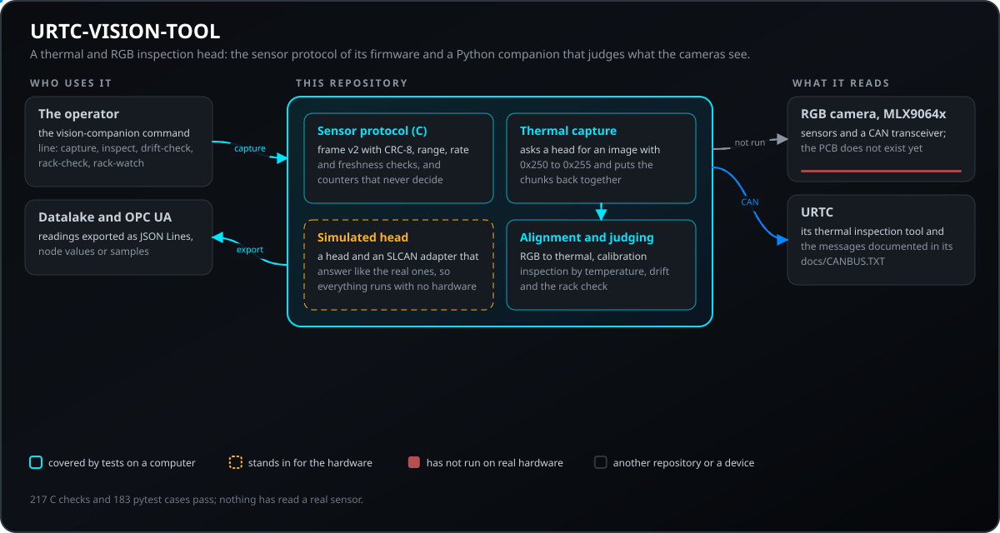
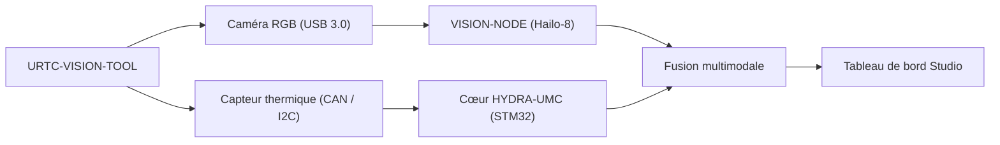
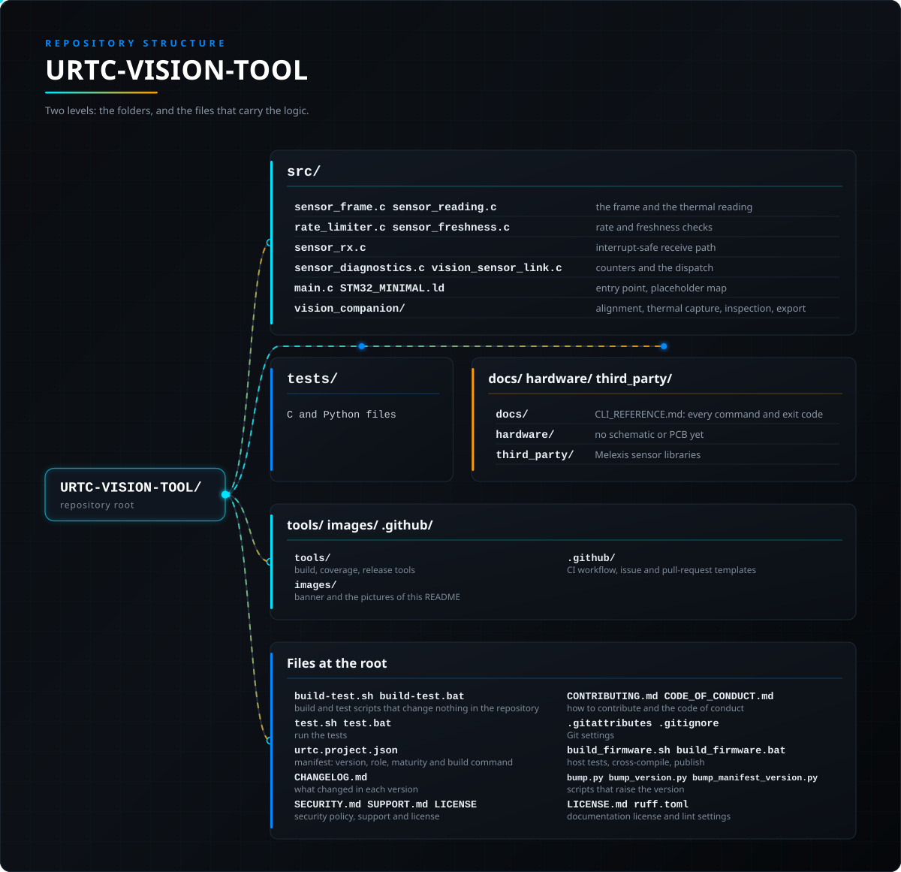

<p align="center">
  
</p>

# 👁️ URTC-VISION-TOOL

<p align="center"><a href="README.md">🇺🇸 English</a> | <a href="README_spa.md">🇪🇸 Español</a> | 🇫🇷 <b>Français</b> | <a href="README_ita.md">🇮🇹 Italiano</a> | <a href="README_deu.md">🇩🇪 Deutsch</a> | <a href="README_zho.md">🇨🇳 简体中文</a> | <a href="README_jpn.md">🇯🇵 日本語</a> | <a href="README_por.md">🇵🇹 Português</a></p>

### 🔬 Tête d'outil intégrée combinant perception thermique et RGB

<p align="center">
  
  
  
  
</p>

---

**Point d'honnêteté : ce qui fonctionne réellement aujourd'hui :** le protocole capteurs côté firmware (`sensor_frame.c`, `sensor_reading.c`, `rate_limiter.c`, `sensor_freshness.c`, `sensor_diagnostics.c`, `vision_sensor_link.c`) est du vrai C pur, couvert par 217 vérifications `TEST_ASSERT` qui passent (`tests/test_*.c`, compilées et exécutées avec le compilateur C de l'hôte), et la CI de ce dépôt les exécute réellement : l'étape firmware de `.github/workflows/ci.yml` appelle `build_firmware.sh`, dont l'étape 2 compile et exécute toujours `tests/` avant de toucher à la compilation pour STM32. Le paquet `vision_companion` côté hôte (`alignment.py`, `cli.py`) est lui aussi réel et couvert par 244 cas pytest qui passent, et la CI exécute aussi cette suite (une étape dédiée installe `src/vision_companion/requirements.txt` et y lance `pytest tests/`), donc une régression dans l'une ou l'autre moitié fait échouer la compilation. Comme le dit déjà l'introduction du README : il n'existe pas encore de PCB ni de schéma pour cette carte, donc rien ici n'a jamais lu un vrai capteur MLX9064x ni une caméra RGB, ni piloté un vrai transceiveur CAN ; `main.c` et `startup_stm32_minimal.c` prouvent seulement que la compilation croisée et l'édition de liens pour Cortex-M4F réussissent avec un script d'édition de liens provisoire. `CHANGELOG.md` indique ce qui a réellement été publié.

---

> **État de la sûreté et de la cybersécurité :** cet écosystème n'est pas un système de sécurité certifié et aucune carte URTC assemblée n'existe encore. Les bootloaders contrôlent les images de firmware par CRC32 et un HMAC-SHA256 à clé partagée, pas par une signature asymétrique (prévue) ; les images d'application publiées sont signées avec la clé publique de développement (`signing_key_kind: dev`), si bien que n'importe qui peut produire une image acceptée par le bootloader ; rien n'a été transmis à une carte réelle. Lisez la [base de sécurité](https://github.com/JuanenRac/URTC-DOCS/blob/main/docs/SECURITY_BASELINE.md) et le [modèle de menaces](https://github.com/JuanenRac/URTC-DOCS/blob/main/docs/THREAT_MODEL.md) avant de vous fier à une affirmation de ce dépôt quant à la sécurité d'une personne.

## 📋 En un coup d'œil

| | |
|---|---|
| Version | `0.2.0` |
| Maturité | Fonctionnel |
| Tests | 244 (`pytest`) |
| Technologie | C / STM32 / Python vision companion |
| Cible | Une carte à microcontrôleur (le firmware) ; compilé sur un PC |
| Sur matériel réel | Pas encore : aucune exécution sur du matériel réel n'est consignée pour cette version |

**Aller à :** [Présentation](#-présentation) · [Architecture](#-architecture) · [Fonctionnalités](#-fonctionnalités) · [Sécurité](#-sécurité-et-protection) · [Interfaces](#-interfaces) · [Démarrage rapide](#-démarrage-rapide) · [Tests](#-tests) · [Structure](#-structure-du-dépôt) · [Liés](#-projets-liés)

<!-- urtc-section:status_vision_tool -->
## 🚦 État du projet

🟢 fait et vérifié · 🟡 fonctionne, avec des limites connues · 🟠 à moitié fait ou non vérifié · 🔴 non fait ou non fonctionnel. Rien n'est vert si cela n'a jamais tourné sur du vrai matériel.

| Partie | État | Ce que le dépôt peut démontrer |
| --- | :---: | --- |
| Logiciel | 🟡 | Fonctionne sur un PC et face au simulateur ; jamais utilisé avec une vraie carte. |
| Tests | 🟢 | La suite de tests passe dans la CI à chaque push. |
| Matériel réel | 🟠 | Pas encore d'essai sur une vraie carte : l'essai au banc reste à faire. |
| Interface et protocoles | 🟡 | Les routes ou les messages proposés sont documentés et testés avec un client ; tous les clients ne les ont pas encore utilisés |
| Documentation | 🟡 | README en huit langues et documents de référence ; les traductions n'ont pas été relues par des locuteurs natifs. |

<!-- /urtc-section:status_vision_tool -->

## 🎯 Présentation

**URTC-VISION-TOOL** est une tête d'outil robotique spécialisée qui fusionne la perception visuelle et thermique en un seul effecteur compatible URTC. Elle est conçue pour le contrôle qualité avancé, l'inspection thermique de PCB et l'alignement de haute précision en pick-and-place.

Équipée d'une caméra RGB à obturateur global et d'un capteur thermique de la famille MLX9064x, elle fournit au nœud de vision par IA des données de deux natures, ce qui lui permet de détecter non seulement la présence d'un composant, mais aussi sa température de fonctionnement ou la dissipation thermique d'une soudure.

Aucun PCB ni schéma n'existe encore pour cette carte (voir `hardware/`), donc rien ci-dessous ne peut piloter de vrais capteurs thermiques ou RGB, mais la chaîne d'outils du firmware et la chaîne de vision côté hôte (génération d'images synthétiques, rendu en fausses couleurs, alignement de la ROI RGB->thermique et extraction de statistiques de température, le tout couvert par pytest) sont réelles et fonctionnent aujourd'hui.

### Fonctionnalités clés :
* 🔬 **Perception bimodale** — capture synchronisée d'images thermiques et RGB. *(la chaîne de traitement alimentée par les deux images est réelle, voir ci-dessous ; la capture synchronisée réelle nécessite le PCB et les capteurs.)*
* 🌡️ **Thermique haute précision** — prise en charge intégrée des capteurs MLX90640, MLX90641 et MLX90642. *(le rendu en fausses couleurs et l'extraction de statistiques par région sont réels, voir ci-dessous ; lire un vrai MLX9064x par I2C nécessite le PCB.)*
* 🎯 **Alignement Eye-in-Hand** — PnP et AOI (inspection optique automatisée) submillimétriques. *(la correspondance des coordonnées de la ROI RGB->thermique et l'extraction de statistiques de température sont réelles et testées, voir `vision_companion/alignment.py` ci-dessous ; la précision submillimétrique nécessite une vraie caméra calibrée.)*
* 📡 **Intégration à URTC** — décidée : cette tête est une tête d'outil URTC et réutilise l'outil d'inspection thermique d'URTC (profil d'outil 22, MLX90640/90641/90642) et ses messages CAN `0x250`-`0x255` (déclenchement, état, blocs de pixels bruts et calibrés, documentés dans `docs/CANBUS.TXT` d'URTC) au lieu d'un second protocole. Le côté hôte de cet échange est réel et testé sans matériel (`urtc_thermal.py`, avec une tête simulée) ; le firmware de la tête, un transceiveur CAN et une carte montée n'existent pas encore, donc rien de tout cela n'a tourné sur un bus. *(Le protocole de trames côté capteur de ce dépôt, ci-dessous, est une brique distincte testée sur l'hôte ; il ne transporte pas l'image thermique.)*
* 🔒 **Contrôles de plage du protocole du capteur** — trame versionnée avec somme de contrôle CRC8, validation de la plage de mesure, limitation de cadence, contrôle de fraîcheur des trames (séquence et horodatage) et compteurs de diagnostic dédiés aux erreurs, à la latence et aux réinitialisations du bus. Trame en version 2 : toute valeur sur plusieurs octets (l'horodatage et la mesure thermique) est en big-endian, comme le bus, et une trame de version 1 est refusée. *(implémenté en C pur et testé uniquement sur un PC ; jamais exécuté sur une carte ni avec un vrai capteur, et pas une fonction de sécurité)*
* ✅ **Chaîne d'outils firmware Cortex-M4F** — une image bare-metal réelle qui se compile et se lie réellement avec `arm-none-eabi-gcc`, la même chaîne d'outils que les dépôts frères URTC et URTC-SMART-RACK. *(implémenté, voir « Compilation et publication » ci-dessous)*
* ✅ **Chaîne de traitement `vision_companion`** — un vrai paquet Python fonctionnel : génération d'images thermiques et RGB synthétiques, rendu thermique en fausses couleurs, alignement de la ROI RGB->thermique, extraction de statistiques de température et rapport de statistiques ; le tout est couvert par 244 cas pytest réels et fonctionne de bout en bout sans matériel connecté. *(implémenté, voir « Compagnon de vision » ci-dessous)*

## 🧩 Rôle dans URTC

URTC-VISION-TOOL est une tête d'outil qui réunit une caméra RGB et un capteur thermique MLX9064x, pour le contrôle qualité, l'inspection thermique de cartes et l'alignement d'une tête de placement. C'est une tête d'outil URTC : elle réutilise l'outil d'inspection thermique d'URTC et ses messages CAN `0x250` à `0x255` plutôt qu'un second protocole, et fournit au nœud de vision (Hailo-8) et au contrôleur HYDRA-UMC des données de deux natures, si bien qu'un composant se juge non seulement à sa présence mais à sa température. Ce qui est réel aujourd'hui, c'est le protocole du capteur du firmware et le compagnon de vision côté hôte, tous deux testés sur un ordinateur ; aucune carte n'existe encore. C'est un outil complémentaire, pas un enfant d'URTC.

## 🏛️ Architecture

<p align="center">
  
</p>

Comment les parties de ce dépôt s'articulent : qui l'utilise, ce qu'il contient et de quoi il dépend. L'image est dessinée à partir de `docs/architecture.json` et vérifiée par rapport au code.

<details>
<summary>Version texte du diagramme (Mermaid)</summary>



</details>

### Architecture et décisions de conception

* **Pourquoi ce projet a deux lignes de versions indépendantes.** `src/firmware_common.h` (le firmware côté STM32) et `src/vision_companion/vision_companion/__init__.py` (un paquet Python séparé côté hôte) sont versionnés indépendamment : ils tournent sur du matériel différent (MCU contre hôte CM5 ou PC) et sont publiés selon des calendriers différents.
* **Pourquoi ce n'est pas un enfant d'URTC.** C'est la même raison que dans le README d'URTC-SMART-RACK : un outil complémentaire qui partage les conventions de firmware d'URTC, sans faire partie de sa hiérarchie d'intégration.
* **Pourquoi un paquet compagnon côté hôte.** La capture double, thermique et RGB, nécessite un vrai traitement d'image (numpy et Pillow) qui n'a pas sa place sur le STM32 lui-même : le paquet compagnon est là où cela se passe réellement. Il n'a pas d'accès propre au bus, mais il parle les messages d'inspection thermique d'URTC (`urtc_thermal.py`) : il construit les requêtes, recompose les blocs de 16 pixels en une image et remet les messages à ce qui transporte le bus.
* **Pourquoi `alignment.py` suppose un champ de vision partagé plutôt qu'une vraie homographie.** Les deux capteurs sont sur la même tête d'outil rigide, donc une remise à l'échelle linéaire par axe entre les coordonnées de pixel en espace RGB et en espace thermique est une approximation raisonnable pour la version 0 ; une vraie calibration par pixel (damier, distorsion d'objectif) nécessite de vraies caméras avec lesquelles calibrer, et elles n'existent pas encore.
* **Comment cela s'intègre dans le reste de l'écosystème.** C'est une tête d'outil URTC (elle réutilise l'outil d'inspection thermique d'URTC et ses messages CAN, voir plus haut), et forme une paire naturelle avec HYDRA-UMC-DETECTION-HEF pour le même rôle de reconnaissance visuelle qu'URTC-SMART-RACK remplit aussi.
* **Pourquoi le protocole de trame du capteur porte son propre champ d'horodatage.** Un véritable horodatage en millisecondes côté capteur permet à l'appelant de savoir *quand* une lecture a réellement été effectuée, indépendamment du moment où le MCU parvient à analyser la trame : une information utile pour l'historique et le diagnostic qu'une simple hypothèse « vient d'arriver » ferait perdre.
* **Pourquoi les compteurs de diagnostic (`sensor_diagnostics.c`) ne prennent jamais eux-mêmes de décision d'acceptation ou de rejet.** Seuls `sensor_frame.c` (trame), `sensor_reading.c` (plage) et `rate_limiter.c` (limitation de cadence) décident si une trame est fiable ; le diagnostic se contente d'enregistrer ce qu'ils ont décidé. Maintenir cette frontière stricte signifie qu'un bogue du diagnostic ne peut jamais laisser passer accidentellement de mauvaises données ; les notes de diagnostic appellent cela « séparer le diagnostic de la sortie de commande ».

## ✨ Fonctionnalités

**Inspection thermique par région, export de séries, dérive du capteur et contrôle du rack (testé sur l'hôte seulement) :** `inspect` juge chaque composant d'un plan selon la règle de température de son type et peut exporter le minimum, le maximum et la moyenne de chaque région sous forme d'échantillons pour le datalake de HYDRA-UMC, en lignes JSON ou en valeurs de nœuds OPC-UA ; `drift-check` compare des images d'une scène de référence à une ligne de base (pixels morts, dérive de décalage) et peut écrire un fichier de calibration ; `rack-check` juge les pointes du rack d'outils à partir d'une image thermique. `rack-watch` suit les pointes pendant que le rack chauffe et indique quand chaque emplacement a atteint sa cible et si l'outil peut être changé ; `rack-simulate` écrit les images d'un rack simulé (sain ou avec un défaut) pour l'essayer sans caméra ; les commandes du rack s'affichent en huit langues (`--lang`). Voir [la référence de la CLI](docs/CLI_REFERENCE.md). Exécuté sur des images synthétiques seulement ; aucune caméra ni carte n'a été utilisée.

**Capture thermique par un adaptateur CAN série (nouveau, testé seulement contre un adaptateur et une tête simulés) :** `capture --port PORT` lit une image calibrée d'une tête URTC qui porte l'outil d'inspection thermique, à travers un adaptateur SLCAN (un port série ou une URL pyserial), avec l'échange de `0x250` à `0x255`, et l'enregistre en `.npy` et en PNG en fausses couleurs, prêt pour `inspect`, `drift-check` et `rack-check`. Une tête qui signale une erreur, ne devient jamais prête ou laisse un bloc sans réponse termine la commande avec un message clair (code de sortie 1), et un port qui ne peut pas être ouvert la termine avec le code 2. Elle n'a pas été exécutée avec un vrai adaptateur, un vrai bus ni une vraie tête.

## 🔒 Sécurité et protection

| Menace | Défense |
|---|---|
| Une trame corrompue ou ancienne du capteur | Une trame versionnée avec CRC-8 (`sensor_frame.c`) ; en version 2, toute valeur sur plusieurs octets, horodatage et mesure thermique compris, est big-endian comme le bus, et une trame de version 1 est refusée |
| Une mesure que le capteur ne peut pas avoir faite | `sensor_reading.c` décode la mesure thermique et refuse ce qui est hors plage |
| Un déluge de trames | `rate_limiter.c` retient les trames par un intervalle minimal |
| Une trame rejouée ou un capteur figé | `sensor_freshness.c` vérifie la séquence et l'horodatage propre du capteur |
| Un bogue des compteurs laissant passer de mauvaises données | `sensor_diagnostics.c` enregistre seulement ce que les autres modules ont décidé (erreurs, latence, réinitialisations du bus) ; il n'accepte ni ne refuse jamais une trame |

Tout cela est du C pur testé sur un ordinateur ; cela n'a jamais tourné sur une carte ni avec un vrai capteur, et ce n'est pas une fonction de sécurité.

## 🔌 Interfaces

* **Les messages d'inspection thermique d'URTC** (`0x250` à `0x255` : déclenchement, état, blocs de pixels bruts et calibrés, documentés dans `docs/CANBUS.TXT` d'URTC) : le côté hôte de cet échange est `urtc_thermal.py`, testé sans matériel contre une tête simulée. `capture --port PORT` l'exécute via un adaptateur SLCAN (un port série ou une URL pyserial) et enregistre l'image en `.npy` et en PNG fausses couleurs ; une tête qui signale une erreur, ne devient jamais prête ou laisse un bloc sans réponse termine la commande avec le code de sortie 1, et un port impossible à ouvrir avec le code 2.
* **La trame du capteur du firmware :** version 2, big-endian, CRC-8 (`sensor_frame.c`) ; c'est une brique distincte, testée sur l'hôte, qui ne transporte pas l'image thermique.
* **La ligne de commande `vision-companion` :** `version`, `selftest`, `analyze-roi`, `capture`, `inspect`, `drift-check`, `rack-check`, `rack-watch` et `rack-simulate`, avec chaque option et code de sortie dans [docs/CLI_REFERENCE.md](docs/CLI_REFERENCE.md).
* **Exports :** les mesures de `inspect` en JSON Lines, en valeurs de nœuds OPC UA ou en échantillons pour le datalake de HYDRA-UMC.

## 🚀 Démarrage rapide

Nécessite la chaîne d'outils ARM GNU (`arm-none-eabi-gcc`, `arm-none-eabi-objcopy`, `arm-none-eabi-size`) et Python 3.

```bash
# Linux/macOS
chmod +x build_firmware.sh   # une seule fois
./build_firmware.sh

# Windows
build_firmware.bat
```

### Compagnon de vision (Python côté hôte)

Cette partie fonctionne aujourd'hui, entièrement, sans aucun matériel connecté :

```bash
cd src/vision_companion
python3 -m venv .venv
# Linux/macOS :
.venv/bin/pip install -r requirements.txt
.venv/bin/python -m vision_companion selftest

# Windows :
.venv\Scripts\pip install -r requirements.txt
.venv\Scripts\python -m vision_companion selftest
```

`selftest` génère une image thermique synthétique de forme MLX9064x (32x24, avec un point chaud façon pointe à souder) et une mire RGB à barres de couleur, rend et enregistre les deux en fichiers réels, et affiche leurs statistiques : preuve que la chaîne de traitement numpy et Pillow fonctionne réellement, indépendamment de la capture avec le capteur réel, qui viendra une fois le matériel disponible.

`analyze-roi X0 Y0 X1 Y1` reporte une boîte englobante de l'espace RGB vers l'espace thermique et fournit des statistiques de température réelles pour cette région ; c'est la logique d'alignement derrière la fonctionnalité Eye-in-Hand du README, réelle aujourd'hui :

```bash
.venv/bin/python -m vision_companion analyze-roi 280 210 360 270
```

Exemple de sortie réelle :

```text
RGB ROI (280,210)-(360,270) in a 640x480 frame
  -> thermal stats: min=75.67C max=78.97C mean=77.69C p95=78.70C (16 thermal px)
```

244 cas pytest réels couvrent `cli.py`, `alignment.py` et les autres modules du paquet :

```bash
pip install -e ".[dev]"
pytest
```

La documentation complète du compagnon est dans `src/vision_companion/README.md`, et [`docs/CLI_REFERENCE.md`](docs/CLI_REFERENCE.md) décrit chaque commande, option et code de sortie avec une sortie réelle capturée.

<!-- urtc-section:compatibility -->
### Prérequis et compatibilité

Les versions des programmes URTC qui fonctionnent ensemble, et la version du protocole que parle chacune, figurent dans le tableau de compatibilité que génère URTC-COMMON : [docs/COMPATIBILITY.md](https://github.com/JuanenRac/URTC/blob/main/docs/COMPATIBILITY.md). Les notes d'une version des dépôts qui portent `tools/changelog_section.py` (le firmware, le flasher, le tester et l'updater) sont la section du CHANGELOG de cette version suivie de ce tableau : `python tools/changelog_section.py VERSION --compat`.
<!-- /urtc-section:compatibility -->

## 🧪 Tests

Deux suites. Le côté firmware est du C dans `tests/` (217 vérifications `TEST_ASSERT`) : la trame du capteur, la mesure, le limiteur de cadence, les diagnostics, la fraîcheur, les scénarios de toute la liaison, la robustesse face aux entrées erronées et les vecteurs partagés d'URTC-COMMON, compilés et exécutés avec le compilateur C de la machine et, en CI, avec AddressSanitizer, UBSan et un plancher de couverture. Le côté hôte est le paquet `vision_companion`, avec 244 cas pytest (`cd src/vision_companion && pytest`) qui exécutent toute la chaîne sans matériel : images synthétiques, fausses couleurs, alignement, calibration, la capture thermique contre une tête simulée, l'inspection, la dérive et le contrôle du rack. Quatre fichiers de test Python vérifient les scripts de compilation, les fichiers joints de la release et les fichiers de version. `bash build_firmware.sh` exécute les tests C avant la compilation croisée et s'interrompt si une assertion échoue. Le chemin de réception qu'utilisera une interruption (`sensor_rx.c` : l'interruption ne fait que mettre l'octet dans un tampon circulaire, la boucle principale trouve les trames, se resynchronise après une trame abîmée et abandonne une demi-trame restée trop longtemps en attente) est aussi de la logique pure, rejouée octet par octet dans les tests.

## 🏗️ Compilation et publication

La compilation commence par compiler et exécuter `tests/` avec le compilateur C *de la machine* (jamais `arm-none-eabi-gcc` : ce sont des tests de logique pure, sans toucher aux registres du MCU) et s'interrompt entièrement si une assertion échoue. Ensuite seulement elle compile `main.c` et `startup_stm32_minimal.c` pour Cortex-M4F, les lie avec le plan mémoire provisoire `STM32_MINIMAL.ld` et publie des fichiers `.elf`/`.bin`/`.hex` versionnés dans `firmware/`. Compiler ne change jamais la version.

Chaque module de `src/` est aussi compilé pour Cortex-M4F et tous sont liés ensemble par vérification (aucune bibliothèque C n'est disponible sur la cible), même si l'image ne contient aujourd'hui que `main.c` et le fichier de démarrage. Avec `URTC_CI=1`, aucun fichier suivi n'est touché.

Il n'y a encore rien à flasher sur du matériel réel : aucun PCB n'existe pour confirmer la référence STM32 cible, le brochage, le câblage du MLX9064x ni l'interface de la caméra RGB.

Les images du firmware (`.bin`, `.hex`, `.elf`) ne sont pas versionnées dans git : une compilation de release écrit `firmware/URTC_VISION_TOOL_FIRMWARE_v<version>.*` (ignoré par git ; `build/firmware` en mode CI, `URTC_CI=1`) et elles ne sont publiées que comme fichiers joints de la release GitHub de chaque version. `python tools/publish_release_assets.py` vérifie les fichiers, écrit le fichier `.sha256` manquant et affiche la commande `gh release create` exacte avec les fichiers à joindre.

L'historique complet des versions est dans [`CHANGELOG.md`](CHANGELOG.md) ; chaque version y a sa propre entrée.

## 📂 Structure du dépôt

<p align="center">
  
</p>

<details>
<summary>Version texte de l'arborescence</summary>

```text
URTC-VISION-TOOL/
├── src/                                               le firmware (protocole du capteur en C pur, copies vérifiées d'URTC-COMMON, point d'entrée, script d'édition de liens provisoire) et le compagnon Python
├── tests/                                             tests hôte en C (217 vérifications) et contrôles Python des scripts de compilation
├── docs/                                              CLI_REFERENCE.md : chaque commande et code de sortie
├── hardware/                                          pas encore de schéma ni de PCB
├── third_party/                                       bibliothèques Melexis
├── tools/                                             outils de compilation, couverture et release
├── images/                                            bannière et images de ce README
├── .github/                                           workflow de CI et modèles d'issues et de pull requests
├── build-test.sh build-test.bat                       scripts de compilation et de test qui ne changent rien dans le dépôt
├── test.sh test.bat                                   lancent les tests
├── urtc.project.json                                  manifeste : version, rôle, maturité et commande de compilation
├── CHANGELOG.md                                       ce qui a changé à chaque version
├── SECURITY.md SUPPORT.md LICENSE                     politique de sécurité, assistance et licence
├── CONTRIBUTING.md CODE_OF_CONDUCT.md                 comment contribuer et code de conduite
├── .gitattributes .gitignore                          réglages Git
├── build_firmware.sh build_firmware.bat               tests hôte, compilation croisée, publication
├── bump.py bump_version.py bump_manifest_version.py   scripts qui augmentent la version
└── LICENSE.md ruff.toml                               licence de la documentation et réglages de lint
```

</details>

La liste annotée de chaque fichier source, une ligne par fichier, est dans [docs/SOURCE_MAP.md](docs/SOURCE_MAP.md).

## 🗺️ Feuille de route et limites connues

**Limites connues aujourd'hui**

* Aucun PCB ni schéma n'existe encore pour cette carte (voir `hardware/`) : rien de tout cela n'a jamais lu un vrai MLX9064x en I2C, une caméra RGB ou un transceiveur CAN. `main.c` et le fichier de démarrage prouvent seulement que la compilation croisée et l'édition de liens pour Cortex-M4F réussissent avec un script d'édition de liens provisoire.
* Le firmware de la tête n'existe pas encore : le côté hôte de l'échange d'inspection thermique n'est testé que contre une tête et un adaptateur SLCAN simulés.
* `alignment.py` suppose un champ de vision commun et remet chaque axe à l'échelle linéairement ; une vraie calibration pixel par pixel (damier, distorsion de l'objectif) demande de vraies caméras.
* La précision sub-millimétrique, la capture réelle synchronisée et les limites thermiques des règles d'inspection n'ont pas été essayées sur de vraies pièces.

**Ensuite**

* Concevoir la carte, fixer la référence STM32 et l'interface de la caméra, écrire les pilotes du capteur et de la caméra, et lancer la capture thermique contre une vraie tête sur banc.

## 🌍 Langues

Le README et les textes existent en anglais, espagnol, français, italien, allemand, chinois, japonais et portugais européen.

## 🔗 Projets liés

URTC est fait de dépôts indépendants, chacun avec sa version, ses tests et son README. Voici la famille, par groupes :

* **URTC Tool Platform:**
  * [URTC](https://github.com/JuanenRac/URTC) - firmware de la carte de la tête d'outil (25 profils d'outil, bootloader CAN) et référence du protocole CAN.
  * [URTC-COMMON](https://github.com/JuanenRac/URTC-COMMON) - le protocole CAN écrit une seule fois comme données (spécification, tables générées, vecteurs de conformité) et le code que les programmes partagent.
  * [URTC-FLASHER](https://github.com/JuanenRac/URTC-FLASHER) - outil de bureau qui met à jour le firmware de la carte par CAN ou par SWD/JTAG.
  * [URTC-GATEWAY](https://github.com/JuanenRac/URTC-GATEWAY) - passerelle devant le bus CAN : ne laisse passer que les identifiants d'une liste, limite leur cadence et demande une clé de session.
  * [URTC-SMART-RACK](https://github.com/JuanenRac/URTC-SMART-RACK) - logique C indépendante du matériel et protocole de commandes pour un support d'outils avec préchauffage et suivi du cycle de vie.
  * [URTC-TESTER](https://github.com/JuanenRac/URTC-TESTER) - tester de bureau du bus CAN en direct qui affiche les commandes et la télémétrie du profil d'outil signalé par une carte.
  * **URTC-VISION-TOOL** (ce dépôt) - protocole de trames de capteur en C et compagnon Python thermique/RGB pour une tête d'outil d'inspection.
  * [URTC-WEB-STUDIO](https://github.com/JuanenRac/URTC-WEB-STUDIO) - application de navigateur qui flashe et teste la carte via Web Serial et SLCAN, sans rien installer.
* **Ecosystem Operations:**
  * [URTC-DEVTOOLS](https://github.com/JuanenRac/URTC-DEVTOOLS) - les outils de dépôt communs de la famille en un ensemble versionné, avec un fichier de verrouillage qui distingue une copie modifiée d'une copie en retard.
  * [URTC-DOCS](https://github.com/JuanenRac/URTC-DOCS) - architecture, interfaces, base de sécurité et catalogue généré de l'écosystème, plus les outils qui comparent tous les dépôts.
  * [URTC-UPDATER](https://github.com/JuanenRac/URTC-UPDATER) - outil de bureau qui détecte, installe et met à jour les dépôts de la famille URTC, une action explicite à la fois.

**Projets frères (indépendants, avec la même base et les mêmes outils) :**

* **[HYDRA-UMC-DOCS](https://github.com/JuanenRac/HYDRA-UMC-DOCS)** - projet frère : le centre de documentation de HYDRA-UMC, un écosystème indépendant qui partage la base et les outils de celui-ci
* **[ARMOR-DOCS](https://github.com/JuanenRac/ARMOR-DOCS)** - projet frère : le centre de documentation d'A.R.M.O.R., l'écosystème de sécurité, lui aussi indépendant et construit sur la même base
* **[JuanenRac](https://github.com/JuanenRac/JuanenRac)** - le profil et le tableau d'état de tous les écosystèmes

## 📚 Documentation

- **[CONTRIBUTING.md](CONTRIBUTING.md)** — technologies utilisées et consignes de codage pour une pull request.
- **[CODE_OF_CONDUCT.md](CODE_OF_CONDUCT.md)** — les règles de conduite attendues dans cette communauté.
- **[SECURITY.md](SECURITY.md)** — comment signaler une vulnérabilité, et les véritables priorités de sécurité de ce projet.
- **[SUPPORT.md](SUPPORT.md)** — où poser des questions et signaler des bugs.
- **[LICENSE.md](LICENSE.md)** — la licence propre de ce projet.

## 🤝 Contribuer et communauté

* Avant une pull request, lancez `URTC_CI=1 python tools/ci_validate.py` : il doit réussir. Voir [CONTRIBUTING.md](CONTRIBUTING.md) et le [code de conduite](CODE_OF_CONDUCT.md).
* Le README existe en huit langues : une modification du texte se fait dans les huit fichiers, et les sections partagées avec d'autres dépôts sont écrites par `tools/readme_sections.py` d'URTC-COMMON.
* Un changement du protocole CAN commence dans URTC-COMMON (`spec/can_protocol.json`) et arrive dans ce dépôt par la copie vérifiée.
* Ne décrivez pas comme fonctionnant sur une carte ce qui a seulement été compilé.
* Signalez une vulnérabilité en privé : [SECURITY.md](SECURITY.md). Questions, idées et rapports : electrohobby3d@gmail.com ([SUPPORT.md](SUPPORT.md)).

## 👤 AUTEUR

**JuanenRac** (Electro Hobby 3D)
📧 electrohobby3d@gmail.com
📺 [youtube.com/@electrohobby3d](https://youtube.com/@electrohobby3d)

## 📜 LICENCE

GPL-3.0-or-later - Voir LICENSE pour plus de détails.
