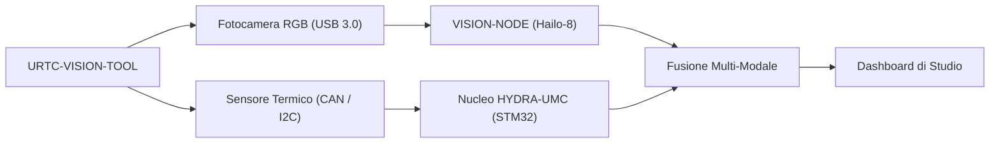

<p align="center">
  
</p>

# 👁️ URTC-VISION-TOOL

<p align="center"><a href="README.md">🇺🇸 English</a> | <a href="README_spa.md">🇪🇸 Español</a> | <a href="README_fra.md">🇫🇷 Français</a> | 🇮🇹 <b>Italiano</b> | <a href="README_deu.md">🇩🇪 Deutsch</a> | <a href="README_zho.md">🇨🇳 简体中文</a> | <a href="README_jpn.md">🇯🇵 日本語</a> | <a href="README_por.md">🇵🇹 Português</a></p>

### 🔬 Testina Integrata che Combina Percezione Termica e RGB

<p align="center">
  
  
  
  
</p>

---

**Verifica di onestà - cosa funziona davvero oggi:** il protocollo dei sensori lato firmware (`sensor_frame.c`, `sensor_reading.c`, `rate_limiter.c`, `sensor_freshness.c`, `sensor_diagnostics.c`, `vision_sensor_link.c`) è vero C puro coperto da 190 controlli `TEST_ASSERT` superati (`tests/test_*.c`, compilati ed eseguiti con il compilatore C dell'host), e la CI di questo repo li esegue davvero: il passo firmware di `.github/workflows/ci.yml` invoca `build_firmware.sh`, il cui passo 2 compila ed esegue sempre `tests/` prima di toccare la build STM32. Il pacchetto `vision_companion` lato host (`alignment.py`, `cli.py`) è anch'esso reale e coperto da 183 casi pytest superati, e la CI esegue anche quella suite (un passo dedicato installa `src/vision_companion/requirements.txt` ed esegue lì `pytest tests/`), quindi una regressione in una delle due metà fa fallire la build. Come già dice l'introduzione del README: per questa scheda non esistono ancora PCB/schema, quindi niente di tutto ciò ha mai letto un vero sensore MLX9064x o una telecamera RGB, né pilotato un vero transceiver CAN - `main.c`/`startup_stm32_minimal.c` dimostrano solo che la cross-compilazione e il link Cortex-M4F riescono con uno script di link provvisorio. Vedi `CHANGELOG.md` per cosa è stato effettivamente rilasciato.

---

> **Stato di sicurezza (safety e security):** questo ecosistema non è un sistema di sicurezza certificato e non esiste ancora alcuna scheda URTC assemblata. I bootloader controllano le immagini firmware con CRC32 e un HMAC-SHA256 a chiave condivisa, non con una firma asimmetrica (prevista); le immagini applicative pubblicate sono firmate con la chiave pubblica di sviluppo (`signing_key_kind: dev`), quindi chiunque può produrre un'immagine accettata dal bootloader; nulla è stato trasmesso a una scheda reale. Leggi la [base di sicurezza](https://github.com/JuanenRac/URTC-DOCS/blob/main/docs/SECURITY_BASELINE.md) e il [modello delle minacce](https://github.com/JuanenRac/URTC-DOCS/blob/main/docs/THREAT_MODEL.md) prima di fidarti di qualsiasi affermazione qui per la sicurezza di una persona.

## 📋 In breve

| | |
|---|---|
| Versione | `0.1.5` |
| Maturità | Funzionale |
| Test | 183 (`pytest`) |
| Tecnologia | C / STM32 / Python vision companion |
| Destinazione | Una scheda con microcontrollore (il firmware); compilato su un PC |
| Su hardware reale | Non ancora: per questa versione non risulta alcuna esecuzione su hardware reale |

**Vai a:** [Panoramica](#-panoramica) · [Architettura](#-architettura) · [Funzionalità](#-funzionalità) · [Sicurezza](#-sicurezza-e-protezione) · [Interfacce](#-interfacce) · [Avvio rapido](#-avvio-rapido) · [Test](#-test) · [Struttura](#-struttura-del-repository) · [Correlati](#-progetti-correlati)

<!-- urtc-section:status_vision_tool -->
## 🚦 Stato del progetto

🟢 fatto e verificato · 🟡 funziona, con limiti noti · 🟠 a metà o non verificato · 🔴 non fatto o non funzionante. Nulla è verde se non ha mai girato su hardware reale.

| Parte | Stato | Ciò che il repository può dimostrare |
| --- | :---: | --- |
| Software | 🟡 | Funziona su un PC e contro il simulatore; mai usato con una scheda reale. |
| Test | 🟢 | La suite di test passa nella CI a ogni push. |
| Hardware reale | 🟠 | Nessuna esecuzione su una scheda reale: la prova al banco è ancora da fare. |
| Documentazione | 🟡 | README in otto lingue e documenti di riferimento; le traduzioni non sono state riviste da madrelingua. |

<!-- /urtc-section:status_vision_tool -->

## 🎯 Panoramica

**URTC-VISION-TOOL** è una testina robotica specializzata che fonde percezione visiva e termica in un unico effettore compatibile URTC. Progettata per QA avanzato, ispezione termica di PCB e allineamento Pick-and-Place ad alta precisione.

Dotata di una fotocamera RGB a otturatore globale e di un sensore termico della famiglia MLX9064x, fornisce al Vision AI Node dati a doppia modalità, permettendogli di rilevare non solo la presenza di un componente ma anche la sua temperatura di funzionamento o la dissipazione termica di una saldatura.

Non esiste ancora un PCB/schematico per questa scheda (vedi `hardware/`), quindi nulla di sottostante può pilotare sensori termici/RGB reali - ma la toolchain del firmware e la pipeline di visione lato host (generazione sintetica di frame, rendering a falsi colori, allineamento ROI RGB->termico ed estrazione di statistiche di temperatura, tutto coperto da pytest) sono reali e funzionano oggi.

### Caratteristiche Principali:
* 🔬 **Percezione Dual-Modale** — cattura sincronizzata di immagini Termiche e RGB. *(la pipeline di elaborazione alimentata da entrambi i frame è reale - vedi sotto; la cattura sincronizzata reale richiede il PCB e i sensori.)*
* 🌡️ **Termico ad Alta Precisione** — supporto integrato per sensori MLX90640/41/42. *(il rendering a falsi colori e l'estrazione di statistiche per regione sono reali - vedi sotto; leggere un vero MLX9064x via I2C richiede il PCB.)*
* 🎯 **Allineamento Eye-in-Hand** — PnP e AOI (Ispezione Ottica Automatizzata) sub-millimetrica. *(la mappatura di coordinate ROI RGB->termico e l'estrazione di statistiche di temperatura sono reali e testate - vedi `vision_companion/alignment.py` sotto; la precisione sub-millimetrica richiede una vera fotocamera calibrata.)*
* 📡 **Integrazione con URTC** — decisa: questa testa è una testa utensile URTC e riutilizza l'utensile di ispezione termica di URTC (profilo utensile 22, MLX90640/90641/90642) e i suoi messaggi CAN `0x250`-`0x255` (avvio, stato, blocchi di pixel grezzi e calibrati, documentati in `docs/CANBUS.TXT` di URTC) invece di un secondo protocollo. Il lato host di quello scambio è reale e provato senza hardware (`urtc_thermal.py`, con una testa simulata); il firmware della testa, un transceiver CAN e una scheda assemblata non esistono ancora, quindi nulla di tutto ciò è girato su un bus. *(Il protocollo di frame lato sensore di questo repository, sotto, è un blocco separato provato sull'host; non trasporta l'immagine termica.)*
* 🔒 **Controlli di Intervallo del Protocollo Sensore** — framing versionato con checksum CRC8, validazione dell'intervallo di misura, limitazione della velocità, controllo di freschezza dei frame (sequenza e timestamp) e contatori di diagnostica dedicati per errori/latenza/reset del bus. Frame in versione 2: ogni valore su più byte (il timestamp e la lettura termica) è big-endian, come il bus, e un frame di versione 1 viene rifiutato. *(implementato in C puro e testato solo su un PC; mai eseguito su una scheda o con un sensore reale e non è una funzione di sicurezza)*
* ✅ **Toolchain firmware Cortex-M4F** — un'immagine bare-metal reale che compila e collega davvero con `arm-none-eabi-gcc`, la stessa toolchain dei repository gemelli URTC e URTC-SMART-RACK. *(implementato — vedi COMPILAZIONE sotto)*
* ✅ **Pipeline di elaborazione `vision_companion`** — un pacchetto Python reale e funzionante: generazione sintetica di frame termici+RGB, rendering termico a falsi colori, allineamento ROI RGB->termico + estrazione di statistiche di temperatura, report statistico, tutto coperto da 183 casi pytest reali, funziona end-to-end senza hardware collegato. *(implementato — vedi COMPAGNO DI VISIONE sotto)*

## 🧩 Ruolo in URTC

URTC-VISION-TOOL è una testa utensile che unisce una telecamera RGB e un sensore termico MLX9064x, per il controllo qualità, l'ispezione termica delle schede e l'allineamento di una testa pick-and-place. È una testa utensile URTC: riusa lo strumento di ispezione termica di URTC e i suoi messaggi CAN da `0x250` a `0x255` invece di un secondo protocollo, e dà al nodo di visione (Hailo-8) e al controllore HYDRA-UMC dati di due tipi, così un componente si giudica non solo dalla presenza ma dalla temperatura. Ciò che è reale oggi è il protocollo del sensore del firmware e il companion di visione lato host, entrambi testati su un computer; nessuna scheda esiste ancora. È uno strumento complementare, non un figlio di URTC.

## 🏛️ Architettura

<p align="center">
  
</p>

Come si incastrano le parti di questo repository: chi lo usa, che cosa contiene e da che cosa dipende. L'immagine è disegnata da `docs/architecture.json` e verificata rispetto al codice.

<details>
<summary>Versione testuale del diagramma (Mermaid)</summary>



</details>

### ARCHITETTURA E DECISIONI DI PROGETTAZIONE

* **Perché questo progetto ha 2 tracce di versione indipendenti.** `src/firmware_common.h` (il firmware lato STM32) e `src/vision_companion/vision_companion/__init__.py` (un pacchetto Python separato lato host) sono versionati indipendentemente - girano su hardware diverso (MCU contro host CM5/PC) e vengono pubblicati con calendari diversi.
* **Perché non è un figlio di URTC stesso.** Stesso motivo del README proprio di URTC-SMART-RACK - uno Strumento Complementare che condivide le convenzioni firmware di URTC, senza far parte della sua gerarchia di integrazione.
* **Perché un pacchetto companion lato host.** La cattura dual-modale termica/RGB richiede una vera elaborazione immagini (numpy/Pillow) che non ha posto sull'STM32 stesso - il pacchetto companion è dove ciò avviene realmente. Non ha un accesso proprio al bus, ma parla i messaggi di ispezione termica di URTC (`urtc_thermal.py`): costruisce le richieste, ricompone i blocchi da 16 pixel in un'immagine e consegna i messaggi a ciò che trasporta il bus.
* **Perché `alignment.py` assume un campo visivo condiviso invece di una vera omografia.** Entrambi i sensori sono sulla stessa testina fisica rigida, quindi un riscalamento lineare per asse tra le coordinate pixel in spazio RGB e spazio termico è un'approssimazione v0 ragionevole - una vera calibrazione per pixel (scacchiera, distorsione della lente) richiede vere fotocamere su cui calibrarsi, che non esistono ancora.
* **Come si inserisce nel resto dell'ecosistema.** Fa parte dell'ecosistema utensili di URTC (riutilizza l'utensile di ispezione termica di URTC e i suoi messaggi CAN, vedi sopra), e forma un abbinamento naturale con HYDRA-UMC-DETECTION-HEF per lo stesso ruolo di riconoscimento visivo che svolge anche URTC-SMART-RACK.
* **Perché il protocollo di trama del sensore porta il proprio campo di timestamp.** Un vero timestamp in millisecondi lato sensore permette a chi chiama di sapere *quando* una lettura è stata effettivamente presa, indipendentemente da quando l'MCU riesce ad analizzare il frame - un reale valore storico/diagnostico che una semplice assunzione di "appena arrivato" farebbe perdere.
* **Perché i contatori di diagnostica (`sensor_diagnostics.c`) non prendono mai da soli una decisione di accettazione/rifiuto.** Solo `sensor_frame.c` (framing), `sensor_reading.c` (intervallo) e `rate_limiter.c` (limitazione della velocità) decidono se un frame è affidabile - la diagnostica si limita a registrare ciò che hanno deciso. Mantenere questo confine rigido significa che un bug nella diagnostica non può mai lasciar passare accidentalmente dati errati, la stessa "separar diagnostico de salida de control" delle note di diagnosi.

## ✨ Funzionalità

**Ispezione termica per regioni, esportazione di serie, deriva del sensore e verifica del rack (testato solo sull'host):** `inspect` giudica ogni componente di un piano secondo la regola di temperatura del suo tipo e può esportare minimo, massimo e media di ogni regione come campioni per il datalake di HYDRA-UMC, come righe JSON o come valori di nodi OPC-UA; `drift-check` confronta fotogrammi di una scena di riferimento con una base (pixel morti, deriva dell'offset) e può scrivere un file di calibrazione; `rack-check` giudica le punte del rack di utensili da un fotogramma termico. `rack-watch` segue le punte mentre il rack si scalda e indica quando ogni slot ha raggiunto l'obiettivo e se l'utensile può essere cambiato; `rack-simulate` scrive i fotogrammi di un rack simulato (sano o con un guasto) per provarlo senza telecamera; i comandi del rack stampano in otto lingue (`--lang`). Vedi [il riferimento della CLI](docs/CLI_REFERENCE.md). Eseguito solo su fotogrammi sintetici; nessuna telecamera o scheda è stata usata.

**Acquisizione termica tramite un adattatore CAN seriale (nuovo, provato solo con un adattatore e una testa simulati):** `capture --port PORTA` legge un'immagine calibrata da una testa URTC che porta l'utensile di ispezione termica, attraverso un adattatore SLCAN (una porta seriale o un URL pyserial), con lo scambio da `0x250` a `0x255`, e la salva come `.npy` e PNG in falsi colori, pronta per `inspect`, `drift-check` e `rack-check`. Una testa che segnala un errore, non diventa mai pronta o lascia un blocco senza risposta termina il comando con un messaggio chiaro (codice di uscita 1), e una porta che non si può aprire lo termina con il codice 2. Non è stata eseguita con un adattatore, un bus o una testa reali.

## 🔒 Sicurezza e protezione

| Minaccia | Difesa |
|---|---|
| Un frame corrotto o vecchio dal sensore | Un frame versionato con CRC-8 (`sensor_frame.c`); nella versione 2 ogni valore su più byte, timestamp e lettura termica inclusi, è big-endian come il bus, e un frame di versione 1 viene rifiutato |
| Una lettura che il sensore non può aver fatto | `sensor_reading.c` decodifica la lettura termica e rifiuta ciò che è fuori intervallo |
| Una raffica di frame | `rate_limiter.c` trattiene i frame con un intervallo minimo |
| Un frame ripetuto o un sensore bloccato | `sensor_freshness.c` controlla la sequenza e il timestamp del sensore stesso |
| Un errore nei contatori che lasci passare dati errati | `sensor_diagnostics.c` registra solo ciò che hanno deciso gli altri moduli (errori, latenza, reset del bus); non accetta né rifiuta mai un frame |

Tutto questo è C puro testato su un computer; non è mai girato su una scheda né con un sensore reale, e non è una funzione di sicurezza.

## 🔌 Interfacce

* **I messaggi di ispezione termica di URTC** (da `0x250` a `0x255`: innesco, stato, blocchi di pixel grezzi e calibrati, documentati in `docs/CANBUS.TXT` di URTC): il lato host di questo scambio è `urtc_thermal.py`, testato senza hardware contro una testa simulata. `capture --port PORT` lo esegue tramite un adattatore SLCAN (una porta seriale o un URL pyserial) e salva l'immagine come `.npy` e PNG a falsi colori; una testa che segnala un errore, non diventa mai pronta o lascia un blocco senza risposta termina il comando con codice di uscita 1, e una porta che non si può aprire con codice 2.
* **Il frame del sensore del firmware:** versione 2, big-endian, CRC-8 (`sensor_frame.c`); è un blocco a sé, testato sull'host, e non trasporta l'immagine termica.
* **La riga di comando `vision-companion`:** `version`, `selftest`, `analyze-roi`, `capture`, `inspect`, `drift-check`, `rack-check`, `rack-watch` e `rack-simulate`, con ogni opzione e codice di uscita in [docs/CLI_REFERENCE.md](docs/CLI_REFERENCE.md).
* **Esportazioni:** le letture di `inspect` come JSON Lines, come valori di nodi OPC UA o come campioni per il data lake di HYDRA-UMC.

## 🚀 Avvio rapido

Richiede la toolchain ARM GNU (`arm-none-eabi-gcc`, `arm-none-eabi-objcopy`, `arm-none-eabi-size`) e Python 3.

```bash
# Linux/macOS
chmod +x build_firmware.sh   # una tantum
./build_firmware.sh

# Windows
build_firmware.bat
```

### COMPAGNO DI VISIONE (Python lato host)

Questa parte funziona oggi, completamente, senza alcun hardware collegato:

```bash
cd src/vision_companion
python3 -m venv .venv
# Linux/macOS:
.venv/bin/pip install -r requirements.txt
.venv/bin/python -m vision_companion selftest

# Windows:
.venv\Scripts\pip install -r requirements.txt
.venv\Scripts\python -m vision_companion selftest
```

`selftest` genera un frame termico sintetico a forma di MLX9064x (32x24, con un punto caldo tipo punta saldante) e un pattern di test RGB a barre colorate, esegue il rendering/salva entrambi come file reali, e stampa le loro statistiche — prova che la pipeline di elaborazione numpy/Pillow funziona davvero, indipendentemente dal passaggio di cattura reale del sensore che arriverà quando esisterà l'hardware.

`analyze-roi X0 Y0 X1 Y1` mappa un riquadro delimitatore in spazio RGB verso lo spazio termico e riporta statistiche reali di temperatura per quella regione — la logica di allineamento dietro la funzionalità Eye-in-Hand Alignment del README, reale oggi:

```bash
.venv/bin/python -m vision_companion analyze-roi 280 210 360 270
```

Output di esempio reale:

```text
RGB ROI (280,210)-(360,270) in a 640x480 frame
  -> thermal stats: min=75.67C max=78.97C mean=77.69C p95=78.70C (16 thermal px)
```

183 casi pytest reali coprono `cli.py`, `alignment.py` e gli altri moduli del pacchetto:

```bash
pip install -e ".[dev]"
pytest
```

Vedi `src/vision_companion/README.md` per la documentazione completa del companion, e [`docs/CLI_REFERENCE.md`](docs/CLI_REFERENCE.md) per ogni comando, flag e codice di uscita con output reale catturato.

<!-- urtc-section:compatibility -->
### Requisiti e compatibilità

Quali versioni dei programmi URTC funzionano insieme, e quale versione del protocollo parla ciascuna, è elencato nella tabella di compatibilità generata da URTC-COMMON: [docs/COMPATIBILITY.md](https://github.com/JuanenRac/URTC/blob/main/docs/COMPATIBILITY.md).
<!-- /urtc-section:compatibility -->

## 🧪 Test

Due suite. Il lato firmware è C in `tests/` (190 controlli `TEST_ASSERT`): il frame del sensore, la lettura, il limitatore di frequenza, la diagnostica, la freschezza, gli scenari dell'intero collegamento, la robustezza contro input errati e i vettori condivisi di URTC-COMMON, compilati ed eseguiti con il compilatore C del computer e, in CI, con AddressSanitizer, UBSan e una soglia di copertura. Il lato host è il pacchetto `vision_companion`, con 183 casi pytest (`cd src/vision_companion && pytest`) che eseguono l'intera catena senza hardware: immagini sintetiche, falsi colori, allineamento, calibrazione, l'acquisizione termica contro una testa simulata, l'ispezione, la deriva e il controllo del rack. Quattro file di test Python verificano gli script di compilazione, gli asset della release e i file di versione. `bash build_firmware.sh` esegue i test C prima della compilazione incrociata e fallisce se un'asserzione fallisce. Anche il percorso di ricezione che userà un interrupt (`sensor_rx.c`: l'interrupt si limita a mettere il byte in un anello, il ciclo principale trova i frame, si risincronizza dopo uno danneggiato e scarta un frame a metà rimasto troppo in attesa) è logica pura, riprodotta byte per byte nei test.

## 🏗️ Compilazione e rilascio

La compilazione compila ed esegue prima `tests/` con il compilatore C *del computer* (mai `arm-none-eabi-gcc`: sono test di pura logica, senza toccare registri dell'MCU) e fallisce del tutto se un'asserzione fallisce. Solo dopo compila `main.c` e `startup_stm32_minimal.c` per Cortex-M4F, li collega con la mappa di memoria provvisoria `STM32_MINIMAL.ld` e pubblica file `.elf`/`.bin`/`.hex` versionati in `firmware/`. Compilare non cambia mai la versione.

Ogni modulo di `src/` viene compilato anche per Cortex-M4F e tutti vengono collegati insieme come controllo (sul target non c'è libreria C), anche se oggi l'immagine contiene solo `main.c` e il file di avvio. Con `URTC_CI=1` non viene toccato alcun file versionato.

Non c'è ancora nulla da flashare su hardware reale - non esiste un PCB che confermi la parte STM32 target, il pinout, il cablaggio dell'MLX9064x, o l'interfaccia della fotocamera RGB.

Le immagini del firmware (`.bin`, `.hex`, `.elf`) non sono versionate in git: una build di release scrive `firmware/URTC_VISION_TOOL_FIRMWARE_v<versione>.*` (ignorato da git; `build/firmware` in modalità CI, `URTC_CI=1`) e sono pubblicate solo come asset della release GitHub di ogni versione. `python tools/publish_release_assets.py` controlla i file, scrive il file `.sha256` mancante e stampa il comando `gh release create` esatto con i file da allegare.

Vedi [`CHANGELOG.md`](CHANGELOG.md) per la cronologia completa delle versioni; ogni versione vi ha la propria voce.

## 📂 Struttura del repository

<p align="center">
  
</p>

<details>
<summary>Versione testuale dell'albero</summary>

```text
URTC-VISION-TOOL/
├── src/                                               il firmware (protocollo del sensore in C puro, copie verificate di URTC-COMMON, punto di ingresso, script di link provvisorio) e il companion Python
├── tests/                                             test host in C (190 controlli) e controlli Python degli script di compilazione
├── docs/                                              CLI_REFERENCE.md: ogni comando e codice di uscita
├── hardware/                                          ancora nessuno schema né PCB
├── tools/                                             strumenti di compilazione, copertura e release
├── images/                                            banner e immagini di questo README
├── .github/                                           workflow di CI e modelli per issue e pull request
├── build-test.sh build-test.bat                       script di compilazione e test che non cambiano nulla nel repository
├── test.sh test.bat                                   eseguono i test
├── urtc.project.json                                  manifesto: versione, ruolo, maturità e comando di compilazione
├── CHANGELOG.md                                       che cosa è cambiato in ogni versione
├── SECURITY.md SUPPORT.md LICENSE                     politica di sicurezza, supporto e licenza
├── CONTRIBUTING.md CODE_OF_CONDUCT.md                 come contribuire e codice di condotta
├── .gitattributes .gitignore                          impostazioni di Git
├── build_firmware.sh build_firmware.bat               test host, compilazione incrociata, pubblicazione
├── bump.py bump_version.py bump_manifest_version.py   script che alzano la versione
└── LICENSE.md ruff.toml                               licenza della documentazione e impostazioni di lint
```

</details>

L'elenco annotato di ogni file sorgente, una riga per file, è in [docs/SOURCE_MAP.md](docs/SOURCE_MAP.md).

## 🗺️ Roadmap e limiti noti

**Limiti noti oggi**

* Per questa scheda non esistono ancora PCB né schema (vedi `hardware/`): niente di tutto questo ha mai letto un vero MLX9064x via I2C, una telecamera RGB o un transceiver CAN. `main.c` e il file di avvio dimostrano solo che compilazione incrociata e link per Cortex-M4F riescono con uno script di link provvisorio.
* Il firmware della testa non esiste ancora: il lato host dello scambio termico è testato solo contro una testa e un adattatore SLCAN simulati.
* `alignment.py` presume un campo visivo comune e riscala ogni asse in modo lineare; una vera calibrazione pixel per pixel (scacchiera, distorsione dell'obiettivo) richiede telecamere reali.
* La precisione sub-millimetrica, l'acquisizione reale sincronizzata e i limiti termici delle regole di ispezione non sono stati provati su parti reali.

**Prossimi passi**

* Progettare la scheda, fissare il componente STM32 e l'interfaccia della telecamera, scrivere i driver del sensore e della telecamera ed eseguire l'acquisizione termica contro una vera testa su banco.

## 🌍 Lingue

Il README e i testi esistono in inglese, spagnolo, francese, italiano, tedesco, cinese, giapponese e portoghese europeo.

## 🔗 Progetti correlati

URTC è fatto di repository indipendenti, ciascuno con la propria versione, i propri test e il proprio README. Ecco la famiglia, per gruppi:

* **URTC Tool Platform:** [URTC](https://github.com/JuanenRac/URTC), [URTC-COMMON](https://github.com/JuanenRac/URTC-COMMON), [URTC-FLASHER](https://github.com/JuanenRac/URTC-FLASHER), [URTC-GATEWAY](https://github.com/JuanenRac/URTC-GATEWAY), [URTC-SMART-RACK](https://github.com/JuanenRac/URTC-SMART-RACK), [URTC-TESTER](https://github.com/JuanenRac/URTC-TESTER), **URTC-VISION-TOOL** (questo repository), [URTC-WEB-STUDIO](https://github.com/JuanenRac/URTC-WEB-STUDIO)
* **Ecosystem Operations:** [URTC-DOCS](https://github.com/JuanenRac/URTC-DOCS), [URTC-UPDATER](https://github.com/JuanenRac/URTC-UPDATER)

**Progetti fratelli (indipendenti, con la stessa base e gli stessi strumenti):**

* **[HYDRA-UMC-DOCS](https://github.com/JuanenRac/HYDRA-UMC-DOCS)** - progetto fratello: il centro di documentazione di HYDRA-UMC, un ecosistema indipendente che condivide base e strumenti con questo
* **[ARMOR-DOCS](https://github.com/JuanenRac/ARMOR-DOCS)** - progetto fratello: il centro di documentazione di A.R.M.O.R., l'ecosistema di sicurezza, anch'esso indipendente e sulla stessa base
* **[JuanenRac](https://github.com/JuanenRac/JuanenRac)** - il profilo e il pannello di stato di tutti gli ecosistemi

## 📚 Documentazione

- **[CONTRIBUTING.md](CONTRIBUTING.md)** — stack tecnologico e linee guida di codifica per una pull request.
- **[CODE_OF_CONDUCT.md](CODE_OF_CONDUCT.md)** — gli standard di comportamento attesi in questa comunità.
- **[SECURITY.md](SECURITY.md)** — come segnalare una vulnerabilità, e le reali aree di attenzione sulla sicurezza di questo progetto.
- **[SUPPORT.md](SUPPORT.md)** — dove porre domande e segnalare bug.
- **[LICENSE.md](LICENSE.md)** — la licenza propria di questo progetto.

## 🤝 Contribuire e comunità

* Prima di una pull request esegui `URTC_CI=1 python tools/ci_validate.py`: deve passare. Vedi [CONTRIBUTING.md](CONTRIBUTING.md) e il [codice di condotta](CODE_OF_CONDUCT.md).
* Il README esiste in otto lingue: una modifica del testo si fa in tutti e otto i file, e le sezioni condivise con altri repository le scrive `tools/readme_sections.py` di URTC-COMMON.
* Una modifica al protocollo CAN parte da URTC-COMMON (`spec/can_protocol.json`) e arriva in questo repository tramite la copia verificata.
* Non descrivere come funzionante su una scheda ciò che è stato solo compilato.
* Segnala una vulnerabilità in privato: [SECURITY.md](SECURITY.md). Domande, idee e segnalazioni: electrohobby3d@gmail.com ([SUPPORT.md](SUPPORT.md)).

## 👤 AUTORE

**JuanenRac** (Electro Hobby 3D)
📧 electrohobby3d@gmail.com
📺 [youtube.com/@electrohobby3d](https://youtube.com/@electrohobby3d)

## 📜 LICENZA

GPL-3.0-or-later - Vedi LICENSE per i dettagli.
