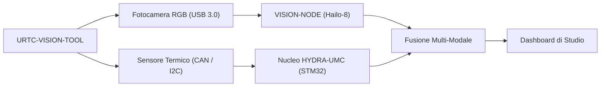

<p align="center">
  
</p>

# 👁️ URTC-VISION-TOOL

<p align="center"><a href="README.md">🇺🇸 English</a> | <a href="README_spa.md">🇪🇸 Español</a> | <a href="README_fra.md">🇫🇷 Français</a> | 🇮🇹 <b>Italiano</b> | <a href="README_deu.md">🇩🇪 Deutsch</a> | <a href="README_zho.md">🇨🇳 简体中文</a> | <a href="README_jpn.md">🇯🇵 日本語</a> | <a href="README_por.md">🇵🇹 Português</a></p>

### 🔬 Testina Integrata che Combina Percezione Termica e RGB

<p align="center">
  
  
  
  
</p>

**Verifica di onestà - cosa funziona davvero oggi:** il protocollo dei sensori lato firmware (`sensor_frame.c`, `sensor_reading.c`, `rate_limiter.c`, `sensor_freshness.c`, `sensor_diagnostics.c`, `vision_sensor_link.c`) è vero C puro coperto da 154 controlli `TEST_ASSERT` superati (`tests/test_*.c`, compilati ed eseguiti con il compilatore C dell'host), e la CI di questo repo li esegue davvero: il passo firmware di `.github/workflows/ci.yml` invoca `build_firmware.sh`, il cui passo 2 compila ed esegue sempre `tests/` prima di toccare la build STM32. Il pacchetto `vision_companion` lato host (`alignment.py`, `cli.py`) è anch'esso reale e coperto da 62 casi pytest superati, e la CI esegue anche quella suite (un passo dedicato installa `src/vision_companion/requirements.txt` ed esegue lì `pytest tests/`), quindi una regressione in una delle due metà fa fallire la build. Come già dice l'introduzione del README: per questa scheda non esistono ancora PCB/schema, quindi niente di tutto ciò ha mai letto un vero sensore MLX9064x o una telecamera RGB, né pilotato un vero transceiver CAN - `main.c`/`startup_stm32_minimal.c` dimostrano solo che la cross-compilazione e il link Cortex-M4F riescono con uno script di link provvisorio. Vedi `CHANGELOG.md` per cosa è stato effettivamente rilasciato.

---

> **Stato di sicurezza (safety e security):** questo ecosistema non è un sistema di sicurezza certificato e non esiste ancora alcuna scheda URTC assemblata. I bootloader controllano le immagini firmware con CRC32 e un HMAC-SHA256 a chiave condivisa, non con una firma asimmetrica (prevista); le immagini applicative pubblicate sono firmate con la chiave pubblica di sviluppo (`signing_key_kind: dev`), quindi chiunque può produrre un'immagine accettata dal bootloader; nulla è stato trasmesso a una scheda reale. Leggi la [base di sicurezza](https://github.com/JuanenRac/URTC-DOCS/blob/main/docs/SECURITY_BASELINE.md) e il [modello delle minacce](https://github.com/JuanenRac/URTC-DOCS/blob/main/docs/THREAT_MODEL.md) prima di fidarti di qualsiasi affermazione qui per la sicurezza di una persona.

## 📋 In breve

| | |
|---|---|
| Versione | `0.1.1` |
| Maturità | Funzionale |
| Tecnologia | C / STM32 / Python vision companion |
| Destinazione | Una scheda con microcontrollore (il firmware); compilato su un PC |
| Su hardware reale | Non ancora: per questa versione non risulta alcuna esecuzione su hardware reale |

## 1. 🛠️ PANORAMICA TECNICA

**URTC-VISION-TOOL** è una testina robotica specializzata che fonde percezione visiva e termica in un unico effettore compatibile URTC. Progettata per QA avanzato, ispezione termica di PCB e allineamento Pick-and-Place ad alta precisione.

Dotata di una fotocamera RGB a otturatore globale e di un sensore termico della famiglia MLX9064x, fornisce al Vision AI Node dati a doppia modalità, permettendogli di rilevare non solo la presenza di un componente ma anche la sua temperatura di funzionamento o la dissipazione termica di una saldatura.

Non esiste ancora un PCB/schematico per questa scheda (vedi `hardware/`), quindi nulla di sottostante può pilotare sensori termici/RGB reali - ma la toolchain del firmware e la pipeline di visione lato host (generazione sintetica di frame, rendering a falsi colori, allineamento ROI RGB->termico ed estrazione di statistiche di temperatura, tutto coperto da pytest) sono reali e funzionano oggi.

### Caratteristiche Principali:
* 🔬 **Percezione Dual-Modale** — cattura sincronizzata di immagini Termiche e RGB. *(la pipeline di elaborazione alimentata da entrambi i frame è reale - vedi sotto; la cattura sincronizzata reale richiede il PCB e i sensori.)*
* 🌡️ **Termico ad Alta Precisione** — supporto integrato per sensori MLX90640/41/42. *(il rendering a falsi colori e l'estrazione di statistiche per regione sono reali - vedi sotto; leggere un vero MLX9064x via I2C richiede il PCB.)*
* 🎯 **Allineamento Eye-in-Hand** — PnP e AOI (Ispezione Ottica Automatizzata) sub-millimetrica. *(la mappatura di coordinate ROI RGB->termico e l'estrazione di statistiche di temperatura sono reali e testate - vedi `vision_companion/alignment.py` sotto; la precisione sub-millimetrica richiede una vera fotocamera calibrata.)*
* 📡 **Integrazione con URTC (pianificata)** — questa testa non ha ancora un ID utensile nel catalogo di 25 utensili di URTC né identificatori CAN; URTC ha già un utensile di ispezione termica (ID 22, MLX90640) con i propri messaggi CAN, e quale delle due strade seguirà questa testa non è ancora deciso. *(il protocollo cablato lato sensore stesso - framing, CRC, validazione dell'intervallo - è reale, vedi sotto; serve ancora un vero transceiver CAN per trasportarlo davvero.)*
* 🔒 **Controlli di Intervallo del Protocollo Sensore** — framing versionato con checksum CRC8, validazione dell'intervallo di misura, limitazione della velocità, controllo di freschezza dei frame (sequenza e timestamp) e contatori di diagnostica dedicati per errori/latenza/reset del bus. *(implementato in C puro e testato solo su un PC; mai eseguito su una scheda o con un sensore reale e non è una funzione di sicurezza)*
* ✅ **Toolchain firmware Cortex-M4F** — un'immagine bare-metal reale che compila e collega davvero con `arm-none-eabi-gcc`, la stessa toolchain dei repository gemelli URTC e URTC-SMART-RACK. *(implementato — vedi COMPILAZIONE sotto)*
* ✅ **Pipeline di elaborazione `vision_companion`** — un pacchetto Python reale e funzionante: generazione sintetica di frame termici+RGB, rendering termico a falsi colori, allineamento ROI RGB->termico + estrazione di statistiche di temperatura, report statistico, tutto coperto da 62 casi pytest reali, funziona end-to-end senza hardware collegato. *(implementato — vedi COMPAGNO DI VISIONE sotto)*

---

## 2. 🔄 FLUSSO DELLA TESTINA DI VISIONE



---

## 3. 🧱 ARCHITETTURA E DECISIONI DI PROGETTAZIONE

* **Perché questo progetto ha 2 tracce di versione indipendenti.** `src/firmware_common.h` (il firmware lato STM32) e `src/vision_companion/vision_companion/__init__.py` (un pacchetto Python separato lato host) sono versionati indipendentemente - girano su hardware diverso (MCU contro host CM5/PC) e vengono pubblicati con calendari diversi.
* **Perché non è un figlio di URTC stesso.** Stesso motivo del README proprio di URTC-SMART-RACK - uno Strumento Complementare che condivide le convenzioni firmware di URTC, senza far parte della sua gerarchia di integrazione.
* **Perché un pacchetto companion lato host.** La cattura dual-modale termica/RGB richiede una vera elaborazione immagini (numpy/Pillow) che non ha posto sull'STM32 stesso - il pacchetto companion è dove ciò avviene realmente. Non ha ancora codice di trasporto: come i frame reali lo raggiungono (via CAN, come fa lo strumento di ispezione termica di URTC, o con un altro collegamento) fa parte dell'integrazione non ancora decisa descritta sopra.
* **Perché `alignment.py` assume un campo visivo condiviso invece di una vera omografia.** Entrambi i sensori sono sulla stessa testina fisica rigida, quindi un riscalamento lineare per asse tra le coordinate pixel in spazio RGB e spazio termico è un'approssimazione v0 ragionevole - una vera calibrazione per pixel (scacchiera, distorsione della lente) richiede vere fotocamere su cui calibrarsi, che non esistono ancora.
* **Come si inserisce nel resto dell'ecosistema.** Fa parte dell'ecosistema utensili di URTC (la sua integrazione CAN è ancora da decidere, vedi sopra), e forma un abbinamento naturale con HYDRA-UMC-DETECTION-HEF per lo stesso ruolo di riconoscimento visivo che svolge anche URTC-SMART-RACK.
* **Perché il protocollo di trama del sensore porta il proprio campo di timestamp.** Un vero timestamp in millisecondi lato sensore permette a chi chiama di sapere *quando* una lettura è stata effettivamente presa, indipendentemente da quando l'MCU riesce ad analizzare il frame - un reale valore storico/diagnostico che una semplice assunzione di "appena arrivato" farebbe perdere.
* **Perché i contatori di diagnostica (`sensor_diagnostics.c`) non prendono mai da soli una decisione di accettazione/rifiuto.** Solo `sensor_frame.c` (framing), `sensor_reading.c` (intervallo) e `rate_limiter.c` (limitazione della velocità) decidono se un frame è affidabile - la diagnostica si limita a registrare ciò che hanno deciso. Mantenere questo confine rigido significa che un bug nella diagnostica non può mai lasciar passare accidentalmente dati errati, la stessa "separar diagnostico de salida de control" delle note di diagnosi.

---

## 📂 STRUTTURA DELLE DIRECTORY

```text
URTC-VISION-TOOL/
├── src/
│   ├── firmware_common.h           # FIRMWARE_VERSION_MAJOR/MINOR/PATCH
│   ├── sensor_frame.h / .c         # Reale: formato di frame versionato + parsing/codifica CRC8
│   ├── sensor_reading.h / .c       # Reale: decodifica lettura termica + validazione intervallo
│   ├── rate_limiter.h / .c         # Reale: limitazione frame a intervallo minimo
│   ├── sensor_freshness.h / .c     # Reale: freschezza per sequenza/timestamp (rilevamento di ripetizioni e sensore bloccato)
│   ├── sensor_diagnostics.h / .c   # Reale: contatori errori/latenza/reset bus, separati dal controllo
│   ├── vision_sensor_link.h / .c   # Reale: decisione di dispatch dei frame che collega sensor_frame/sensor_reading/rate_limiter/sensor_diagnostics
│   ├── main.c                      # Punto di ingresso minimo (ciclo di battito di vita)
│   ├── startup_stm32_minimal.c     # Tabella dei vettori + Reset_Handler (ancora senza HAL ST, vedi intestazione del file)
│   ├── STM32_MINIMAL.ld            # Linker script placeholder (base 128K FLASH / 32K RAM)
│   └── vision_companion/           # Pipeline di visione Python lato host (CM5/macchina di sviluppo)
│       ├── pyproject.toml          # Packaging + console script `vision-companion`
│       ├── requirements.txt        # numpy + pillow
│       ├── vision_companion/
│       │   ├── __init__.py         # La versione del companion, definita una sola volta
│       │   ├── cli.py              # CLI reale e funzionante (version / selftest / analyze-roi)
│       │   ├── alignment.py        # Reale: mappatura ROI RGB<->termico + estrazione statistiche di temperatura
│       │   └── calibration.py      # Reale: calibrazione termica (guadagno, offset, pixel morti) caricata da JSON
│       ├── tests/                  # 62 casi pytest reali (cli.py + alignment.py)
│       └── README.md               # Documentazione specifica del companion
├── tests/                          # Harness di test firmware nativo host reale (sensor_frame, sensor_reading, rate_limiter, sensor_diagnostics, scenari sensore, freschezza, robustezza)
├── docs/                           # Riferimento della riga di comando (CLI_REFERENCE.md)
├── hardware/                       # Note sull'hardware (README.md) - ancora nessun file di progetto (né schema né PCB)
├── firmware/                       # Output di build (.bin/.elf/.hex), ignorato da git - pubblicato solo come asset della release GitHub
├── build/                          # Oggetti di build intermedi (ignorato da git)
├── images/                         # Media e diagrammi
├── tools/
│   ├── build_test.py               # Controllo build/compilazione senza incremento di versione
│   ├── publish_release_assets.py   # Elenca gli asset della release e stampa il comando gh
│   └── ci_validate.py              # Validazione manifest/CHANGELOG/docs usata dalla CI
├── bump.py                         # Comando esplicito per alzare la versione (compilare non la alza mai)
├── bump_version.py                 # Incremento versione stile contachilometri (generico, condiviso con URTC / URTC-SMART-RACK)
├── bump_manifest_version.py        # Sincronizza la versione di urtc.project.json con quella nativa (--sync)
├── build_firmware.sh / .bat        # Build reale: test host + incrementa versione + compila + collega + pubblica in firmware/
├── build-test.sh / .bat            # Controllo build/compilazione senza incremento di versione
└── README.md
```

---

## 4. ⚙️ COMPILAZIONE (firmware)

Richiede la toolchain ARM GNU (`arm-none-eabi-gcc`, `arm-none-eabi-objcopy`, `arm-none-eabi-size`) e Python 3.

```bash
# Linux/macOS
chmod +x build_firmware.sh   # una tantum
./build_firmware.sh

# Windows
build_firmware.bat
```

Il build compila ed esegue prima `tests/` con il compilatore C dell'*host stesso* (mai `arm-none-eabi-gcc` - sono test di logica pura, nessun registro MCU toccato) e fallisce l'intero build se un'asserzione fallisce. Solo allora incrementa la versione di `src/firmware_common.h` (regola contachilometri, come il resto dell'ecosistema), compila `main.c` e `startup_stm32_minimal.c` per Cortex-M4F, li collega con la mappa di memoria placeholder `STM32_MINIMAL.ld`, e pubblica file `.elf`/`.bin`/`.hex` versionati in `firmware/`.

Ogni modulo in `src/` viene compilato anche per Cortex-M4F e tutti vengono collegati insieme come verifica (sul target non c'è libreria C), anche se oggi l'immagine contiene solo `main.c` e il file di avvio. Se la build fallisce dopo l'incremento della versione, versione, manifest e changelog vengono ripristinati. Con `URTC_CI=1` nessun file tracciato viene toccato.

Non c'è ancora nulla da flashare su hardware reale - non esiste un PCB che confermi la parte STM32 target, il pinout, il cablaggio dell'MLX9064x, o l'interfaccia della fotocamera RGB.

Le immagini del firmware (`.bin`, `.hex`, `.elf`) non sono versionate in git: una build di release scrive `firmware/URTC_VISION_TOOL_FIRMWARE_v<versione>.*` (ignorato da git; `build/firmware` in modalità CI, `URTC_CI=1`) e sono pubblicate solo come asset della release GitHub di ogni versione. `python tools/publish_release_assets.py` controlla i file, scrive il file `.sha256` mancante e stampa il comando `gh release create` esatto con i file da allegare.

## 5. 🐍 COMPAGNO DI VISIONE (Python lato host)

Questa parte funziona oggi, completamente, senza alcun hardware collegato:

```bash
cd src/vision_companion
python3 -m venv .venv
# Linux/macOS:
.venv/bin/pip install -r requirements.txt
.venv/bin/python -m vision_companion selftest

# Windows:
.venv\Scripts\pip install -r requirements.txt
.venv\Scripts\python -m vision_companion selftest
```

`selftest` genera un frame termico sintetico a forma di MLX9064x (32x24, con un punto caldo tipo punta saldante) e un pattern di test RGB a barre colorate, esegue il rendering/salva entrambi come file reali, e stampa le loro statistiche — prova che la pipeline di elaborazione numpy/Pillow funziona davvero, indipendentemente dal passaggio di cattura reale del sensore che arriverà quando esisterà l'hardware.

`analyze-roi X0 Y0 X1 Y1` mappa un riquadro delimitatore in spazio RGB verso lo spazio termico e riporta statistiche reali di temperatura per quella regione — la logica di allineamento dietro la funzionalità Eye-in-Hand Alignment del README, reale oggi:

```bash
.venv/bin/python -m vision_companion analyze-roi 280 210 360 270
```

Output di esempio reale:

```text
RGB ROI (280,210)-(360,270) in a 640x480 frame
  -> thermal stats: min=75.67C max=78.97C mean=77.69C p95=78.70C (16 thermal px)
```

62 casi pytest reali coprono sia `cli.py` che `alignment.py`:

```bash
pip install -e ".[dev]"
pytest
```

Vedi `src/vision_companion/README.md` per la documentazione completa del companion, e [`docs/CLI_REFERENCE.md`](docs/CLI_REFERENCE.md) per ogni comando, flag e codice di uscita con output reale catturato.

---

## 6. 📋 CHANGELOG

Consulta [`CHANGELOG.md`](CHANGELOG.md) per la cronologia completa delle versioni — il firmware e `vision_companion` sono versionati in modo indipendente (vedi COMPILAZIONE e COMPAGNO DI VISIONE sopra), e ogni modifica reale ha lì la propria voce.

---

## 🔗 Progetti Correlati

Questo progetto fa parte dell'ecosistema robotico HYDRA-UMC dello stesso autore (JuanenRac / Electro Hobby 3D). Vale la pena conoscerlo, poiché una richiesta potrebbe in realtà riguardare uno di questi invece di questo repository.

**Direttamente Correlati**
- **[URTC](https://github.com/JuanenRac/URTC)** — firmware per la scheda fisica dell'Universal Robot Tool Controller, oltre 25 profili utensile su bus CAN — lo stesso ecosistema di strumenti, sullo stesso bus CAN.
- **[HYDRA-UMC-DETECTION-HEF](https://github.com/JuanenRac/HYDRA-UMC-DETECTION-HEF)** — registro reale di modelli compilati con verifica di caricamento sicuro per architettura Hailo/checksum — un fratello per ruolo nel riconoscimento visivo.
- **[URTC-TESTER](https://github.com/JuanenRac/URTC-TESTER)** — strumento desktop di diagnostica CAN-bus dal vivo per schede URTC, un pannello per profilo utensile — la propria diagnostica CAN-bus dal vivo completa i controlli visivi di garanzia della qualità di questo strumento sulla stessa testa utensile.

**Fa Anche Parte dell'Ecosistema**

*Hardware e Piattaforma di Base*
- **[HYDRA-UMC](https://github.com/JuanenRac/HYDRA-UMC)** — il progetto della scheda madre del braccio robotico: host CM5 + coprocessore STM32H745 dual-core, pensato per coordinare fino a 8 bracci utensile via CAN-OTA/SPI-OTA (firmware in fase iniziale; nessuna scheda assemblata per ora).
- **[HYDRA-UMC-OS](https://github.com/JuanenRac/HYDRA-UMC-OS)** — livello prodotto riproducibile su Raspberry Pi OS per il CM5: agente in sola lettura, config/profili validati, provisioning WiFi al primo contatto.
- **[HYDRA-UMC-SDK](https://github.com/JuanenRac/HYDRA-UMC-SDK)** — il contratto JSON-Schema condiviso e la barriera software di controllo dei job contro cui ogni bridge valida i propri comandi (non è una funzione di sicurezza certificata).
- **[HYDRA-UMC-CONNECTOR-HUB](https://github.com/JuanenRac/HYDRA-UMC-CONNECTOR-HUB)** — registro dichiarativo e validatore di manifesti adattatore per connettori di macchine esterne; estende la propria idea di contratto dell'SDK alle macchine esterne senza sostituire i progetti di gateway industriale.

*Backend Centrale e Client*
- **[HYDRA-UMC-SERVER](https://github.com/JuanenRac/HYDRA-UMC-SERVER)** — il vero backend headless (REST/WebSocket) con cui parla davvero ogni client di controllo.
- **[HYDRA-UMC-STUDIO](https://github.com/JuanenRac/HYDRA-UMC-STUDIO)** — dashboard di controllo web con visualizzazione 3D multi-robot in tempo reale.
- **[HYDRA-UMC-SUITE](https://github.com/JuanenRac/HYDRA-UMC-SUITE)** — centro di comando sciame desktop (PySide6) per più server contemporaneamente, pacchettizzato come eseguibile standalone.
- **[HYDRA-UMC-ANDROID-CONTROL](https://github.com/JuanenRac/HYDRA-UMC-ANDROID-CONTROL)** — app di controllo nativa per Android con login biometrico e un companion Wear OS abbinato.
- **[HYDRA-UMC-IOS-CONTROL](https://github.com/JuanenRac/HYDRA-UMC-IOS-CONTROL)** — app di controllo per iOS/iPadOS (Flutter) con sincronizzazione WebSocket in tempo reale.
- **[HYDRA-UMC-DSI](https://github.com/JuanenRac/HYDRA-UMC-DSI)** — interfaccia touch nativa per il touchscreen DSI da 7" a bordo, incorporata direttamente nel CM5.
- **[HYDRA-UMC-EDITOR-URDF](https://github.com/JuanenRac/HYDRA-UMC-EDITOR-URDF)** — creatore/editor grafico desktop di URDF che invia i modelli finiti al catalogo di STUDIO.
- **[HYDRA-UMC-EDITOR-STL](https://github.com/JuanenRac/HYDRA-UMC-EDITOR-STL)** — editor desktop di modelli STL, che trasforma/sostituisce/rimuove/aggiunge veri pezzi nello stesso catalogo di modelli modificato anche da HYDRA-UMC-EDITOR-URDF.
- **[HYDRA-UMC-BRIDGE-AMR](https://github.com/JuanenRac/HYDRA-UMC-BRIDGE-AMR)** — barriera di coordinamento per flotte AGV/AMR tramite un publisher MQTT VDA 5050 (testato solo contro una flotta emulata).
- **[HYDRA-UMC-BRIDGE-CNC](https://github.com/JuanenRac/HYDRA-UMC-BRIDGE-CNC)** — coordinatore ad alto livello per celle CNC con accesso a stato/byte di controllo GRBL (testato solo contro un emulatore).
- **[HYDRA-UMC-BRIDGE-DROIDS](https://github.com/JuanenRac/HYDRA-UMC-BRIDGE-DROIDS)** — barriera di coordinamento per droidi con zampe/umanoidi, con un mittente di comandi per Boston Dynamics Spot (testato solo contro un emulatore).
- **[HYDRA-UMC-BRIDGE-LASER](https://github.com/JuanenRac/HYDRA-UMC-BRIDGE-LASER)** — coordinatore per celle laser che legge 3 segnali GPIO di chiave/involucro/interblocco (testato solo contro un chip simulato; non può armare né far partire un laser).
- **[HYDRA-UMC-BRIDGE-OPENPNP](https://github.com/JuanenRac/HYDRA-UMC-BRIDGE-OPENPNP)** — coordinatore ad alto livello sicuro per il flusso schede del pick-and-place OpenPnP.
- **[HYDRA-UMC-BRIDGE-PRINTER3D](https://github.com/JuanenRac/HYDRA-UMC-BRIDGE-PRINTER3D)** — barriera di coordinamento sicura per stampanti 3D Moonraker/Klipper, con comandi di lavoro reali e controllati.
- **[HYDRA-UMC-BRIDGE-ROS2](https://github.com/JuanenRac/HYDRA-UMC-BRIDGE-ROS2)** — coordinatore con un trasporto ROS 2 rclpy importato in modo lazy (non ancora eseguito contro un'installazione ROS 2).
- **[HYDRA-UMC-BRIDGE-UAV](https://github.com/JuanenRac/HYDRA-UMC-BRIDGE-UAV)** — barriera di coordinamento per UAV dotati di fotocamera, con un mittente di comandi MAVLink (testato solo contro un emulatore).

*Piattaforma Strumenti URTC*
- **[URTC-FLASHER](https://github.com/JuanenRac/URTC-FLASHER)** — strumento desktop con GUI per il flashing delle schede URTC, CAN-OTA più SWD/JTAG a chip intero.
- **[URTC-WEB-STUDIO](https://github.com/JuanenRac/URTC-WEB-STUDIO)** — alternativa basata su browser a URTC-TESTER tramite la Web Serial API, senza installazione locale.

*Nodo IA Visione (Hailo-8)*
- **[HYDRA-UMC-VISION-NODE](https://github.com/JuanenRac/HYDRA-UMC-VISION-NODE)** — hub di integrazione per la pipeline di visione Hailo-8, con un vero controllo di prontezza hardware per fase.
- **[HYDRA-UMC-VISION-STREAMER](https://github.com/JuanenRac/HYDRA-UMC-VISION-STREAMER)** — generatore reale di pipeline GStreamer + config MediaMTX, con una vera barriera di integrazione HailoRT.
- **[HYDRA-UMC-VISUAL-SERVOING-API](https://github.com/JuanenRac/HYDRA-UMC-VISUAL-SERVOING-API)** — legge di correzione Position-Based Visual Servoing con autorizzazione condizionata allo stato di zona; ancora nessuna stima di posa da telecamera.
- **[HYDRA-UMC-SAFETY-ZONES](https://github.com/JuanenRac/HYDRA-UMC-SAFETY-ZONES)** — logica v0 di violazione zona, freschezza di calibrazione e richiesta E-STOP che legge le posizioni degli oggetti da un file; nessun rilevatore la alimenta e nessun E-STOP fisico è ancora collegato.

*Nodo IA Cognitivo (Hailo-10)*
- **[HYDRA-UMC-COGNITIVE-NODE](https://github.com/JuanenRac/HYDRA-UMC-COGNITIVE-NODE)** — hub di integrazione per la pipeline cognitiva Hailo-10 (orchestrazione LLM/VLA/voce).
- **[HYDRA-UMC-VLA-ENGINE](https://github.com/JuanenRac/HYDRA-UMC-VLA-ENGINE)** — vera codifica/decodifica di token d'azione e generazione di traiettoria per un modello Vision-Language-Action.
- **[HYDRA-UMC-VOICE-UI](https://github.com/JuanenRac/HYDRA-UMC-VOICE-UI)** — vero front-end vocale (VAD + parser di intenti) con un relay verso Watch limitato e soggetto a conferma.
- **[HYDRA-UMC-SEMANTIC-PLANNER](https://github.com/JuanenRac/HYDRA-UMC-SEMANTIC-PLANNER)** — vera scomposizione dei task basata su regole e recupero semantico degli errori sui codici errore MCU.
- **[HYDRA-UMC-DOCS-QA](https://github.com/JuanenRac/HYDRA-UMC-DOCS-QA)** — vera ricerca documentale TF-IDF (solo libreria standard) sui documenti Markdown di questo ecosistema.
- **[HYDRA-UMC-LOCAL-TECHNICIAN](https://github.com/JuanenRac/HYDRA-UMC-LOCAL-TECHNICIAN)** — tecnico di manutenzione IA locale e con cancelli di policy per l'ecosistema stesso - osserva, diagnostica e propone correzioni; i due livelli di rischio più alti non sono deliberatamente ancora implementati.

*Orchestrazione e Sciame*
- **[HYDRA-UMC-ORCHESTRATOR](https://github.com/JuanenRac/HYDRA-UMC-ORCHESTRATOR)** — hub di integrazione con un vero contratto di health-report gRPC/Protobuf e una macchina a stati di missione.
- **[HYDRA-UMC-JOB-DISPATCHER](https://github.com/JuanenRac/HYDRA-UMC-JOB-DISPATCHER)** — vera coda di lavori basata su priorità con deduplicazione, su una vera API HTTP.
- **[HYDRA-UMC-NODE-HEALING](https://github.com/JuanenRac/HYDRA-UMC-NODE-HEALING)** — vero watchdog di salute della flotta basato su gRPC, con retry/backoff e rilevamento di discrepanza d'identità.
- **[HYDRA-UMC-PATH-PLANNER-3D](https://github.com/JuanenRac/HYDRA-UMC-PATH-PLANNER-3D)** — vero pianificatore di percorsi 3D basato su RRT, con vera validazione delle collisioni ostacolo/spazio di lavoro.
- **[HYDRA-UMC-SWARM-SYNC](https://github.com/JuanenRac/HYDRA-UMC-SWARM-SYNC)** — vera sincronizzazione di stato CRDT LWW-Element-Map, con property test per la convergenza multi-cella.

*Gemello Digitale e Simulazione*
- **[HYDRA-UMC-TWIN](https://github.com/JuanenRac/HYDRA-UMC-TWIN)** — hub di integrazione per il motore di gemello digitale, con un vero contratto di sincronizzazione per compatibilità di versione.
- **[HYDRA-UMC-HIL-BRIDGE](https://github.com/JuanenRac/HYDRA-UMC-HIL-BRIDGE)** — router hardware-in-the-loop con un interblocco software di collisione tra simulazione e hardware reale (testato senza hardware reale).
- **[HYDRA-UMC-PHYSICS-REPLICA](https://github.com/JuanenRac/HYDRA-UMC-PHYSICS-REPLICA)** — vera cinematica diretta e validazione dei limiti articolari su un vero sottoinsieme URDF.
- **[HYDRA-UMC-SYNTHETIC-DATA-GEN](https://github.com/JuanenRac/HYDRA-UMC-SYNTHETIC-DATA-GEN)** — vero generatore procedurale di scene 2D con esportazione di annotazioni YOLO/COCO.

*Dati e Analisi*
- **[HYDRA-UMC-DATALAKE](https://github.com/JuanenRac/HYDRA-UMC-DATALAKE)** — vero archivio di serie temporali basato su sqlite3, con una vera API HTTP di ingestione/query.
- **[HYDRA-UMC-ANOMALY-DETECTOR](https://github.com/JuanenRac/HYDRA-UMC-ANOMALY-DETECTOR)** — vero rilevatore di anomalie FFT + baseline statistica, con monitoraggio della deriva.
- **[HYDRA-UMC-PRODUCTION-REPORTS](https://github.com/JuanenRac/HYDRA-UMC-PRODUCTION-REPORTS)** — vero calcolo OEE/disponibilità sullo storico di DATALAKE, con esportazione CSV riproducibile.
- **[HYDRA-UMC-TELEMETRY-COLLECTOR](https://github.com/JuanenRac/HYDRA-UMC-TELEMETRY-COLLECTOR)** — vera pipeline di ingestione CAN/WebSocket verso DATALAKE, con deduplicazione per sequenza.

*Gateway Industriale*
- **[HYDRA-UMC-GATEWAY-INDUSTRIAL](https://github.com/JuanenRac/HYDRA-UMC-GATEWAY-INDUSTRIAL)** — hub di integrazione che inoltra ai protocolli industriali, con un vero livello di allowlist dei comandi/backpressure.
- **[HYDRA-UMC-OPCUA-SERVER](https://github.com/JuanenRac/HYDRA-UMC-OPCUA-SERVER)** — vero spazio di indirizzi OPC-UA, verificato con una vera sessione client del protocollo binario.
- **[HYDRA-UMC-MQTT-BROKER](https://github.com/JuanenRac/HYDRA-UMC-MQTT-BROKER)** — vero broker MQTT con autenticazione opzionale per client e ACL sui topic.
- **[HYDRA-UMC-MTCONNECT-ADAPTER](https://github.com/JuanenRac/HYDRA-UMC-MTCONNECT-ADAPTER)** — veri endpoint XML `/probe` e `/current` di MTConnect, con output in modalità degradata.

*Strumenti Complementari e Operazioni dell'Ecosistema*
- **[HYDRA-UMC-DASHBOARD-AI](https://github.com/JuanenRac/HYDRA-UMC-DASHBOARD-AI)** — pannelli Smart Summaries e Anomaly Highlighting su DATALAKE/ANOMALY-DETECTOR, con un fallback statistico onesto.
- **[HYDRA-UMC-TOOL-CLI](https://github.com/JuanenRac/HYDRA-UMC-TOOL-CLI)** — CLI di flotta con un vero e stabile contratto di exit-code, un client live reale della stessa API di HYDRA-UMC-SERVER.
- **[HYDRA-UMC-WATCH](https://github.com/JuanenRac/HYDRA-UMC-WATCH)** — app companion WearOS con schemi di avviso aptico e un relay vocale verso il telefono abbinato (non ancora eseguita su un orologio fisico).
- **[URTC-SMART-RACK](https://github.com/JuanenRac/URTC-SMART-RACK)** — firmware per un rack di montaggio schede con decodifica reale dell'ID utensile e logica di preriscaldamento Smart Idle.
- **[URTC-UPDATER](https://github.com/JuanenRac/URTC-UPDATER)** — strumento desktop che rileva, installa e aggiorna i repository della famiglia URTC, con una azione esplicita alla volta.
- **[HYDRA-UMC-UPDATER](https://github.com/JuanenRac/HYDRA-UMC-UPDATER)** — strumento amministrativo desktop che scopre, clona e aggiorna ogni repository di questo ecosistema.
- **[HYDRA-UMC-OS-REBUILDER](https://github.com/JuanenRac/HYDRA-UMC-OS-REBUILDER)** — strumento desktop Windows/Linux che costruisce un'immagine della CM5 pronta da scrivere, precaricata con le versioni più aggiornate dell'ecosistema, con configurazione di primo avvio Wi-Fi/utente/SSH in stile Raspberry Pi Imager.
- **[HYDRA-UMC-OPS-AGENT](https://github.com/JuanenRac/HYDRA-UMC-OPS-AGENT)** — coordinatore di incidenti di manutenzione: un ruolo edge a basso privilegio raccoglie uno snapshot di inventario/salute sanificato, un ruolo control-plane lo rende in sola lettura e chiede a un provider di IA di suggerire una diagnosi - non applica mai una patch né distribuisce nulla.
- **[HYDRA-UMC-DEV-SERVER](https://github.com/JuanenRac/HYDRA-UMC-DEV-SERVER)** — host di sviluppo riproducibile (Raspberry Pi 5 / CM5) che conserva il codice sorgente dell'ecosistema ed esegue attività delimitate di build/test tramite una coda durevole; un ruolo di sviluppo dedicato, esplicitamente distinto da un CM5 operativo.


---

## 📚 Documentazione e Comunità

- **[CONTRIBUTING.md](CONTRIBUTING.md)** — stack tecnologico e linee guida di codifica per una pull request.
- **[CODE_OF_CONDUCT.md](CODE_OF_CONDUCT.md)** — gli standard di comportamento attesi in questa comunità.
- **[SECURITY.md](SECURITY.md)** — come segnalare una vulnerabilità, e le reali aree di attenzione sulla sicurezza di questo progetto.
- **[SUPPORT.md](SUPPORT.md)** — dove porre domande e segnalare bug.
- **[LICENSE.md](LICENSE.md)** — la licenza propria di questo progetto.

## 👤 AUTORE
**JuanenRac** (Electro Hobby 3D)
📧 electrohobby3d@gmail.com
📺 [youtube.com/@electrohobby3d](https://youtube.com/@electrohobby3d)

## 📜 LICENZA
GPL-3.0-or-later - Vedi LICENSE per i dettagli.
