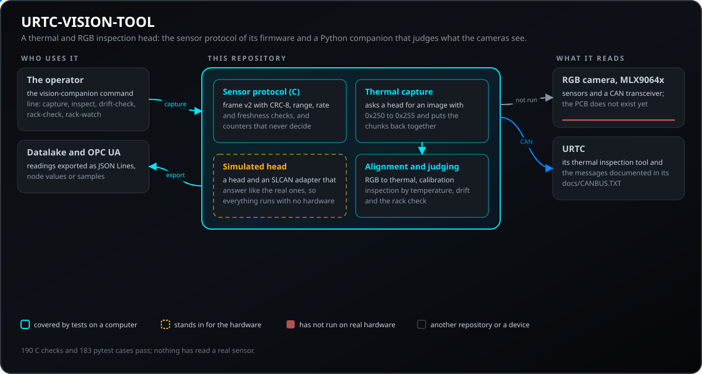
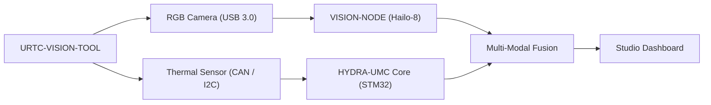
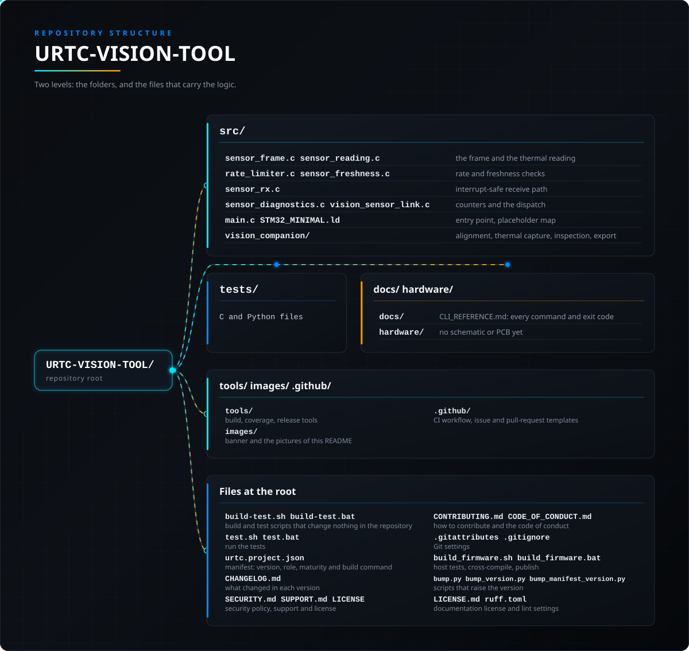

<p align="center">
  
</p>

# 👁️ URTC-VISION-TOOL

<p align="center"><a href="README.md">🇺🇸 English</a> | <a href="README_spa.md">🇪🇸 Español</a> | <a href="README_fra.md">🇫🇷 Français</a> | <a href="README_ita.md">🇮🇹 Italiano</a> | <a href="README_deu.md">🇩🇪 Deutsch</a> | <a href="README_zho.md">🇨🇳 简体中文</a> | <a href="README_jpn.md">🇯🇵 日本語</a> | 🇵🇹 <b>Português</b></p>

### 🔬 Efetuador Integrado que Combina Perceção Térmica e RGB

<p align="center">
  
  
  
  
</p>

---

**Verificação de honestidade - o que realmente funciona hoje:** o protocolo de sensor do lado do firmware (`sensor_frame.c`, `sensor_reading.c`, `rate_limiter.c`, `sensor_freshness.c`, `sensor_diagnostics.c`, `vision_sensor_link.c`) é C puro e real, sustentado por 190 verificações `TEST_ASSERT` aprovadas (`tests/test_*.c`, compiladas e executadas com o próprio compilador de C da máquina anfitriã), e o CI deste repositório executa-os de facto: o passo de firmware de `.github/workflows/ci.yml` invoca `build_firmware.sh`, cujo passo 2 compila e executa sempre `tests/` antes de tocar na compilação para STM32. O pacote `vision_companion` do lado do anfitrião (`alignment.py`, `cli.py`) é igualmente real e está sustentado por 183 casos de pytest aprovados, e o CI também executa essa suite (o seu próprio passo instala `src/vision_companion/requirements.txt` e executa `pytest tests/` aí), pelo que uma regressão em qualquer uma das duas metades faz falhar a compilação. Como a própria introdução deste README já diz: ainda não existe PCB/esquemático para esta placa, pelo que nada aqui alguma vez leu um sensor MLX9064x real nem uma câmara RGB, nem controlou um transcetor CAN real - `main.c`/`startup_stm32_minimal.c` apenas demonstram que a compilação cruzada e a ligação para Cortex-M4F têm êxito com um linker script provisório. Consulte `CHANGELOG.md` para saber exatamente o que foi entregue até agora.

---

> **Estado de segurança (safety e security):** este ecossistema não é um sistema de segurança certificado e ainda não existe nenhuma placa URTC montada. Os bootloaders verificam as imagens de firmware com CRC32 e um HMAC-SHA256 de chave partilhada, não com uma assinatura assimétrica (prevista); as imagens de aplicação publicadas estão assinadas com a chave pública de desenvolvimento (`signing_key_kind: dev`), pelo que qualquer pessoa pode produzir uma imagem que o bootloader aceita; nada foi transmitido a uma placa real. Leia a [base de segurança](https://github.com/JuanenRac/URTC-DOCS/blob/main/docs/SECURITY_BASELINE.md) e o [modelo de ameaças](https://github.com/JuanenRac/URTC-DOCS/blob/main/docs/THREAT_MODEL.md) antes de confiar em qualquer afirmação aqui para a segurança de uma pessoa.

## 📋 Num relance

| | |
|---|---|
| Versão | `0.1.6` |
| Maturidade | Funcional |
| Testes | 183 (`pytest`) |
| Tecnologia | C / STM32 / Python vision companion |
| Destino | Uma placa com microcontrolador (o firmware); compila-se num PC |
| Em hardware real | Ainda não: não há registo de execução em hardware real para esta versão |

**Ir para:** [Visão geral](#-visão-geral) · [Arquitetura](#-arquitetura) · [Funcionalidades](#-funcionalidades) · [Segurança](#-segurança-e-proteção) · [Interfaces](#-interfaces) · [Início rápido](#-início-rápido) · [Testes](#-testes) · [Estrutura](#-estrutura-do-repositório) · [Relacionados](#-projetos-relacionados)

<!-- urtc-section:status_vision_tool -->
## 🚦 Estado do projeto

🟢 feito e verificado · 🟡 funciona, com limites conhecidos · 🟠 a meio ou por verificar · 🔴 por fazer ou a não funcionar. Nada é verde se nunca correu em hardware real.

| Parte | Estado | O que o repositório consegue demonstrar |
| --- | :---: | --- |
| Software | 🟡 | Funciona num PC e contra o simulador; nunca foi usado com uma placa real. |
| Testes | 🟢 | A bateria de testes passa na CI em cada envio. |
| Hardware real | 🟠 | Ainda não correu numa placa real: o ensaio de bancada continua pendente. |
| Documentação | 🟡 | README em oito línguas e documentos de referência; as traduções não foram revistas por falantes nativos. |

<!-- /urtc-section:status_vision_tool -->

## 🎯 Visão geral

**URTC-VISION-TOOL** é uma cabeça de ferramenta robótica especializada que funde a perceção visual e térmica num único efetuador compatível com URTC. Foi concebida para QA avançada, inspeção térmica de PCBs e alinhamento Pick-and-Place de alta precisão.

Equipada com uma câmara RGB global shutter e um sensor térmico da família MLX9064x, fornece ao Vision AI Node dados bimodais, permitindo-lhe detetar não só a presença de um componente, mas também a sua temperatura de funcionamento ou a dissipação de calor da soldadura.

Ainda não existe PCB/esquemático para esta placa (ver `hardware/`), pelo que nada do que se segue pode controlar sensores térmicos/RGB reais - mas a cadeia de ferramentas de firmware e o pipeline de processamento de visão do lado do anfitrião (geração de frames sintéticos, renderização em falsa cor, alinhamento de ROI RGB->térmico e extração de estatísticas de temperatura, tudo coberto por pytest) são reais e funcionam hoje.

### Caraterísticas Principais:
* 🔬 **Perceção Bimodal** — captura sincronizada de imagem térmica e RGB. *(o pipeline de processamento que ambos os frames alimentam é real - ver abaixo; a captura real sincronizada requer a PCB e os sensores.)*
* 🌡️ **Térmica de Alta Precisão** — suporte integrado para sensores MLX90640/41/42. *(a renderização em falsa cor e a extração de estatísticas por região são reais - ver abaixo; ler um MLX9064x real por I2C requer a PCB.)*
* 🎯 **Alinhamento Eye-in-Hand** — PnP submilimétrico e AOI (Inspeção Ótica Automatizada). *(o mapeamento de coordenadas de ROI RGB->térmico e a extração de estatísticas de temperatura são reais e testados - ver `vision_companion/alignment.py` abaixo; a precisão submilimétrica requer uma câmara real calibrada.)*
* 📡 **Integração com o URTC** — decidida: esta cabeça é uma cabeça de ferramenta do URTC e reutiliza a ferramenta de inspeção térmica do URTC (perfil de ferramenta 22, MLX90640/90641/90642) e as suas mensagens CAN `0x250`-`0x255` (disparo, estado, blocos de píxeis em bruto e calibrados, documentados em `docs/CANBUS.TXT` do URTC) em vez de um segundo protocolo. O lado do anfitrião dessa troca é real e testado sem hardware (`urtc_thermal.py`, com uma cabeça simulada); o firmware da cabeça, um transcetor CAN e uma placa montada ainda não existem, por isso nada disto correu num barramento. *(O protocolo de tramas do lado do sensor deste repositório, abaixo, é um bloco separado testado no anfitrião; não transporta a imagem térmica.)*
* 🔒 **Verificações de Intervalo do Protocolo de Sensor** — enquadramento versionado com checksum CRC8, validação do intervalo de medição, limitação de taxa, verificação de atualidade das frames (sequência e timestamp) e contadores de diagnóstico dedicados de erros/latência/reinício de barramento. Frame na versão 2: todo o valor de vários bytes (o timestamp e a leitura térmica) é big-endian, como o barramento, e um frame da versão 1 é recusado. *(implementado em C puro e testado apenas num PC; nunca executado numa placa nem com um sensor real e não é uma função de segurança)*
* ✅ **Cadeia de ferramentas de firmware Cortex-M4F** — uma imagem bare-metal real que compila de forma cruzada e liga com `arm-none-eabi-gcc`, a mesma cadeia de ferramentas dos repositórios irmãos URTC e URTC-SMART-RACK. *(implementado — ver COMPILAÇÃO abaixo)*
* ✅ **Pipeline de processamento `vision_companion`** — um pacote Python real e funcional: geração de frames sintéticos térmicos+RGB, renderização térmica em falsa cor, alinhamento de ROI RGB->térmico + extração de estatísticas de temperatura, relatório de estatísticas, tudo coberto por 183 casos reais de pytest, executa de ponta a ponta sem hardware ligado. *(implementado — ver COMPANION DE VISÃO abaixo)*

## 🧩 Papel no URTC

O URTC-VISION-TOOL é uma cabeça de ferramenta que junta uma câmara RGB e um sensor térmico MLX9064x, para inspeção de qualidade, inspeção térmica de placas e alinhamento de uma cabeça de colocação. É uma cabeça de ferramenta URTC: reutiliza a ferramenta de inspeção térmica do URTC e as suas mensagens CAN `0x250` a `0x255` em vez de um segundo protocolo, e dá ao nó de visão (Hailo-8) e ao controlador HYDRA-UMC dados de dois tipos, de modo que um componente é avaliado não só pela presença mas pela temperatura. O que é real hoje é o protocolo do sensor do firmware e o acompanhante de visão do lado do anfitrião, ambos testados num computador; ainda não existe nenhuma placa. É uma ferramenta complementar, não filha do URTC.

## 🏛️ Arquitetura

<p align="center">
  
</p>

Como as partes deste repositório se encaixam: quem o usa, o que contém e de que depende. A imagem é desenhada a partir de `docs/architecture.json` e verificada com o código.

<details>
<summary>Versão em texto do diagrama (Mermaid)</summary>



</details>

### ARQUITETURA E DECISÕES DE DESIGN

* **Porque é que este projeto tem 2 linhas de versões independentes.** `src/firmware_common.h` (o firmware do lado do STM32) e `src/vision_companion/vision_companion/__init__.py` (um pacote Python separado do lado do anfitrião) são versionados de forma independente - correm em hardware diferente (MCU vs. anfitrião CM5/PC) e são entregues em calendários diferentes.
* **Porque é que não é filho do próprio URTC.** O mesmo raciocínio do README do URTC-SMART-RACK - uma Ferramenta Complementar que partilha as convenções de firmware do URTC, mas que não faz parte da sua hierarquia de integração.
* **Porque é que existe um pacote companion do lado do anfitrião.** A captura bimodal térmica/RGB requer processamento de imagem real (numpy/Pillow) que não tem lugar no próprio STM32 - o pacote companion é onde isso realmente acontece. Não tem acesso próprio ao barramento, mas fala as mensagens de inspeção térmica do URTC (`urtc_thermal.py`): constrói os pedidos, recompõe os blocos de 16 píxeis numa imagem e entrega as mensagens ao que transporta o barramento.
* **Porque é que `alignment.py` assume um campo de visão partilhado em vez de uma homografia real.** Ambos os sensores estão na mesma cabeça de ferramenta rígida, pelo que um reescalonamento linear por eixo entre as coordenadas de píxel do espaço RGB e do espaço térmico é uma aproximação v0 razoável - uma calibração real por píxel (tabuleiro de xadrez, distorção da lente) requer câmaras reais contra as quais calibrar, que ainda não existem.
* **Como se integra no resto do ecossistema.** Faz parte do ecossistema de ferramentas do URTC (reutiliza a ferramenta de inspeção térmica do URTC e as suas mensagens CAN, ver acima), e é um par natural do HYDRA-UMC-DETECTION-HEF para o mesmo papel de reconhecimento visual que o URTC-SMART-RACK também desempenha.
* **Porque é que o protocolo de frames do sensor transporta o seu próprio campo de timestamp.** Um timestamp em milissegundos do lado do sensor permite a quem chama saber *quando* uma leitura foi realmente feita, independentemente de quando o MCU consegue analisar o frame - valor real de historiador/diagnóstico que um simples pressuposto de "acabou de chegar" perderia.
* **Porque é que os contadores de diagnóstico (`sensor_diagnostics.c`) nunca tomam eles próprios uma decisão de aceitar/rejeitar.** Apenas `sensor_frame.c` (enquadramento), `sensor_reading.c` (intervalo) e `rate_limiter.c` (limitação) decidem se um frame é de confiança - o diagnóstico apenas regista o que eles decidiram. Manter esta fronteira estrita significa que um erro no diagnóstico nunca pode deixar passar dados incorretos por acidente, o "separar diagnostico de salida de control" das próprias notas de diagnóstico.

## ✨ Funcionalidades

**Inspeção térmica por região, exportação de séries, deriva do sensor e verificação do rack (testado apenas no anfitrião):** `inspect` avalia cada componente de um plano pela regra de temperatura do seu tipo e pode exportar o mínimo, o máximo e a média de cada região como amostras para o datalake do HYDRA-UMC, como linhas JSON ou como valores de nós OPC-UA; `drift-check` compara imagens de uma cena de referência com uma base (píxeis mortos, deriva do desvio) e pode escrever um ficheiro de calibração; `rack-check` avalia as pontas do rack de ferramentas a partir de uma imagem térmica. `rack-watch` acompanha as pontas enquanto o rack aquece e indica quando cada posição atingiu o objetivo e se a ferramenta pode ser trocada, `rack-simulate` escreve as imagens de um rack simulado (saudável ou com uma avaria) para o experimentar sem câmara, e os comandos do rack escrevem em oito idiomas (`--lang`). Ver [a referência da CLI](docs/CLI_REFERENCE.md). Executado apenas com imagens sintéticas; nenhuma câmara nem placa foi usada.

**Captura térmica através de um adaptador CAN série (novo, jogado só contra um adaptador e uma cabeça simulados):** `capture --port PORTA` lê uma imagem calibrada de uma cabeça URTC que leva a ferramenta de inspeção térmica, através de um adaptador SLCAN (uma porta série ou um URL do pyserial), com a troca de `0x250` a `0x255`, e guarda-a como `.npy` e PNG em falsas cores, pronta para `inspect`, `drift-check` e `rack-check`. Uma cabeça que indica um erro, nunca fica pronta ou deixa um bloco sem resposta termina o comando com uma mensagem clara (código de saída 1), e uma porta que não se consegue abrir termina-o com o código 2. Não foi executada com um adaptador, um barramento nem uma cabeça reais.

## 🔒 Segurança e proteção

| Ameaça | Defesa |
|---|---|
| Uma trama corrompida ou antiga do sensor | Uma trama versionada com CRC-8 (`sensor_frame.c`); na versão 2 todo o valor de vários bytes, incluindo a marca de tempo e a leitura térmica, é big-endian como o barramento, e uma trama da versão 1 é recusada |
| Uma leitura que o sensor não pode ter feito | `sensor_reading.c` descodifica a leitura térmica e recusa o que está fora do intervalo |
| Uma enxurrada de tramas | `rate_limiter.c` retém as tramas por um intervalo mínimo |
| Uma trama repetida ou um sensor bloqueado | `sensor_freshness.c` verifica a sequência e a marca de tempo do próprio sensor |
| Uma falha nos contadores que deixe passar dados maus | `sensor_diagnostics.c` só regista o que os outros módulos decidiram (erros, latência, reinícios do barramento); nunca aceita nem recusa uma trama |

Tudo isto é C puro testado num computador; nunca correu numa placa nem com um sensor real, e não é uma função de segurança.

## 🔌 Interfaces

* **As mensagens de inspeção térmica do URTC** (`0x250` a `0x255`: disparo, estado, blocos de píxeis em bruto e calibrados, documentadas em `docs/CANBUS.TXT` do URTC): o lado anfitrião dessa troca é `urtc_thermal.py`, testado sem hardware contra uma cabeça simulada. `capture --port PORT` executa-o através de um adaptador SLCAN (uma porta série ou um URL do pyserial) e guarda a imagem como `.npy` e um PNG em falsa cor; uma cabeça que comunica um erro, nunca fica pronta ou deixa um bloco sem resposta termina o comando com código de saída 1, e uma porta que não se consegue abrir com código 2.
* **A trama do sensor do firmware:** versão 2, big-endian, CRC-8 (`sensor_frame.c`); é um bloco à parte, testado no anfitrião, e não transporta a imagem térmica.
* **A linha de comandos `vision-companion`:** `version`, `selftest`, `analyze-roi`, `capture`, `inspect`, `drift-check`, `rack-check`, `rack-watch` e `rack-simulate`, com cada opção e código de saída em [docs/CLI_REFERENCE.md](docs/CLI_REFERENCE.md).
* **Exportações:** as leituras de `inspect` como JSON Lines, como valores de nós OPC UA ou como amostras para o lago de dados do HYDRA-UMC.

## 🚀 Início rápido

Requer a ARM GNU Toolchain (`arm-none-eabi-gcc`, `arm-none-eabi-objcopy`, `arm-none-eabi-size`) e Python 3.

```bash
# Linux/macOS
chmod +x build_firmware.sh   # one-time
./build_firmware.sh

# Windows
build_firmware.bat
```

### COMPANION DE VISÃO (Python do lado do anfitrião)

Esta parte funciona hoje, na totalidade, sem hardware ligado:

```bash
cd src/vision_companion
python3 -m venv .venv
# Linux/macOS:
.venv/bin/pip install -r requirements.txt
.venv/bin/python -m vision_companion selftest

# Windows:
.venv\Scripts\pip install -r requirements.txt
.venv\Scripts\python -m vision_companion selftest
```

`selftest` gera um frame térmico sintético com a forma de um MLX9064x (32x24, com um ponto quente semelhante à ponta de um ferro de soldar) e um padrão de teste sintético RGB de barras de cor, renderiza/guarda ambos como ficheiros reais e imprime as suas estatísticas — prova de que o pipeline de processamento numpy/Pillow funciona genuinamente, independentemente do passo de captura real do sensor, que chegará quando existir hardware.

`analyze-roi X0 Y0 X1 Y1` mapeia uma caixa delimitadora do espaço RGB para o espaço térmico e comunica estatísticas de temperatura reais dessa região — a lógica de alinhamento por trás da funcionalidade Eye-in-Hand Alignment do README, real hoje:

```bash
.venv/bin/python -m vision_companion analyze-roi 280 210 360 270
```

Exemplo de saída real:

```text
RGB ROI (280,210)-(360,270) in a 640x480 frame
  -> thermal stats: min=75.67C max=78.97C mean=77.69C p95=78.70C (16 thermal px)
```

183 casos reais de pytest cobrem `cli.py`, `alignment.py` e os restantes módulos do pacote:

```bash
pip install -e ".[dev]"
pytest
```

Consulte `src/vision_companion/README.md` para a documentação completa do companion, e [`docs/CLI_REFERENCE.md`](docs/CLI_REFERENCE.md) para todos os comandos, flags e códigos de saída com saída real capturada.

<!-- urtc-section:compatibility -->
### Requisitos e compatibilidade

As versões dos programas URTC que funcionam em conjunto, e a versão do protocolo que cada uma fala, constam da tabela de compatibilidade que o URTC-COMMON gera: [docs/COMPATIBILITY.md](https://github.com/JuanenRac/URTC/blob/main/docs/COMPATIBILITY.md). As notas de uma versão dos repositórios que incluem `tools/changelog_section.py` (o firmware, o flasher, o tester e o updater) são a secção do CHANGELOG dessa versão seguida desta tabela: `python tools/changelog_section.py VERSION --compat`.
<!-- /urtc-section:compatibility -->

## 🧪 Testes

Há dois conjuntos de testes. O lado do firmware é C em `tests/` (190 verificações `TEST_ASSERT`): a trama do sensor, a leitura, o limitador de taxa, os diagnósticos, a atualidade, os cenários de toda a ligação, a robustez contra entradas erradas e os vetores partilhados do URTC-COMMON, compilados e executados com o compilador C do próprio computador e, na CI, com AddressSanitizer, UBSan e um mínimo de cobertura. O lado do anfitrião é o pacote `vision_companion`, com 183 casos de pytest (`cd src/vision_companion && pytest`) que executam todo o fluxo sem hardware: imagens sintéticas, falsa cor, alinhamento, calibração, a captura térmica contra uma cabeça simulada, a inspeção, a deriva e a verificação do suporte. Quatro ficheiros de teste Python verificam os scripts de compilação, os ativos da release e os ficheiros de versão. `bash build_firmware.sh` executa os testes C antes da compilação cruzada e falha se uma asserção falhar. O caminho de receção que uma interrupção vai usar (`sensor_rx.c`: a interrupção só põe o byte num anel, o ciclo principal encontra as tramas, ressincroniza-se depois de uma danificada e descarta uma trama a meio que esperou demasiado) também é lógica pura, reproduzido byte a byte nos testes.

## 🏗️ Compilação e publicação

A compilação começa por compilar e executar `tests/` com o compilador C *do próprio computador* (nunca `arm-none-eabi-gcc`: são testes de lógica pura, sem tocar em registos do MCU) e falha por completo se alguma asserção falhar. Só então compila `main.c` e `startup_stm32_minimal.c` para Cortex-M4F, liga-os ao mapa de memória provisório `STM32_MINIMAL.ld` e publica ficheiros `.elf`/`.bin`/`.hex` com versão em `firmware/`. Compilar nunca altera a versão.

Cada módulo de `src/` é também compilado para Cortex-M4F e todos são ligados em conjunto como verificação (não há biblioteca C no alvo), embora hoje a imagem só contenha `main.c` e o ficheiro de arranque. Com `URTC_CI=1` nenhum ficheiro versionado é tocado.

Ainda não há nada para gravar em hardware real — não existe PCB que confirme o componente STM32 de destino, a disposição de pinos, a cablagem do MLX9064x nem a interface da câmara RGB.

As imagens de firmware (`.bin`, `.hex`, `.elf`) não são versionadas no git: uma compilação de release escreve `firmware/URTC_VISION_TOOL_FIRMWARE_v<versão>.*` (ignorado pelo git; `build/firmware` em modo CI, `URTC_CI=1`) e são publicadas apenas como assets da release do GitHub de cada versão. `python tools/publish_release_assets.py` verifica os ficheiros, escreve o ficheiro `.sha256` em falta e imprime o comando `gh release create` exato com os ficheiros a anexar.

Veja [`CHANGELOG.md`](CHANGELOG.md) para o histórico completo de versões; cada versão tem aí a sua própria entrada.

## 📂 Estrutura do repositório

<p align="center">
  
</p>

<details>
<summary>Versão em texto da árvore</summary>

```text
URTC-VISION-TOOL/
├── src/                                               o firmware (protocolo do sensor em C puro, cópias verificadas do URTC-COMMON, ponto de entrada, script de ligação provisório) e o acompanhante em Python
├── tests/                                             testes de host em C (190 verificações) e verificações em Python dos scripts de compilação
├── docs/                                              CLI_REFERENCE.md: cada comando e código de saída
├── hardware/                                          ainda sem esquema nem PCB
├── tools/                                             ferramentas de compilação, cobertura e release
├── images/                                            faixa e imagens deste README
├── .github/                                           fluxo de CI e modelos de issues e pull requests
├── build-test.sh build-test.bat                       scripts de compilação e testes que não alteram nada no repositório
├── test.sh test.bat                                   executam os testes
├── urtc.project.json                                  manifesto: versão, papel, maturidade e comando de compilação
├── CHANGELOG.md                                       o que mudou em cada versão
├── SECURITY.md SUPPORT.md LICENSE                     política de segurança, suporte e licença
├── CONTRIBUTING.md CODE_OF_CONDUCT.md                 como contribuir e código de conduta
├── .gitattributes .gitignore                          definições do Git
├── build_firmware.sh build_firmware.bat               testes de host, compilação cruzada, publicação
├── bump.py bump_version.py bump_manifest_version.py   scripts que sobem a versão
└── LICENSE.md ruff.toml                               licença da documentação e definições de lint
```

</details>

A lista anotada de cada ficheiro de código, uma linha por ficheiro, está em [docs/SOURCE_MAP.md](docs/SOURCE_MAP.md).

## 🗺️ Roteiro e limites conhecidos

**Limites conhecidos hoje**

* Ainda não existe PCB nem esquema para esta placa (veja `hardware/`): nada disto alguma vez leu um MLX9064x real por I2C, uma câmara RGB ou um transcetor CAN. `main.c` e o ficheiro de arranque apenas provam que a compilação cruzada e a ligação para Cortex-M4F funcionam com um script de ligação provisório.
* O firmware da cabeça ainda não existe: o lado anfitrião da troca térmica só é testado contra uma cabeça e um adaptador SLCAN simulados.
* `alignment.py` assume um campo de visão partilhado e reescala cada eixo linearmente; uma calibração real píxel a píxel (tabuleiro, distorção da lente) precisa de câmaras reais.
* A precisão submilimétrica, a captura real sincronizada e os limites térmicos das regras de inspeção não foram experimentados com peças reais.

**A seguir**

* Projetar a placa, fixar o componente STM32 e a interface da câmara, escrever os controladores do sensor e da câmara e executar a captura térmica contra uma cabeça real em bancada.

## 🌍 Idiomas

O README e os textos existem em inglês, espanhol, francês, italiano, alemão, chinês, japonês e português europeu.

## 🔗 Projetos relacionados

O URTC é feito de repositórios independentes, cada um com a sua versão, os seus testes e o seu README. Esta é a família, por grupos:

* **URTC Tool Platform:**
  * [URTC](https://github.com/JuanenRac/URTC) - firmware da placa da cabeça de ferramenta (25 perfis de ferramenta, bootloader CAN) e a referência do protocolo CAN.
  * [URTC-COMMON](https://github.com/JuanenRac/URTC-COMMON) - o protocolo CAN escrito uma só vez como dados (especificação, tabelas geradas, vetores de conformidade) e o código que os programas partilham.
  * [URTC-FLASHER](https://github.com/JuanenRac/URTC-FLASHER) - ferramenta de ambiente de trabalho que atualiza o firmware da placa por CAN ou por SWD/JTAG.
  * [URTC-GATEWAY](https://github.com/JuanenRac/URTC-GATEWAY) - gateway à frente do barramento CAN: só deixa passar os identificadores de uma lista, limita a sua taxa e pede uma chave de sessão.
  * [URTC-SMART-RACK](https://github.com/JuanenRac/URTC-SMART-RACK) - lógica em C independente do hardware e protocolo de comandos para um suporte de ferramentas com pré-aquecimento e acompanhamento do ciclo de vida.
  * [URTC-TESTER](https://github.com/JuanenRac/URTC-TESTER) - testador de ambiente de trabalho do barramento CAN em direto que mostra os controlos e a telemetria do perfil de ferramenta que uma placa reporta.
  * **URTC-VISION-TOOL** (este repositório) - protocolo de tramas de sensor em C e um companheiro em Python térmico/RGB para uma cabeça de ferramenta de inspeção.
  * [URTC-WEB-STUDIO](https://github.com/JuanenRac/URTC-WEB-STUDIO) - aplicação de navegador que grava e testa a placa por Web Serial e SLCAN, sem instalar nada.
* **Ecosystem Operations:**
  * [URTC-DEVTOOLS](https://github.com/JuanenRac/URTC-DEVTOOLS) - as ferramentas de repositório partilhadas da família como um conjunto com versão e um ficheiro de bloqueio que distingue uma cópia editada de uma desatualizada.
  * [URTC-DOCS](https://github.com/JuanenRac/URTC-DOCS) - arquitetura, interfaces, base de segurança e catálogo gerado do ecossistema, mais as ferramentas que comparam todos os repositórios.
  * [URTC-UPDATER](https://github.com/JuanenRac/URTC-UPDATER) - ferramenta de ambiente de trabalho que deteta, instala e atualiza os repositórios da família URTC, uma ação explícita de cada vez.

**Projetos irmãos (independentes, com a mesma base e as mesmas ferramentas):**

* **[HYDRA-UMC-DOCS](https://github.com/JuanenRac/HYDRA-UMC-DOCS)** - projeto irmão: o centro de documentação do HYDRA-UMC, um ecossistema independente que partilha a base e as ferramentas com este
* **[ARMOR-DOCS](https://github.com/JuanenRac/ARMOR-DOCS)** - projeto irmão: o centro de documentação do A.R.M.O.R., o ecossistema de segurança, também independente e sobre a mesma base
* **[JuanenRac](https://github.com/JuanenRac/JuanenRac)** - o perfil e o painel de estado de todos os ecossistemas

## 📚 Documentação

- **[CONTRIBUTING.md](CONTRIBUTING.md)** — stack tecnológica e diretrizes de codificação para um pull request.
- **[CODE_OF_CONDUCT.md](CODE_OF_CONDUCT.md)** — as normas de comportamento esperadas nesta comunidade.
- **[SECURITY.md](SECURITY.md)** — como comunicar uma vulnerabilidade, e as áreas de foco de segurança reais deste projeto.
- **[SUPPORT.md](SUPPORT.md)** — onde colocar questões e comunicar erros.
- **[LICENSE.md](LICENSE.md)** — a licença própria deste projeto.

## 🤝 Contribuir e comunidade

* Antes de um pull request execute `URTC_CI=1 python tools/ci_validate.py`: tem de passar. Veja [CONTRIBUTING.md](CONTRIBUTING.md) e o [código de conduta](CODE_OF_CONDUCT.md).
* O README existe em oito idiomas: uma alteração ao texto faz-se nos oito ficheiros, e as secções partilhadas com outros repositórios são escritas por `tools/readme_sections.py` do URTC-COMMON.
* Uma alteração ao protocolo CAN começa no URTC-COMMON (`spec/can_protocol.json`) e chega a este repositório através da cópia verificada.
* Não descreva como a funcionar numa placa aquilo que só foi compilado.
* Comunique uma vulnerabilidade em privado: [SECURITY.md](SECURITY.md). Perguntas, ideias e relatórios: electrohobby3d@gmail.com ([SUPPORT.md](SUPPORT.md)).

## 👤 AUTOR

**JuanenRac** (Electro Hobby 3D)
📧 electrohobby3d@gmail.com
📺 [youtube.com/@electrohobby3d](https://youtube.com/@electrohobby3d)

## 📜 LICENÇA

GPL-3.0-or-later - Consulte LICENSE para mais detalhes.
