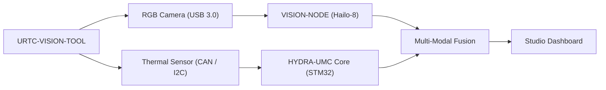

<p align="center">
  
</p>

# 👁️ URTC-VISION-TOOL

<p align="center"><a href="README.md">🇺🇸 English</a> | <a href="README_spa.md">🇪🇸 Español</a> | <a href="README_fra.md">🇫🇷 Français</a> | <a href="README_ita.md">🇮🇹 Italiano</a> | <a href="README_deu.md">🇩🇪 Deutsch</a> | <a href="README_zho.md">🇨🇳 简体中文</a> | <a href="README_jpn.md">🇯🇵 日本語</a> | 🇵🇹 <b>Português</b></p>

### 🔬 Efetuador Integrado que Combina Perceção Térmica e RGB

<p align="center">
  
  
  
  
</p>

**Verificação de honestidade - o que realmente funciona hoje:** o protocolo de sensor do lado do firmware (`sensor_frame.c`, `sensor_reading.c`, `rate_limiter.c`, `sensor_freshness.c`, `sensor_diagnostics.c`, `vision_sensor_link.c`) é C puro e real, sustentado por 154 verificações `TEST_ASSERT` aprovadas (`tests/test_*.c`, compiladas e executadas com o próprio compilador de C da máquina anfitriã), e o CI deste repositório executa-os de facto: o passo de firmware de `.github/workflows/ci.yml` invoca `build_firmware.sh`, cujo passo 2 compila e executa sempre `tests/` antes de tocar na compilação para STM32. O pacote `vision_companion` do lado do anfitrião (`alignment.py`, `cli.py`) é igualmente real e está sustentado por 75 casos de pytest aprovados, e o CI também executa essa suite (o seu próprio passo instala `src/vision_companion/requirements.txt` e executa `pytest tests/` aí), pelo que uma regressão em qualquer uma das duas metades faz falhar a compilação. Como a própria introdução deste README já diz: ainda não existe PCB/esquemático para esta placa, pelo que nada aqui alguma vez leu um sensor MLX9064x real nem uma câmara RGB, nem controlou um transcetor CAN real - `main.c`/`startup_stm32_minimal.c` apenas demonstram que a compilação cruzada e a ligação para Cortex-M4F têm êxito com um linker script provisório. Consulte `CHANGELOG.md` para saber exatamente o que foi entregue até agora.

---

> **Estado de segurança (safety e security):** este ecossistema não é um sistema de segurança certificado e ainda não existe nenhuma placa URTC montada. Os bootloaders verificam as imagens de firmware com CRC32 e um HMAC-SHA256 de chave partilhada, não com uma assinatura assimétrica (prevista); as imagens de aplicação publicadas estão assinadas com a chave pública de desenvolvimento (`signing_key_kind: dev`), pelo que qualquer pessoa pode produzir uma imagem que o bootloader aceita; nada foi transmitido a uma placa real. Leia a [base de segurança](https://github.com/JuanenRac/URTC-DOCS/blob/main/docs/SECURITY_BASELINE.md) e o [modelo de ameaças](https://github.com/JuanenRac/URTC-DOCS/blob/main/docs/THREAT_MODEL.md) antes de confiar em qualquer afirmação aqui para a segurança de uma pessoa.

## 📋 Num relance

| | |
|---|---|
| Versão | `0.1.2` |
| Maturidade | Funcional |
| Tecnologia | C / STM32 / Python vision companion |
| Destino | Uma placa com microcontrolador (o firmware); compila-se num PC |
| Em hardware real | Ainda não: não há registo de execução em hardware real para esta versão |

## 1. 🛠️ VISÃO TÉCNICA GERAL

**URTC-VISION-TOOL** é uma cabeça de ferramenta robótica especializada que funde a perceção visual e térmica num único efetuador compatível com URTC. Foi concebida para QA avançada, inspeção térmica de PCBs e alinhamento Pick-and-Place de alta precisão.

Equipada com uma câmara RGB global shutter e um sensor térmico da família MLX9064x, fornece ao Vision AI Node dados bimodais, permitindo-lhe detetar não só a presença de um componente, mas também a sua temperatura de funcionamento ou a dissipação de calor da soldadura.

Ainda não existe PCB/esquemático para esta placa (ver `hardware/`), pelo que nada do que se segue pode controlar sensores térmicos/RGB reais - mas a cadeia de ferramentas de firmware e o pipeline de processamento de visão do lado do anfitrião (geração de frames sintéticos, renderização em falsa cor, alinhamento de ROI RGB->térmico e extração de estatísticas de temperatura, tudo coberto por pytest) são reais e funcionam hoje.

### Caraterísticas Principais:
* 🔬 **Perceção Bimodal** — captura sincronizada de imagem térmica e RGB. *(o pipeline de processamento que ambos os frames alimentam é real - ver abaixo; a captura real sincronizada requer a PCB e os sensores.)*
* 🌡️ **Térmica de Alta Precisão** — suporte integrado para sensores MLX90640/41/42. *(a renderização em falsa cor e a extração de estatísticas por região são reais - ver abaixo; ler um MLX9064x real por I2C requer a PCB.)*
* 🎯 **Alinhamento Eye-in-Hand** — PnP submilimétrico e AOI (Inspeção Ótica Automatizada). *(o mapeamento de coordenadas de ROI RGB->térmico e a extração de estatísticas de temperatura são reais e testados - ver `vision_companion/alignment.py` abaixo; a precisão submilimétrica requer uma câmara real calibrada.)*
* 📡 **Integração com o URTC** — decidida: esta cabeça é uma cabeça de ferramenta do URTC e reutiliza a ferramenta de inspeção térmica do URTC (perfil de ferramenta 22, MLX90640/90641/90642) e as suas mensagens CAN `0x250`-`0x255` (disparo, estado, blocos de píxeis em bruto e calibrados, documentados em `docs/CANBUS.TXT` do URTC) em vez de um segundo protocolo. O lado do anfitrião dessa troca é real e testado sem hardware (`urtc_thermal.py`, com uma cabeça simulada); o firmware da cabeça, um transcetor CAN e uma placa montada ainda não existem, por isso nada disto correu num barramento. *(O protocolo de tramas do lado do sensor deste repositório, abaixo, é um bloco separado testado no anfitrião; não transporta a imagem térmica.)*
* 🔒 **Verificações de Intervalo do Protocolo de Sensor** — enquadramento versionado com checksum CRC8, validação do intervalo de medição, limitação de taxa, verificação de atualidade das frames (sequência e timestamp) e contadores de diagnóstico dedicados de erros/latência/reinício de barramento. *(implementado em C puro e testado apenas num PC; nunca executado numa placa nem com um sensor real e não é uma função de segurança)*
* ✅ **Cadeia de ferramentas de firmware Cortex-M4F** — uma imagem bare-metal real que compila de forma cruzada e liga com `arm-none-eabi-gcc`, a mesma cadeia de ferramentas dos repositórios irmãos URTC e URTC-SMART-RACK. *(implementado — ver COMPILAÇÃO abaixo)*
* ✅ **Pipeline de processamento `vision_companion`** — um pacote Python real e funcional: geração de frames sintéticos térmicos+RGB, renderização térmica em falsa cor, alinhamento de ROI RGB->térmico + extração de estatísticas de temperatura, relatório de estatísticas, tudo coberto por 75 casos reais de pytest, executa de ponta a ponta sem hardware ligado. *(implementado — ver COMPANION DE VISÃO abaixo)*

---

## 2. 🔄 FLUXO DA FERRAMENTA DE VISÃO



---

## 3. 🧱 ARQUITETURA E DECISÕES DE DESIGN

* **Porque é que este projeto tem 2 linhas de versões independentes.** `src/firmware_common.h` (o firmware do lado do STM32) e `src/vision_companion/vision_companion/__init__.py` (um pacote Python separado do lado do anfitrião) são versionados de forma independente - correm em hardware diferente (MCU vs. anfitrião CM5/PC) e são entregues em calendários diferentes.
* **Porque é que não é filho do próprio URTC.** O mesmo raciocínio do README do URTC-SMART-RACK - uma Ferramenta Complementar que partilha as convenções de firmware do URTC, mas que não faz parte da sua hierarquia de integração.
* **Porque é que existe um pacote companion do lado do anfitrião.** A captura bimodal térmica/RGB requer processamento de imagem real (numpy/Pillow) que não tem lugar no próprio STM32 - o pacote companion é onde isso realmente acontece. Não tem acesso próprio ao barramento, mas fala as mensagens de inspeção térmica do URTC (`urtc_thermal.py`): constrói os pedidos, recompõe os blocos de 16 píxeis numa imagem e entrega as mensagens ao que transporta o barramento.
* **Porque é que `alignment.py` assume um campo de visão partilhado em vez de uma homografia real.** Ambos os sensores estão na mesma cabeça de ferramenta rígida, pelo que um reescalonamento linear por eixo entre as coordenadas de píxel do espaço RGB e do espaço térmico é uma aproximação v0 razoável - uma calibração real por píxel (tabuleiro de xadrez, distorção da lente) requer câmaras reais contra as quais calibrar, que ainda não existem.
* **Como se integra no resto do ecossistema.** Faz parte do ecossistema de ferramentas do URTC (reutiliza a ferramenta de inspeção térmica do URTC e as suas mensagens CAN, ver acima), e é um par natural do HYDRA-UMC-DETECTION-HEF para o mesmo papel de reconhecimento visual que o URTC-SMART-RACK também desempenha.
* **Porque é que o protocolo de frames do sensor transporta o seu próprio campo de timestamp.** Um timestamp em milissegundos do lado do sensor permite a quem chama saber *quando* uma leitura foi realmente feita, independentemente de quando o MCU consegue analisar o frame - valor real de historiador/diagnóstico que um simples pressuposto de "acabou de chegar" perderia.
* **Porque é que os contadores de diagnóstico (`sensor_diagnostics.c`) nunca tomam eles próprios uma decisão de aceitar/rejeitar.** Apenas `sensor_frame.c` (enquadramento), `sensor_reading.c` (intervalo) e `rate_limiter.c` (limitação) decidem se um frame é de confiança - o diagnóstico apenas regista o que eles decidiram. Manter esta fronteira estrita significa que um erro no diagnóstico nunca pode deixar passar dados incorretos por acidente, o "separar diagnostico de salida de control" das próprias notas de diagnóstico.

---

## 📂 ESTRUTURA DE DIRETÓRIOS

```text
URTC-VISION-TOOL/
├── src/
│   ├── firmware_common.h           # FIRMWARE_VERSION_MAJOR/MINOR/PATCH
│   ├── sensor_frame.h / .c         # Real: versioned frame format + CRC8 parse/encode
│   ├── sensor_reading.h / .c       # Real: thermal reading decode + range validation
│   ├── rate_limiter.h / .c         # Real: minimum-interval frame throttling
│   ├── sensor_freshness.h / .c     # Real: atualidade por sequência/timestamp (deteção de repetições e de sensor congelado)
│   ├── sensor_diagnostics.h / .c   # Real: error/latency/bus-reset counters, separate from control
│   ├── vision_sensor_link.h / .c   # Real: frame-dispatch decision tying sensor_frame/sensor_reading/rate_limiter/sensor_diagnostics together
│   ├── main.c                      # Minimal entry point (proof-of-life heartbeat loop)
│   ├── startup_stm32_minimal.c     # Vector table + Reset_Handler (no ST HAL yet, see file header)
│   ├── STM32_MINIMAL.ld            # Placeholder linker script (128K FLASH / 32K RAM floor)
│   └── vision_companion/           # Host-side (CM5/dev machine) Python vision pipeline
│       ├── pyproject.toml          # Packaging + `vision-companion` console script
│       ├── requirements.txt        # numpy + pillow
│       ├── vision_companion/
│       │   ├── __init__.py         # A versão do companion, definida uma só vez
│       │   ├── cli.py              # Real, working CLI (version / selftest / analyze-roi)
│       │   ├── alignment.py        # Real: RGB<->thermal ROI mapping + temperature-stats extraction
│       │   └── calibration.py      # Real: calibração térmica (ganho, desvios, píxeis mortos) carregada de JSON
│       ├── tests/                  # 75 real pytest cases (cli.py + alignment.py)
│       └── README.md               # Companion-specific usage docs
├── tests/                          # Real host-native firmware test harness (sensor_frame, sensor_reading, rate_limiter, sensor_diagnostics, sensor scenarios, atualidade, robustez)
├── docs/                           # Referência da linha de comandos (CLI_REFERENCE.md)
├── hardware/                       # Notas de hardware (README.md) - ainda sem ficheiros de projeto (sem esquema nem PCB)
├── firmware/                       # Saída de compilação (.bin/.elf/.hex), ignorada pelo git - publicada apenas como assets da release do GitHub
├── build/                          # Intermediate build objects (gitignored)
├── images/                         # Media and diagrams
├── tools/
│   ├── build_test.py               # Non-versioning build/compile check
│   ├── publish_release_assets.py   # Lista os assets da release e imprime o comando gh
│   └── ci_validate.py              # Manifest/CHANGELOG/docs validation used by CI
├── bump.py                         # Comando explícito para subir a versão (compilar nunca a sobe)
├── bump_version.py                 # Odometer-style version bump (generic, shared with URTC / URTC-SMART-RACK)
├── bump_manifest_version.py        # Syncs urtc.project.json's version to the native one (--sync)
├── build_firmware.sh / .bat        # Real build: host tests + bump version + compile + link + publish to firmware/
├── build-test.sh / .bat            # Non-versioning build/compile check
└── README.md
```

---

## 4. ⚙️ COMPILAÇÃO (firmware)

Requer a ARM GNU Toolchain (`arm-none-eabi-gcc`, `arm-none-eabi-objcopy`, `arm-none-eabi-size`) e Python 3.

```bash
# Linux/macOS
chmod +x build_firmware.sh   # one-time
./build_firmware.sh

# Windows
build_firmware.bat
```

A compilação começa por compilar e executar `tests/` com o compilador de C *do próprio anfitrião* (nunca `arm-none-eabi-gcc` - estes são testes de lógica pura, sem tocar em registos do MCU) e falha por inteiro se alguma asserção falhar. Só então incrementa a versão de `src/firmware_common.h` (regra do odómetro, igual ao resto do ecossistema), compila `main.c` e `startup_stm32_minimal.c` para Cortex-M4F, liga-os ao mapa de memória provisório `STM32_MINIMAL.ld` e publica ficheiros `.elf`/`.bin`/`.hex` versionados em `firmware/`.

Todos os módulos em `src/` são também compilados para Cortex-M4F e ligados todos em conjunto como verificação (o alvo não tem biblioteca C), embora hoje a imagem contenha apenas `main.c` e o ficheiro de arranque. Se a compilação falhar depois de a versão ser incrementada, a versão, o manifesto e o changelog são repostos como estavam. Com `URTC_CI=1` nada versionado é alterado.

Ainda não há nada para gravar em hardware real — não existe PCB que confirme o componente STM32 de destino, a disposição de pinos, a cablagem do MLX9064x nem a interface da câmara RGB.

As imagens de firmware (`.bin`, `.hex`, `.elf`) não são versionadas no git: uma compilação de release escreve `firmware/URTC_VISION_TOOL_FIRMWARE_v<versão>.*` (ignorado pelo git; `build/firmware` em modo CI, `URTC_CI=1`) e são publicadas apenas como assets da release do GitHub de cada versão. `python tools/publish_release_assets.py` verifica os ficheiros, escreve o ficheiro `.sha256` em falta e imprime o comando `gh release create` exato com os ficheiros a anexar.

## 5. 🐍 COMPANION DE VISÃO (Python do lado do anfitrião)

Esta parte funciona hoje, na totalidade, sem hardware ligado:

```bash
cd src/vision_companion
python3 -m venv .venv
# Linux/macOS:
.venv/bin/pip install -r requirements.txt
.venv/bin/python -m vision_companion selftest

# Windows:
.venv\Scripts\pip install -r requirements.txt
.venv\Scripts\python -m vision_companion selftest
```

`selftest` gera um frame térmico sintético com a forma de um MLX9064x (32x24, com um ponto quente semelhante à ponta de um ferro de soldar) e um padrão de teste sintético RGB de barras de cor, renderiza/guarda ambos como ficheiros reais e imprime as suas estatísticas — prova de que o pipeline de processamento numpy/Pillow funciona genuinamente, independentemente do passo de captura real do sensor, que chegará quando existir hardware.

`analyze-roi X0 Y0 X1 Y1` mapeia uma caixa delimitadora do espaço RGB para o espaço térmico e comunica estatísticas de temperatura reais dessa região — a lógica de alinhamento por trás da funcionalidade Eye-in-Hand Alignment do README, real hoje:

```bash
.venv/bin/python -m vision_companion analyze-roi 280 210 360 270
```

Exemplo de saída real:

```text
RGB ROI (280,210)-(360,270) in a 640x480 frame
  -> thermal stats: min=75.67C max=78.97C mean=77.69C p95=78.70C (16 thermal px)
```

75 casos reais de pytest cobrem tanto `cli.py` como `alignment.py`:

```bash
pip install -e ".[dev]"
pytest
```

Consulte `src/vision_companion/README.md` para a documentação completa do companion, e [`docs/CLI_REFERENCE.md`](docs/CLI_REFERENCE.md) para todos os comandos, flags e códigos de saída com saída real capturada.

---

## 6. 📋 CHANGELOG

Consulte [`CHANGELOG.md`](CHANGELOG.md) para o histórico completo de versões — o firmware e o `vision_companion` são versionados de forma independente (ver COMPILAÇÃO e COMPANION DE VISÃO acima), e cada alteração real tem a sua própria entrada aí.

---

## 🔗 Projetos Relacionados

Este projeto faz parte do ecossistema de robótica HYDRA-UMC do mesmo autor (JuanenRac / Electro Hobby 3D). Vale a pena conhecê-los, já que um pedido pode, na verdade, dizer respeito a um destes e não a este repositório.

**Diretamente Relacionados**
- **[URTC](https://github.com/JuanenRac/URTC)** — firmware da PCB física do Universal Robot Tool Controller, mais de 25 perfis de ferramenta sobre barramento CAN — o mesmo ecossistema de ferramentas, sobre o mesmo barramento CAN.
- **[HYDRA-UMC-DETECTION-HEF](https://github.com/JuanenRac/HYDRA-UMC-DETECTION-HEF)** — registo real de modelos compilados com verificação de carregamento seguro por arquitetura Hailo/checksum — um irmão em termos de papel no reconhecimento visual.
- **[URTC-TESTER](https://github.com/JuanenRac/URTC-TESTER)** — ferramenta de diagnóstico de barramento CAN em direto para desktop para placas URTC, um painel por perfil de ferramenta — o seu próprio diagnóstico CAN em direto complementa as verificações de QA visual desta ferramenta na mesma cabeça de ferramenta.

**Também Parte do Ecossistema**

*Hardware Central e Plataforma*
- **[HYDRA-UMC](https://github.com/JuanenRac/HYDRA-UMC)** — o desenho da placa-mãe do braço robótico: anfitrião CM5 + STM32H745 de dois núcleos, pensado para orquestrar até 8 braços de ferramenta por CAN-OTA/SPI-OTA (firmware numa fase inicial; ainda sem placa montada).
- **[HYDRA-UMC-OS](https://github.com/JuanenRac/HYDRA-UMC-OS)** — camada de produto reprodutível de Raspberry Pi OS para o CM5: agente só de leitura, configuração/perfis validados, provisionamento Wi-Fi de primeiro contacto.
- **[HYDRA-UMC-SDK](https://github.com/JuanenRac/HYDRA-UMC-SDK)** — o contrato JSON-Schema partilhado e a fronteira de software de controlo de trabalhos contra a qual cada bridge valida os seus comandos (não é uma função de segurança certificada).
- **[HYDRA-UMC-CONNECTOR-HUB](https://github.com/JuanenRac/HYDRA-UMC-CONNECTOR-HUB)** — registo declarativo de manifestos de adaptador e validador para conectores de máquinas externas; estende a própria ideia de contrato do SDK a máquinas externas sem substituir os projetos de gateway industrial.

*Backend Central e Clientes*
- **[HYDRA-UMC-SERVER](https://github.com/JuanenRac/HYDRA-UMC-SERVER)** — o verdadeiro backend headless (REST/WebSocket) com o qual todos os clientes de controlo comunicam de facto.
- **[HYDRA-UMC-STUDIO](https://github.com/JuanenRac/HYDRA-UMC-STUDIO)** — painel de controlo web com visualização 3D multirrobô em tempo real.
- **[HYDRA-UMC-SUITE](https://github.com/JuanenRac/HYDRA-UMC-SUITE)** — centro de comando de enxame para desktop (PySide6) para vários servidores em simultâneo, empacotado como executável autónomo.
- **[HYDRA-UMC-ANDROID-CONTROL](https://github.com/JuanenRac/HYDRA-UMC-ANDROID-CONTROL)** — aplicação de controlo Android nativa com início de sessão biométrico e uma aplicação companheira Wear OS emparelhada.
- **[HYDRA-UMC-IOS-CONTROL](https://github.com/JuanenRac/HYDRA-UMC-IOS-CONTROL)** — aplicação de controlo para iOS/iPadOS (Flutter) com sincronização WebSocket em tempo real.
- **[HYDRA-UMC-DSI](https://github.com/JuanenRac/HYDRA-UMC-DSI)** — interface tátil nativa para o ecrã tátil DSI de 7" integrado, incorporada no próprio CM5.
- **[HYDRA-UMC-EDITOR-URDF](https://github.com/JuanenRac/HYDRA-UMC-EDITOR-URDF)** — criador/editor gráfico de URDF para desktop que envia os modelos concluídos para o catálogo do próprio STUDIO.
- **[HYDRA-UMC-EDITOR-STL](https://github.com/JuanenRac/HYDRA-UMC-EDITOR-STL)** — editor de modelos STL para desktop, que transforma/substitui/remove/adiciona peças reais no mesmo catálogo de modelos que o HYDRA-UMC-EDITOR-URDF também edita.
- **[HYDRA-UMC-BRIDGE-AMR](https://github.com/JuanenRac/HYDRA-UMC-BRIDGE-AMR)** — fronteira de coordenação para frotas AGV/AMR através de um publicador MQTT VDA 5050 (testado apenas contra uma frota emulada).
- **[HYDRA-UMC-BRIDGE-CNC](https://github.com/JuanenRac/HYDRA-UMC-BRIDGE-CNC)** — coordenador de células CNC de alto nível com acesso ao estado GRBL e aos bytes de controlo (testado apenas contra um emulador).
- **[HYDRA-UMC-BRIDGE-DROIDS](https://github.com/JuanenRac/HYDRA-UMC-BRIDGE-DROIDS)** — fronteira de coordenação para droides com patas/humanoides, com um emissor de comandos para o Boston Dynamics Spot (testado apenas contra um emulador).
- **[HYDRA-UMC-BRIDGE-LASER](https://github.com/JuanenRac/HYDRA-UMC-BRIDGE-LASER)** — coordenador de células laser que lê 3 sinais GPIO (chave, caixa e interlock) (testado apenas contra um chip simulado; não pode armar nem disparar um laser).
- **[HYDRA-UMC-BRIDGE-OPENPNP](https://github.com/JuanenRac/HYDRA-UMC-BRIDGE-OPENPNP)** — coordenador seguro de alto nível do fluxo de placas para o pick-and-place OpenPnP.
- **[HYDRA-UMC-BRIDGE-PRINTER3D](https://github.com/JuanenRac/HYDRA-UMC-BRIDGE-PRINTER3D)** — fronteira de coordenação segura para impressoras 3D Moonraker/Klipper, com comandos de trabalho reais controlados por portas de segurança.
- **[HYDRA-UMC-BRIDGE-ROS2](https://github.com/JuanenRac/HYDRA-UMC-BRIDGE-ROS2)** — coordenador com um transporte ROS 2 baseado em rclpy importado sob demanda (ainda não executado contra uma instalação ROS 2).
- **[HYDRA-UMC-BRIDGE-UAV](https://github.com/JuanenRac/HYDRA-UMC-BRIDGE-UAV)** — fronteira de coordenação para UAV com câmara, com um emissor de comandos MAVLink (testado apenas contra um emulador).

*Plataforma de Ferramentas URTC*
- **[URTC-FLASHER](https://github.com/JuanenRac/URTC-FLASHER)** — ferramenta de gravação com interface gráfica para desktop para placas URTC, CAN-OTA mais SWD/JTAG de chip completo.
- **[URTC-WEB-STUDIO](https://github.com/JuanenRac/URTC-WEB-STUDIO)** — alternativa baseada em browser ao URTC-TESTER através da Web Serial API, sem necessidade de instalação local.

*Vision AI Node (Hailo-8)*
- **[HYDRA-UMC-VISION-NODE](https://github.com/JuanenRac/HYDRA-UMC-VISION-NODE)** — hub de integração do pipeline de visão Hailo-8, com uma verificação real de prontidão de hardware por etapa.
- **[HYDRA-UMC-VISION-STREAMER](https://github.com/JuanenRac/HYDRA-UMC-VISION-STREAMER)** — pipeline GStreamer real + gerador de configuração MediaMTX com uma fronteira de integração HailoRT real.
- **[HYDRA-UMC-VISUAL-SERVOING-API](https://github.com/JuanenRac/HYDRA-UMC-VISUAL-SERVOING-API)** — lei de correção de servovisão baseada em posição com autorização condicionada ao estado da zona; ainda sem estimativa de pose por câmara.
- **[HYDRA-UMC-SAFETY-ZONES](https://github.com/JuanenRac/HYDRA-UMC-SAFETY-ZONES)** — lógica v0 de violação de zonas, atualidade da calibração e pedido de E-STOP que lê as posições dos objetos de um ficheiro; nenhum detetor a alimenta e ainda não há E-STOP físico ligado.

*Cognitive AI Node (Hailo-10)*
- **[HYDRA-UMC-COGNITIVE-NODE](https://github.com/JuanenRac/HYDRA-UMC-COGNITIVE-NODE)** — hub de integração do pipeline cognitivo Hailo-10 (orquestração de LLM/VLA/voz).
- **[HYDRA-UMC-VLA-ENGINE](https://github.com/JuanenRac/HYDRA-UMC-VLA-ENGINE)** — codificação/descodificação real de tokens de ação e geração de trajetórias para um modelo Vision-Language-Action.
- **[HYDRA-UMC-VOICE-UI](https://github.com/JuanenRac/HYDRA-UMC-VOICE-UI)** — front-end de voz real (VAD + analisador de intenções) com um relé limitado para o Watch, controlado por confirmação.
- **[HYDRA-UMC-SEMANTIC-PLANNER](https://github.com/JuanenRac/HYDRA-UMC-SEMANTIC-PLANNER)** — decomposição de tarefas real baseada em regras e recuperação semântica de erros sobre os códigos de erro do MCU.
- **[HYDRA-UMC-DOCS-QA](https://github.com/JuanenRac/HYDRA-UMC-DOCS-QA)** — pesquisa documental TF-IDF real, apenas com a biblioteca padrão, sobre a própria documentação Markdown deste ecossistema.
- **[HYDRA-UMC-LOCAL-TECHNICIAN](https://github.com/JuanenRac/HYDRA-UMC-LOCAL-TECHNICIAN)** — técnico de manutenção de IA local, controlado por políticas, para o próprio ecossistema - observa, diagnostica e propõe correções; os dois níveis de risco mais elevados não estão deliberadamente implementados ainda.

*Orquestração e Enxame*
- **[HYDRA-UMC-ORCHESTRATOR](https://github.com/JuanenRac/HYDRA-UMC-ORCHESTRATOR)** — hub de integração com um contrato real de relatório de estado gRPC/Protobuf e máquina de estados de missão.
- **[HYDRA-UMC-JOB-DISPATCHER](https://github.com/JuanenRac/HYDRA-UMC-JOB-DISPATCHER)** — fila de trabalhos real baseada em prioridades com desduplicação, sobre uma API HTTP real.
- **[HYDRA-UMC-NODE-HEALING](https://github.com/JuanenRac/HYDRA-UMC-NODE-HEALING)** — watchdog real de saúde da frota baseado em gRPC, com retry/backoff e deteção de incompatibilidade de identidade.
- **[HYDRA-UMC-PATH-PLANNER-3D](https://github.com/JuanenRac/HYDRA-UMC-PATH-PLANNER-3D)** — planeador de trajetórias 3D real baseado em RRT, com validação real de colisões com obstáculos/espaço de trabalho.
- **[HYDRA-UMC-SWARM-SYNC](https://github.com/JuanenRac/HYDRA-UMC-SWARM-SYNC)** — sincronização real de estado CRDT LWW-Element-Map, testada por propriedades quanto à convergência multicélula.

*Gémeo Digital e Simulação*
- **[HYDRA-UMC-TWIN](https://github.com/JuanenRac/HYDRA-UMC-TWIN)** — hub de integração do motor de gémeo digital, com um contrato real de sincronização de compatibilidade de versões.
- **[HYDRA-UMC-HIL-BRIDGE](https://github.com/JuanenRac/HYDRA-UMC-HIL-BRIDGE)** — encaminhador hardware-in-the-loop com um interlock de software de colisão entre a simulação e o hardware real (testado sem hardware real).
- **[HYDRA-UMC-PHYSICS-REPLICA](https://github.com/JuanenRac/HYDRA-UMC-PHYSICS-REPLICA)** — cinemática direta real e validação de limites de juntas sobre um subconjunto real de URDF.
- **[HYDRA-UMC-SYNTHETIC-DATA-GEN](https://github.com/JuanenRac/HYDRA-UMC-SYNTHETIC-DATA-GEN)** — gerador procedimental real de cenas 2D com exportação de anotações YOLO/COCO.

*Dados e Análise*
- **[HYDRA-UMC-DATALAKE](https://github.com/JuanenRac/HYDRA-UMC-DATALAKE)** — armazém real de séries temporais sobre sqlite3 com uma API HTTP real de ingestão/consulta.
- **[HYDRA-UMC-ANOMALY-DETECTOR](https://github.com/JuanenRac/HYDRA-UMC-ANOMALY-DETECTOR)** — detetor real de anomalias com FFT + linha de base estatística e monitorização de deriva.
- **[HYDRA-UMC-PRODUCTION-REPORTS](https://github.com/JuanenRac/HYDRA-UMC-PRODUCTION-REPORTS)** — cálculo real de OEE/disponibilidade sobre o histórico do DATALAKE, com exportação CSV reprodutível.
- **[HYDRA-UMC-TELEMETRY-COLLECTOR](https://github.com/JuanenRac/HYDRA-UMC-TELEMETRY-COLLECTOR)** — pipeline real de ingestão CAN/WebSocket para o DATALAKE, com desduplicação por sequência.

*Gateway Industrial*
- **[HYDRA-UMC-GATEWAY-INDUSTRIAL](https://github.com/JuanenRac/HYDRA-UMC-GATEWAY-INDUSTRIAL)** — hub de integração que retransmite para protocolos industriais, com uma camada real de lista de permissões de comandos/backpressure.
- **[HYDRA-UMC-OPCUA-SERVER](https://github.com/JuanenRac/HYDRA-UMC-OPCUA-SERVER)** — espaço de endereçamento OPC-UA real, verificado com uma sessão real de cliente de protocolo binário.
- **[HYDRA-UMC-MQTT-BROKER](https://github.com/JuanenRac/HYDRA-UMC-MQTT-BROKER)** — broker MQTT real com autenticação opcional por cliente e ACLs de tópicos.
- **[HYDRA-UMC-MTCONNECT-ADAPTER](https://github.com/JuanenRac/HYDRA-UMC-MTCONNECT-ADAPTER)** — endpoints XML reais MTConnect `/probe` e `/current` com saída em modo degradado.

*Ferramentas Complementares e Operações do Ecossistema*
- **[HYDRA-UMC-DASHBOARD-AI](https://github.com/JuanenRac/HYDRA-UMC-DASHBOARD-AI)** — painéis de Smart Summaries e Anomaly Highlighting sobre o DATALAKE/ANOMALY-DETECTOR, com uma alternativa estatística honesta.
- **[HYDRA-UMC-TOOL-CLI](https://github.com/JuanenRac/HYDRA-UMC-TOOL-CLI)** — CLI de frota com um contrato real e estável de códigos de saída, um cliente em direto genuíno da própria API do HYDRA-UMC-SERVER.
- **[HYDRA-UMC-WATCH](https://github.com/JuanenRac/HYDRA-UMC-WATCH)** — aplicação companheira WearOS com padrões de alerta tátil e um relé de voz para o telemóvel emparelhado (ainda não executada num relógio físico).
- **[URTC-SMART-RACK](https://github.com/JuanenRac/URTC-SMART-RACK)** — firmware para um rack de montagem de placas com descodificação real de ID de ferramenta e lógica de pré-aquecimento Smart Idle.
- **[URTC-UPDATER](https://github.com/JuanenRac/URTC-UPDATER)** — ferramenta de ambiente de trabalho que deteta, instala e atualiza os repositórios da família URTC, uma ação explícita de cada vez.
- **[HYDRA-UMC-UPDATER](https://github.com/JuanenRac/HYDRA-UMC-UPDATER)** — ferramenta administrativa para desktop que descobre, clona e atualiza todos os repositórios deste ecossistema.
- **[HYDRA-UMC-OS-REBUILDER](https://github.com/JuanenRac/HYDRA-UMC-OS-REBUILDER)** — ferramenta para desktop Windows/Linux que constrói uma imagem CM5 pronta a gravar, pré-carregada com as versões mais recentes do ecossistema, com configuração de primeiro arranque de Wi-Fi/utilizador/SSH ao estilo do Raspberry Pi Imager.
- **[HYDRA-UMC-OPS-AGENT](https://github.com/JuanenRac/HYDRA-UMC-OPS-AGENT)** — coordenador de incidentes de manutenção: um papel edge de baixo privilégio recolhe um instantâneo sanitizado de inventário/estado, um papel de control-plane apresenta-o só de leitura e pede a um fornecedor de IA que sugira um diagnóstico - nunca aplica um patch nem implementa nada.
- **[HYDRA-UMC-DEV-SERVER](https://github.com/JuanenRac/HYDRA-UMC-DEV-SERVER)** — anfitrião de desenvolvimento reprodutível (Raspberry Pi 5 / CM5) que guarda o código-fonte do ecossistema e executa tarefas limitadas de compilação/teste sob uma fila durável; um papel de desenvolvimento dedicado, explicitamente não um CM5 operacional.


---

## 📚 Documentação e Comunidade

- **[CONTRIBUTING.md](CONTRIBUTING.md)** — stack tecnológica e diretrizes de codificação para um pull request.
- **[CODE_OF_CONDUCT.md](CODE_OF_CONDUCT.md)** — as normas de comportamento esperadas nesta comunidade.
- **[SECURITY.md](SECURITY.md)** — como comunicar uma vulnerabilidade, e as áreas de foco de segurança reais deste projeto.
- **[SUPPORT.md](SUPPORT.md)** — onde colocar questões e comunicar erros.
- **[LICENSE.md](LICENSE.md)** — a licença própria deste projeto.

## 👤 AUTOR
**JuanenRac** (Electro Hobby 3D)
📧 electrohobby3d@gmail.com
📺 [youtube.com/@electrohobby3d](https://youtube.com/@electrohobby3d)

## 📜 LICENÇA
GPL-3.0-or-later - Consulte LICENSE para mais detalhes.
