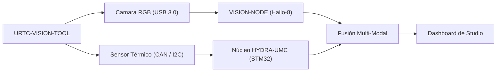

<p align="center">
  
</p>

# 👁️ URTC-VISION-TOOL

<p align="center"><a href="README.md">🇺🇸 English</a> | 🇪🇸 <b>Español</b> | <a href="README_fra.md">🇫🇷 Français</a> | <a href="README_ita.md">🇮🇹 Italiano</a> | <a href="README_deu.md">🇩🇪 Deutsch</a> | <a href="README_zho.md">🇨🇳 简体中文</a> | <a href="README_jpn.md">🇯🇵 日本語</a> | <a href="README_por.md">🇵🇹 Português</a></p>

### 🔬 Cabezal Integrado que Combina Percepción Térmica y RGB

<p align="center">
  
  
  
  
</p>

---

**Comprobación de honestidad - lo que realmente funciona hoy:** el protocolo de sensores del lado del firmware (`sensor_frame.c`, `sensor_reading.c`, `rate_limiter.c`, `sensor_freshness.c`, `sensor_diagnostics.c`, `vision_sensor_link.c`) es C puro real respaldado por 190 comprobaciones `TEST_ASSERT` que pasan (`tests/test_*.c`, compiladas y ejecutadas con el compilador C del host), y la CI de este repo las ejecuta de verdad: el paso de firmware de `.github/workflows/ci.yml` llama a `build_firmware.sh`, cuyo paso 2 siempre compila y ejecuta `tests/` antes de tocar el build STM32. El paquete `vision_companion` del lado del host (`alignment.py`, `cli.py`) también es real y está respaldado por 183 casos de pytest que pasan, y la CI también ejecuta esa suite (un paso propio instala `src/vision_companion/requirements.txt` y ejecuta `pytest tests/` allí), así que una regresión en cualquiera de las dos mitades hace fallar el build. Como ya dice la introducción del README: todavía no existe PCB/esquema para esta placa, así que nada de esto ha leído nunca un sensor MLX9064x o una cámara RGB reales, ni manejado un transceptor CAN real - `main.c`/`startup_stm32_minimal.c` solo demuestran que la compilación cruzada y el enlazado Cortex-M4F funcionan con un linker script provisional. Ver `CHANGELOG.md` para saber exactamente qué se ha publicado.

---

> **Estado de seguridad física y de ciberseguridad:** este ecosistema no es un sistema de seguridad certificado y todavía no existe ninguna placa URTC poblada. Los bootloaders comprueban las imágenes de firmware con CRC32 y un HMAC-SHA256 de clave compartida, no con una firma asimétrica (prevista); las imágenes de aplicación publicadas están firmadas con la clave pública de desarrollo (`signing_key_kind: dev`), así que cualquiera puede producir una imagen que el bootloader acepte; no se ha transmitido nada a una placa real. Lee la [línea base de seguridad](https://github.com/JuanenRac/URTC-DOCS/blob/main/docs/SECURITY_BASELINE.md) y el [modelo de amenazas](https://github.com/JuanenRac/URTC-DOCS/blob/main/docs/THREAT_MODEL.md) antes de fiarte de cualquier afirmación de aquí para la seguridad de una persona.

## 📋 De un vistazo

| | |
|---|---|
| Versión | `0.1.5` |
| Madurez | Funcional |
| Tests | 183 (`pytest`) |
| Tecnología | C / STM32 / Python vision companion |
| Destino | Una placa con microcontrolador (el firmware); se compila en un PC |
| En hardware real | Todavía no: no consta ninguna ejecución en hardware real para esta versión |

**Ir a:** [Resumen](#-resumen) · [Arquitectura](#-arquitectura) · [Funciones](#-funciones) · [Seguridad](#-seguridad-y-protección) · [Interfaces](#-interfaces) · [Inicio rápido](#-inicio-rápido) · [Pruebas](#-pruebas) · [Estructura](#-estructura-del-repositorio) · [Relacionados](#-proyectos-relacionados)

<!-- urtc-section:status_vision_tool -->
## 🚦 Estado del proyecto

🟢 hecho y verificado · 🟡 funciona, con límites conocidos · 🟠 a medias o sin verificar · 🔴 sin hacer o sin funcionar. Nada es verde si nunca corrió en hardware real.

| Parte | Estado | Lo que el repositorio puede demostrar |
| --- | :---: | --- |
| Software | 🟡 | Funciona en un PC y contra el simulador; nunca se ha usado con una placa real. |
| Pruebas | 🟢 | La batería de pruebas pasa en la CI en cada subida. |
| Hardware real | 🟠 | Aún no se ha ejecutado con una placa real: la prueba de banco sigue pendiente. |
| Documentación | 🟡 | README en ocho idiomas y documentos de referencia; las traducciones no las ha revisado ningún hablante nativo. |

<!-- /urtc-section:status_vision_tool -->

## 🎯 Resumen

**URTC-VISION-TOOL** es un cabezal de robot especializado que fusiona percepción visual y térmica en un único efector compatible con URTC. Está diseñado para QA avanzado, inspección térmica de PCBs y alineación de Pick-and-Place de alta precisión.

Equipado con una cámara RGB de obturador global y un sensor térmico de la familia MLX9064x, proporciona al Vision AI Node datos duales, permitiéndole detectar no solo la presencia de un componente sino también su temperatura de funcionamiento o la disipación de calor de una soldadura.

Todavía no existe PCB/esquemático para esta placa (ver `hardware/`), así que nada de lo de abajo puede manejar sensores térmicos/RGB reales - pero el toolchain de firmware y el pipeline de visión del lado host (generación sintética de frames, renderizado en falso color, alineación de ROI RGB->térmico y extracción de estadísticas de temperatura, todo cubierto por pytest) son reales y funcionan hoy.

### Características Clave:
* 🔬 **Percepción Dual-Modal** — captura sincronizada de imagen Térmica y RGB. *(el pipeline de procesamiento que alimentan ambos frames es real - ver abajo; la captura sincronizada real necesita el PCB y los sensores.)*
* 🌡️ **Térmico de Alta Precisión** — soporte integrado para sensores MLX90640/41/42. *(el renderizado en falso color y la extracción de estadísticas por región son reales - ver abajo; leer un MLX9064x real por I2C necesita el PCB.)*
* 🎯 **Alineación Eye-in-Hand** — PnP y AOI (Inspección Óptica Automatizada) sub-milimétrica. *(el mapeo de coordenadas ROI RGB->térmico y la extracción de estadísticas de temperatura son reales y están testeados - ver `vision_companion/alignment.py` abajo; la precisión sub-milimétrica necesita una cámara calibrada real.)*
* 📡 **Integración con URTC** — decidida: este cabezal es un cabezal de herramienta de URTC y reutiliza la herramienta de inspección térmica de URTC (perfil de herramienta 22, MLX90640/90641/90642) y sus mensajes CAN `0x250`-`0x255` (disparo, estado, trozos de píxeles en bruto y calibrados, documentados en `docs/CANBUS.TXT` de URTC) en lugar de un segundo protocolo. El lado host de ese intercambio es real y está probado sin hardware (`urtc_thermal.py`, con un cabezal simulado); el firmware del cabezal, un transceptor CAN y una placa montada todavía no existen, así que nada de esto ha corrido en un bus. *(El protocolo de tramas del lado del sensor de este repositorio, más abajo, es un bloque independiente probado en el host; no transporta la imagen térmica.)*
* 🔒 **Comprobaciones de Rango del Protocolo de Sensor** — framing versionado con checksum CRC8, validación del rango de medición, limitación de tasa, comprobación de frescura de las tramas (secuencia y timestamp) y contadores de diagnóstico dedicados de error/latencia/reset de bus. Trama en versión 2: todo valor de varios bytes (el timestamp y la lectura térmica) es big-endian, como el bus, y una trama de la versión 1 se rechaza. *(implementado como C puro y probado solo en un PC; nunca se ha ejecutado en una placa ni con un sensor real, y no es una función de seguridad)*
* ✅ **Toolchain de firmware Cortex-M4F** — una imagen bare-metal real que compila y enlaza de verdad con `arm-none-eabi-gcc`, el mismo toolchain que los repositorios hermanos URTC y URTC-SMART-RACK. *(implementado — ver COMPILACIÓN abajo)*
* ✅ **Pipeline de procesamiento `vision_companion`** — un paquete Python real y funcional: generación sintética de frames térmicos+RGB, renderizado térmico en falso color, alineación de ROI RGB->térmico + extracción de estadísticas de temperatura, informe de estadísticas, todo cubierto por 183 casos reales de pytest, funciona de principio a fin sin hardware conectado. *(implementado — ver COMPANION DE VISIÓN abajo)*

## 🧩 Papel en URTC

URTC-VISION-TOOL es un cabezal que une una cámara RGB y un sensor térmico MLX9064x, para inspección de calidad, inspección térmica de placas y alineación de un cabezal pick-and-place. Es un cabezal de herramienta URTC: reutiliza la herramienta de inspección térmica de URTC y sus mensajes CAN `0x250` a `0x255` en lugar de un segundo protocolo, y da al nodo de visión (Hailo-8) y al controlador HYDRA-UMC datos de dos tipos, de modo que un componente se juzga no solo por su presencia sino por su temperatura. Lo real hoy es el protocolo del sensor del firmware y el acompañante de visión del lado del anfitrión, ambos probados en un ordenador; todavía no existe ninguna placa. Es una herramienta complementaria, no hija de URTC.

## 🏛️ Arquitectura

<p align="center">
  
</p>

Cómo encajan las partes de este repositorio: quién lo usa, qué contiene y de qué depende. La imagen se dibuja desde `docs/architecture.json` y se comprueba contra el código.

<details>
<summary>Versión en texto del diagrama (Mermaid)</summary>



</details>

### ARQUITECTURA Y DECISIONES DE DISEÑO

* **Por qué este proyecto tiene 2 pistas de versión independientes.** `src/firmware_common.h` (el firmware del lado STM32) y `src/vision_companion/vision_companion/__init__.py` (un paquete Python independiente del lado host) se versionan por separado - corren en hardware distinto (MCU frente a host CM5/PC) y se publican en calendarios distintos.
* **Por qué no es un hijo del propio URTC.** Mismo motivo que el propio README de URTC-SMART-RACK - una Herramienta Complementaria que comparte las convenciones de firmware de URTC, sin formar parte de su jerarquía de integración.
* **Por qué un paquete complementario del lado host.** La captura dual térmica/RGB necesita procesamiento de imagen real (numpy/Pillow) que no tiene sitio corriendo en el propio STM32 - el paquete complementario es donde eso ocurre de verdad. No tiene acceso propio al bus, pero habla los mensajes de inspección térmica de URTC (`urtc_thermal.py`): construye las peticiones, recompone los trozos de 16 píxeles en una imagen y entrega los mensajes a lo que sea que transporte el bus.
* **Por qué `alignment.py` asume un campo de visión compartido en vez de una homografía real.** Ambos sensores están en el mismo cabezal físico rígido, así que un reescalado lineal por eje entre coordenadas de píxel en espacio RGB y espacio térmico es una aproximación v0 razonable - una calibración real por píxel (tablero de ajedrez, distorsión de lente) necesita cámaras reales contra las que calibrar, que todavía no existen.
* **Cómo encaja en el resto del ecosistema.** Pertenece al propio ecosistema de herramientas de URTC (reutiliza la herramienta de inspección térmica de URTC y sus mensajes CAN, ver arriba), y forma pareja natural con HYDRA-UMC-DETECTION-HEF para el mismo papel de reconocimiento visual que también cumple URTC-SMART-RACK.
* **Por qué el protocolo de trama del sensor lleva su propio campo de timestamp.** Un timestamp real en milisegundos generado por el propio sensor permite a quien llama saber *cuándo* se tomó realmente una lectura, independientemente de cuándo la MCU llegue a analizar la trama - un valor real para historial/diagnóstico que una simple suposición de "acaba de llegar" perdería.
* **Por qué los contadores de diagnóstico (`sensor_diagnostics.c`) nunca toman una decisión de aceptar/rechazar por sí mismos.** Solo `sensor_frame.c` (framing), `sensor_reading.c` (rango) y `rate_limiter.c` (limitación de tasa) deciden si se confía en una trama - diagnóstico solo registra lo que ellos decidieron. Mantener ese límite estricto significa que un bug en diagnóstico nunca pueda dejar pasar datos incorrectos por accidente, la propia "separar diagnóstico de salida de control" de las notas de diagnóstico.

## ✨ Funciones

**Inspección térmica por regiones, exportación de series, deriva del sensor y comprobación del rack (solo probado en el host):** `inspect` juzga cada componente de un plan según la regla de temperatura de su tipo y puede exportar el mínimo, el máximo y la media de cada región como muestras para el datalake de HYDRA-UMC, como líneas JSON o como valores de nodos OPC-UA; `drift-check` compara fotogramas de una escena de referencia con una línea base (píxeles muertos, deriva del desfase) y puede escribir un archivo de calibración; `rack-check` juzga las puntas del rack de herramientas a partir de un fotograma térmico. `rack-watch` sigue las puntas mientras el rack calienta e indica cuándo cada hueco alcanzó su objetivo y si se puede cambiar la herramienta, `rack-simulate` escribe los fotogramas de un rack simulado (sano o con un fallo) para probarlo sin cámara, y las órdenes del rack escriben en ocho idiomas (`--lang`). Véase [la referencia de la CLI](docs/CLI_REFERENCE.md). Ejecutado solo con fotogramas sintéticos; no se ha usado ninguna cámara ni placa.

**Captura térmica por un adaptador CAN serie (nuevo, probado solo con un adaptador y una cabeza simulados):** `capture --port PUERTO` lee una imagen calibrada de una cabeza URTC que lleva la herramienta de inspección térmica, a través de un adaptador SLCAN (un puerto serie o una URL de pyserial), con el intercambio de `0x250` a `0x255`, y la guarda como `.npy` y PNG en falso color, lista para `inspect`, `drift-check` y `rack-check`. Una cabeza que informa de un error, nunca queda lista o deja un bloque sin responder termina el comando con un mensaje claro (código de salida 1), y un puerto que no se puede abrir lo termina con el código 2. No se ha ejecutado con un adaptador, un bus ni una cabeza reales.

## 🔒 Seguridad y protección

| Amenaza | Defensa |
|---|---|
| Una trama corrupta o antigua del sensor | Una trama versionada con CRC-8 (`sensor_frame.c`); en la versión 2 todo valor de varios bytes, la marca de tiempo y la lectura térmica incluidas, es big-endian como el bus, y una trama de versión 1 se rechaza |
| Una lectura que el sensor no puede haber hecho | `sensor_reading.c` decodifica la lectura térmica y rechaza lo que está fuera de rango |
| Una avalancha de tramas | `rate_limiter.c` retiene las tramas con un intervalo mínimo |
| Una trama repetida o un sensor bloqueado | `sensor_freshness.c` comprueba la secuencia y la marca de tiempo del propio sensor |
| Un fallo en los contadores que deje pasar datos malos | `sensor_diagnostics.c` solo registra lo que decidieron los demás módulos (errores, latencia, reinicios del bus); nunca acepta ni rechaza una trama |

Todo esto es C puro probado en un ordenador; nunca se ha ejecutado en una placa ni con un sensor real, y no es una función de seguridad.

## 🔌 Interfaces

* **Los mensajes de inspección térmica de URTC** (`0x250` a `0x255`: disparo, estado, trozos de píxeles en bruto y calibrados, documentados en `docs/CANBUS.TXT` de URTC): el lado anfitrión de ese intercambio es `urtc_thermal.py`, probado sin hardware contra un cabezal simulado. `capture --port PORT` lo ejecuta a través de un adaptador SLCAN (un puerto serie o una URL de pyserial) y guarda la imagen como `.npy` y un PNG en falso color; un cabezal que informa de un error, nunca queda listo o deja un trozo sin respuesta termina el comando con código de salida 1, y un puerto que no se puede abrir con código 2.
* **La trama del sensor del firmware:** versión 2, big-endian, CRC-8 (`sensor_frame.c`); es un bloque aparte, probado en el anfitrión, y no transporta la imagen térmica.
* **La línea de comandos `vision-companion`:** `version`, `selftest`, `analyze-roi`, `capture`, `inspect`, `drift-check`, `rack-check`, `rack-watch` y `rack-simulate`, con cada opción y código de salida en [docs/CLI_REFERENCE.md](docs/CLI_REFERENCE.md).
* **Exportaciones:** las lecturas de `inspect` como JSON Lines, como valores de nodos OPC UA o como muestras para el lago de datos de HYDRA-UMC.

## 🚀 Inicio rápido

Requiere el ARM GNU Toolchain (`arm-none-eabi-gcc`, `arm-none-eabi-objcopy`, `arm-none-eabi-size`) y Python 3.

```bash
# Linux/macOS
chmod +x build_firmware.sh   # una sola vez
./build_firmware.sh

# Windows
build_firmware.bat
```

### COMPANION DE VISIÓN (Python del lado host)

Esta parte funciona hoy, completamente, sin ningún hardware conectado:

```bash
cd src/vision_companion
python3 -m venv .venv
# Linux/macOS:
.venv/bin/pip install -r requirements.txt
.venv/bin/python -m vision_companion selftest

# Windows:
.venv\Scripts\pip install -r requirements.txt
.venv\Scripts\python -m vision_companion selftest
```

`selftest` genera un frame térmico sintético con forma MLX9064x (32x24, con un punto caliente tipo punta de soldadura) y un patrón de prueba RGB de barras de color, renderiza/guarda ambos como archivos reales, e imprime sus estadísticas — prueba de que el pipeline de procesamiento numpy/Pillow funciona de verdad, independientemente del paso de captura del sensor real que llegará cuando exista hardware.

`analyze-roi X0 Y0 X1 Y1` mapea una caja delimitadora en espacio RGB a espacio térmico y reporta estadísticas reales de temperatura para esa región — la lógica de alineación detrás de la característica Eye-in-Hand Alignment del README, real hoy:

```bash
.venv/bin/python -m vision_companion analyze-roi 280 210 360 270
```

Salida de ejemplo real:

```text
RGB ROI (280,210)-(360,270) in a 640x480 frame
  -> thermal stats: min=75.67C max=78.97C mean=77.69C p95=78.70C (16 thermal px)
```

183 casos reales de pytest cubren `cli.py`, `alignment.py` y los demás módulos del paquete:

```bash
pip install -e ".[dev]"
pytest
```

Ver `src/vision_companion/README.md` para la documentación completa del companion, y [`docs/CLI_REFERENCE.md`](docs/CLI_REFERENCE.md) para cada comando, flag y código de salida con salida real capturada.

<!-- urtc-section:compatibility -->
### Requisitos y compatibilidad

Qué versiones de los programas de URTC funcionan juntas, y qué versión del protocolo habla cada una, figura en la tabla de compatibilidad que genera URTC-COMMON: [docs/COMPATIBILITY.md](https://github.com/JuanenRac/URTC/blob/main/docs/COMPATIBILITY.md).
<!-- /urtc-section:compatibility -->

## 🧪 Pruebas

Hay dos baterías. El lado del firmware es C en `tests/` (190 comprobaciones `TEST_ASSERT`): la trama del sensor, la lectura, el limitador de tasa, los diagnósticos, la frescura, los escenarios de todo el enlace, la robustez ante entradas erróneas y los vectores compartidos de URTC-COMMON, compilados y ejecutados con el compilador de C del propio equipo y, en la CI, con AddressSanitizer, UBSan y un mínimo de cobertura. El lado del anfitrión es el paquete `vision_companion`, con 183 casos de pytest (`cd src/vision_companion && pytest`) que ejecutan todo el flujo sin hardware: imágenes sintéticas, falso color, alineación, calibración, la captura térmica contra un cabezal simulado, la inspección, la deriva y la comprobación del rack. Cuatro archivos de prueba en Python comprueban los scripts de compilación, los activos de la release y los archivos de versión. `bash build_firmware.sh` ejecuta las pruebas en C antes de la compilación cruzada y falla si una aserción falla. La ruta de recepción que usará una interrupción (`sensor_rx.c`: la interrupción solo mete el byte en un anillo, el bucle principal encuentra las tramas, se resincroniza tras una dañada y descarta una trama a medias que esperó demasiado) también es lógica pura, reproducida byte a byte en las pruebas.

## 🏗️ Compilación y publicación

La compilación primero compila y ejecuta `tests/` con el compilador de C *del propio equipo* (nunca `arm-none-eabi-gcc`: son pruebas de lógica pura, sin tocar registros del MCU) y falla por completo si alguna aserción falla. Solo entonces compila `main.c` y `startup_stm32_minimal.c` para Cortex-M4F, los enlaza con el mapa de memoria provisional `STM32_MINIMAL.ld` y publica archivos `.elf`/`.bin`/`.hex` con versión en `firmware/`. Compilar nunca cambia la versión.

Cada módulo de `src/` se compila también para Cortex-M4F y todos se enlazan juntos como comprobación (no hay biblioteca C en el destino), aunque hoy la imagen solo contiene `main.c` y el archivo de arranque. Con `URTC_CI=1` no se toca ningún archivo versionado.

Todavía no hay nada que flashear a hardware real - no existe PCB que confirme la pieza STM32 objetivo, el pinout, el cableado del MLX9064x, o la interfaz de la cámara RGB.

Las imágenes de firmware (`.bin`, `.hex`, `.elf`) no se versionan en git: un build de release escribe `firmware/URTC_VISION_TOOL_FIRMWARE_v<versión>.*` (ignorado por git; `build/firmware` en modo CI, `URTC_CI=1`) y se publican solo como assets de la release de GitHub de cada versión. `python tools/publish_release_assets.py` comprueba los ficheros, escribe el fichero `.sha256` que falte e imprime el comando `gh release create` exacto con los ficheros a adjuntar.

Consulta [`CHANGELOG.md`](CHANGELOG.md) para el historial completo de versiones; cada versión tiene allí su propia entrada.

## 📂 Estructura del repositorio

<p align="center">
  
</p>

<details>
<summary>Versión en texto del árbol</summary>

```text
URTC-VISION-TOOL/
├── src/                                               el firmware (protocolo del sensor en C puro, copias comprobadas de URTC-COMMON, punto de entrada, script de enlazado provisional) y el acompañante en Python
├── tests/                                             pruebas de host en C (190 comprobaciones) y comprobaciones en Python de los scripts de compilación
├── docs/                                              CLI_REFERENCE.md: cada comando y código de salida
├── hardware/                                          todavía sin esquema ni PCB
├── tools/                                             compilación, cobertura y herramientas de release
├── images/                                            banner e imágenes de este README
├── .github/                                           flujo de CI y plantillas de issues y pull requests
├── build-test.sh build-test.bat                       scripts de compilación y pruebas que no cambian nada en el repositorio
├── test.sh test.bat                                   ejecutan las pruebas
├── urtc.project.json                                  manifiesto: versión, papel, madurez y comando de compilación
├── CHANGELOG.md                                       qué cambió en cada versión
├── SECURITY.md SUPPORT.md LICENSE                     política de seguridad, soporte y licencia
├── CONTRIBUTING.md CODE_OF_CONDUCT.md                 cómo contribuir y código de conducta
├── .gitattributes .gitignore                          ajustes de Git
├── build_firmware.sh build_firmware.bat               pruebas de host, compilación cruzada, publicación
├── bump.py bump_version.py bump_manifest_version.py   scripts que suben la versión
└── LICENSE.md ruff.toml                               licencia de la documentación y ajustes de lint
```

</details>

La lista anotada de cada archivo de código, una línea por archivo, está en [docs/SOURCE_MAP.md](docs/SOURCE_MAP.md).

## 🗺️ Hoja de ruta y límites conocidos

**Límites conocidos hoy**

* Todavía no existe PCB ni esquema para esta placa (véase `hardware/`): nada de esto ha leído nunca un MLX9064x real por I2C, una cámara RGB ni un transceptor CAN. `main.c` y el archivo de arranque solo demuestran que la compilación cruzada y el enlace para Cortex-M4F funcionan con un script de enlazado provisional.
* El firmware del cabezal no existe todavía: el lado anfitrión del intercambio térmico solo se prueba contra un cabezal y un adaptador SLCAN simulados.
* `alignment.py` supone un campo de visión compartido y reescala cada eje linealmente; una calibración real por píxel (tablero de ajedrez, distorsión de la lente) necesita cámaras reales.
* La precisión submilimétrica, la captura real sincronizada y los límites térmicos de las reglas de inspección no se han probado con piezas reales.

**Siguiente**

* Diseñar la placa, fijar la pieza STM32 y la interfaz de la cámara, escribir los controladores del sensor y de la cámara y ejecutar la captura térmica contra un cabezal real en banco.

## 🌍 Idiomas

El README y los textos existen en inglés, español, francés, italiano, alemán, chino, japonés y portugués de Portugal.

## 🔗 Proyectos relacionados

URTC se compone de repositorios independientes, cada uno con su versión, sus pruebas y su README. Esta es la familia, por grupos:

* **URTC Tool Platform:** [URTC](https://github.com/JuanenRac/URTC), [URTC-COMMON](https://github.com/JuanenRac/URTC-COMMON), [URTC-FLASHER](https://github.com/JuanenRac/URTC-FLASHER), [URTC-GATEWAY](https://github.com/JuanenRac/URTC-GATEWAY), [URTC-SMART-RACK](https://github.com/JuanenRac/URTC-SMART-RACK), [URTC-TESTER](https://github.com/JuanenRac/URTC-TESTER), **URTC-VISION-TOOL** (este repositorio), [URTC-WEB-STUDIO](https://github.com/JuanenRac/URTC-WEB-STUDIO)
* **Ecosystem Operations:** [URTC-DOCS](https://github.com/JuanenRac/URTC-DOCS), [URTC-UPDATER](https://github.com/JuanenRac/URTC-UPDATER)

**Proyectos hermanos (independientes, con la misma base y herramientas):**

* **[HYDRA-UMC-DOCS](https://github.com/JuanenRac/HYDRA-UMC-DOCS)** - proyecto hermano: el centro de documentación de HYDRA-UMC, un ecosistema independiente que comparte base y herramientas con este
* **[ARMOR-DOCS](https://github.com/JuanenRac/ARMOR-DOCS)** - proyecto hermano: el centro de documentación de A.R.M.O.R., el ecosistema de seguridad, también independiente y sobre la misma base
* **[JuanenRac](https://github.com/JuanenRac/JuanenRac)** - el perfil y el panel de estado de todos los ecosistemas

## 📚 Documentación

- **[CONTRIBUTING.md](CONTRIBUTING.md)** — stack tecnológico y pautas de codificación para un pull request.
- **[CODE_OF_CONDUCT.md](CODE_OF_CONDUCT.md)** — los estándares de comportamiento esperados en esta comunidad.
- **[SECURITY.md](SECURITY.md)** — cómo reportar una vulnerabilidad, y las áreas reales de enfoque en seguridad de este proyecto.
- **[SUPPORT.md](SUPPORT.md)** — dónde hacer preguntas y reportar errores.
- **[LICENSE.md](LICENSE.md)** — la licencia propia de este proyecto.

## 🤝 Contribuir y comunidad

* Antes de una pull request ejecuta `URTC_CI=1 python tools/ci_validate.py`: debe pasar. Consulta [CONTRIBUTING.md](CONTRIBUTING.md) y el [código de conducta](CODE_OF_CONDUCT.md).
* El README existe en ocho idiomas: un cambio en el texto se hace en los ocho archivos, y las secciones compartidas con otros repositorios las escribe `tools/readme_sections.py` de URTC-COMMON.
* Un cambio en el protocolo CAN empieza en URTC-COMMON (`spec/can_protocol.json`) y llega a este repositorio mediante la copia comprobada.
* No describas como funcionando en una placa lo que solo se ha compilado.
* Informa de una vulnerabilidad en privado: [SECURITY.md](SECURITY.md). Preguntas, ideas e informes: electrohobby3d@gmail.com ([SUPPORT.md](SUPPORT.md)).

## 👤 AUTOR

**JuanenRac** (Electro Hobby 3D)
📧 electrohobby3d@gmail.com
📺 [youtube.com/@electrohobby3d](https://youtube.com/@electrohobby3d)

## 📜 LICENCIA

GPL-3.0-or-later - Ver LICENSE para más detalles.
