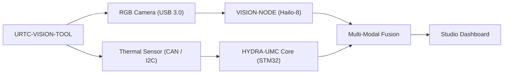

<p align="center">
  
</p>

# 👁️ URTC-VISION-TOOL

<p align="center"><a href="README.md">🇺🇸 English</a> | <a href="README_spa.md">🇪🇸 Español</a> | <a href="README_fra.md">🇫🇷 Français</a> | <a href="README_ita.md">🇮🇹 Italiano</a> | <a href="README_deu.md">🇩🇪 Deutsch</a> | 🇨🇳 <b>简体中文</b> | <a href="README_jpn.md">🇯🇵 日本語</a> | <a href="README_por.md">🇵🇹 Português</a></p>

### 🔬 融合热成像与 RGB 感知的集成末端执行器

<p align="center">
  
  
  
  
</p>

---

**诚实核查 - 今天真正能运行的部分：** 固件侧的传感器协议（`sensor_frame.c`、`sensor_reading.c`、`rate_limiter.c`、`sensor_freshness.c`、`sensor_diagnostics.c`、`vision_sensor_link.c`）是真实的纯 C 代码，有 190 个通过的 `TEST_ASSERT` 检查（`tests/test_*.c`，用主机自身的 C 编译器编译并运行），并且本仓库的 CI 确实会运行它们：`.github/workflows/ci.yml` 的固件步骤调用 `build_firmware.sh`，其第 2 步总是在进行 STM32 构建之前编译并运行 `tests/`。主机侧的 `vision_companion` 包（`alignment.py`、`cli.py`）同样是真实的，有 183 个通过的 pytest 用例，CI 也会运行这套测试（专门的步骤安装 `src/vision_companion/requirements.txt` 并在该目录运行 `pytest tests/`），因此任何一半出现回归都会导致构建失败。正如 README 开头所说：这块板卡还没有 PCB/原理图，因此这里的任何东西都从未读取过真实的 MLX9064x 传感器或 RGB 摄像头，也从未驱动过真实的 CAN 收发器——`main.c`/`startup_stm32_minimal.c` 只证明 Cortex-M4F 的交叉编译和链接在占位链接脚本下能够成功。已发布的内容请参见 `CHANGELOG.md`。

---

> **安全与安防现状:**本生态系统不是经认证的安全系统,目前也不存在已组装的 URTC 电路板。引导程序使用 CRC32 和共享密钥的 HMAC-SHA256 校验固件映像,而非非对称签名(计划中);已发布的应用映像使用公开的开发密钥签名(`signing_key_kind: dev`),因此任何人都可以生成引导程序接受的映像;尚未向任何真实电路板发送过任何内容。在依赖此处任何说法来保障人身安全之前,请先阅读[安全基线](https://github.com/JuanenRac/URTC-DOCS/blob/main/docs/SECURITY_BASELINE.md)和[威胁模型](https://github.com/JuanenRac/URTC-DOCS/blob/main/docs/THREAT_MODEL.md)。

## 📋 速览

| | |
|---|---|
| 版本 | `0.1.5` |
| 成熟度 | 可用 |
| 测试 | 183 (`pytest`) |
| 技术栈 | C / STM32 / Python vision companion |
| 目标 | 微控制器板（固件）；在电脑上构建 |
| 真实硬件 | 尚未：此版本没有在真实硬件上运行的记录 |

**跳转到：** [概述](#-概述) · [架构](#-架构) · [功能](#-功能) · [安全](#-安全与防护) · [接口](#-接口) · [快速开始](#-快速开始) · [测试](#-测试) · [结构](#-仓库结构) · [相关项目](#-相关项目)

<!-- urtc-section:status_vision_tool -->
## 🚦 项目状态

🟢 已完成并已验证 · 🟡 可用，但有已知限制 · 🟠 做了一半或未验证 · 🔴 未完成或不能用。从未在真实硬件上运行过的内容不会是绿色。

| 部分 | 状态 | 仓库能够证明的内容 |
| --- | :---: | --- |
| 软件 | 🟡 | 可在电脑上和模拟器上运行；从未在真实板子上运行过。 |
| 测试 | 🟢 | 每次推送时测试套件都会在 CI 中通过。 |
| 真实硬件 | 🟠 | 尚未在真实板子上运行：台架测试仍待进行。 |
| 文档 | 🟡 | 提供八种语言的 README 和参考文档；翻译未经母语者审阅。 |

<!-- /urtc-section:status_vision_tool -->

## 🎯 概述

**URTC-VISION-TOOL** 是一款专用的机器人工具头，将视觉与热成像感知融合到
单一的 URTC 兼容执行器中。它专为高级质检、PCB 热成像检测和高精度抓取
放置对位而设计。

它配备了一个 RGB 全局快门摄像头和一个 MLX9064x 系列热传感器，为视觉 AI
节点提供双模态数据，使其不仅能检测组件是否存在，还能检测其工作温度或
焊点散热情况。

该板卡目前尚不存在 PCB/原理图（见 `hardware/`），因此下面的功能都无法驱动
真实的热成像/RGB 传感器——但固件工具链以及主机端的视觉处理流水线（合成帧
生成、伪彩色渲染、RGB->热成像 ROI 对位与温度统计提取，全部有 pytest 覆盖）
今天就是真实且可用的。

### 关键特性：
* 🔬 **双模态感知** —— 同步的热成像与 RGB 图像捕获。*（两路帧所馈送的处理流水线是真实的——见下文；真正的同步捕获需要 PCB 和传感器。）*
* 🌡️ **高精度热成像** —— 集成 MLX90640/41/42 传感器支持。*（伪彩色渲染和按区域统计提取是真实的——见下文；通过 I2C 读取真实的 MLX9064x 需要 PCB。）*
* 🎯 **Eye-in-Hand 对位** —— 亚毫米级 PnP 与 AOI（自动光学检测）。*（RGB->热成像 ROI 坐标映射与温度统计提取是真实的并已测试——见下文的 `vision_companion/alignment.py`；亚毫米级精度需要真实的已标定摄像头。）*
* 📡 **与 URTC 的集成** —— 已决定：该刀头是 URTC 的工具头，复用 URTC 的热成像检测工具（工具配置 22，MLX90640/90641/90642）及其 CAN 消息 `0x250`-`0x255`（触发、状态、原始与校准后的像素块，记录在 URTC 的 `docs/CANBUS.TXT` 中），而不是另起第二套协议。该交换的主机端是真实的，并已在没有硬件的情况下测试（`urtc_thermal.py`，带模拟刀头）；刀头固件、CAN 收发器和已装配的电路板都还不存在，因此这些都没有在总线上运行过。*（本仓库的传感器侧帧协议（见下文）是单独的、在主机上测试过的组件，不承载热成像图像。）*
* 🔒 **传感器协议范围检查** —— 版本化帧格式，带 CRC8 校验和，测量范围校验，速率限制，帧新鲜度检查（序列号与时间戳），以及独立于控制决策的专用错误/延迟/总线复位诊断计数器。帧版本 2：所有多字节数值（时间戳与热读数）均与总线一样采用大端序，版本 1 的帧会被拒绝。*（以纯 C 实现，仅在 PC 上测试过；从未在板卡上或配合真实传感器运行过，也不是安全功能）*
* ✅ **Cortex-M4F 固件工具链** —— 一个真实的裸机镜像，使用与兄弟仓库 URTC 和 URTC-SMART-RACK 相同的工具链，通过 `arm-none-eabi-gcc` 交叉编译并链接。*（已实现——见下方"构建"）*
* ✅ **`vision_companion` 处理流水线** —— 一个真实可用的 Python 包：合成热成像+RGB 帧生成、伪彩色热成像渲染、RGB->热成像 ROI 对位 + 温度统计提取、统计报告，全部由 183 个真实 pytest 用例覆盖，无需连接任何硬件即可端到端运行。*（已实现——见下方"VISION COMPANION"）*

## 🧩 在 URTC 中的角色

URTC-VISION-TOOL 是一个把 RGB 摄像头和 MLX9064x 热传感器合在一起的工具头，用于质量检测、电路板的热检测和贴装头的对准。它是 URTC 的工具头：复用 URTC 的热检测工具及其 CAN 消息 `0x250` 至 `0x255`，而不是再设计一套协议，并向视觉节点（Hailo-8）和 HYDRA-UMC 控制器提供两种数据，因此判断一个元件不仅看它是否存在，还看它的温度。现在真实存在的是固件的传感器协议和主机侧的视觉伴随程序，二者都已在计算机上测试；板子还不存在。它是互补工具，不是 URTC 的子项目。

## 🏛️ 架构

<p align="center">
  
</p>

本仓库各部分如何协作：谁在使用它、它包含什么、它依赖什么。图片由 `docs/architecture.json` 绘制，并与代码核对。

<details>
<summary>图表的文本版 (Mermaid)</summary>



</details>

### 架构与设计决策

* **为什么本项目拥有 2 条独立的版本跟踪线。** `src/firmware_common.h`（STM32 端固件）和 `src/vision_companion/vision_companion/__init__.py`（独立的主机端 Python 包）分别独立进行版本管理——它们运行在不同的硬件上（MCU 与主机 CM5/PC），并按不同的发布节奏交付。
* **为什么它不是 URTC 自身的子项目。** 与 URTC-SMART-RACK 自身 README 中的理由相同——它是一个共享 URTC 固件惯例的配套工具，而非其集成层级结构的一部分。
* **为什么需要一个主机端配套软件包。** 热成像/RGB 双模态捕获需要真正的图像处理（numpy/Pillow），而这不适合直接运行在 STM32 上——该配套软件包正是执行这些处理的地方。它自己没有总线访问，但会说 URTC 的热成像检测消息（`urtc_thermal.py`）：构造请求，把 16 像素的块重新拼成图像，并把消息交给承载总线的东西。
* **为什么 `alignment.py` 假设两个传感器共享同一视场，而非使用真实单应变换。** 两个传感器安装在同一个刚性工具头上，因此在 RGB 空间与热成像空间之间对像素坐标做逐轴线性缩放是合理的 v0 近似——真正的逐像素标定（棋盘格、镜头畸变）需要真实摄像头才能进行，而这些目前还不存在。
* **这如何融入生态系统的其余部分。** 属于 URTC 自身的工具生态系统（复用 URTC 的热成像检测工具及其 CAN 消息，见上文），并与 HYDRA-UMC-DETECTION-HEF 自然搭配，承担与 URTC-SMART-RACK 相同的视觉识别角色。
* **为什么传感器帧协议携带自己的时间戳字段。** 真实的传感器端毫秒级时间戳让调用方知道一次读数*实际上是何时*采集的，而与 MCU 何时才能解析该帧无关——这是历史记录/诊断方面真实的价值，若只是简单地假设“刚刚到达”则会丢失这一价值。
* **为什么诊断计数器（`sensor_diagnostics.c`）自身从不做出接受/拒绝的决策。** 只有 `sensor_frame.c`（帧格式）、`sensor_reading.c`（范围）和 `rate_limiter.c`（速率限制）决定一帧数据是否可信——诊断模块只记录它们的决策结果。严格保持这一边界意味着诊断模块中的 bug 永远不可能意外放行错误数据，这正是诊断笔记自身所说的"separar diagnostico de salida de control"。

## ✨ 功能

**按区域的热检测、序列导出、传感器漂移和机架检查(仅在主机上测试):** `inspect` 按每类元件的温度规则判定计划中的每个元件,并可把每个区域的最小值、最大值和平均值导出为 HYDRA-UMC 数据湖的样本、JSON 行或 OPC-UA 节点值;`drift-check` 把参考场景的帧与基线比较(坏点、偏移漂移)并可写出校准文件;`rack-check` 根据热像帧判断工具机架上各个笔尖。`rack-watch` 在机架加热时跟踪笔尖,指出每个槽位何时达到目标以及是否可以更换工具;`rack-simulate` 写出模拟机架(正常或带故障)的帧,无需相机即可试用;机架命令可用八种语言输出(`--lang`)。参见[命令行参考](docs/CLI_REFERENCE.md)。仅在合成帧上运行;没有使用任何相机或电路板。

**通过串行 CAN 适配器进行热成像采集（新增，仅针对模拟适配器和模拟头验证）：** `capture --port 端口` 通过 SLCAN 适配器（串口或 pyserial URL），用 `0x250` 到 `0x255` 的交互，从带有热检测工具的 URTC 头读取一幅校准图像，并保存为 `.npy` 和伪彩色 PNG，可直接用于 `inspect`、`drift-check` 和 `rack-check`。头报告错误、始终未就绪或某个数据块无应答时，命令会给出清晰提示并结束（退出码 1）；无法打开端口时以退出码 2 结束。尚未用真实的适配器、总线或头运行过。

## 🔒 安全与防护

| 威胁 | 防御 |
|---|---|
| 来自传感器的损坏或过时的帧 | 带版本号的帧和 CRC-8（`sensor_frame.c`）；版本 2 中所有多字节数值（包括时间戳和热读数）都与总线一样采用大端序，版本 1 的帧会被拒绝 |
| 传感器不可能产生的读数 | `sensor_reading.c` 解码热读数并拒绝超出范围的值 |
| 帧洪泛 | `rate_limiter.c` 按最小间隔扣留帧 |
| 重放的帧或卡死的传感器 | `sensor_freshness.c` 检查序号和传感器自己的时间戳 |
| 计数器中的缺陷放过坏数据 | `sensor_diagnostics.c` 只记录其他模块的决定（错误、延迟、总线复位），从不接受或拒绝任何帧 |

这一切都是在计算机上测试的纯 C；从未在板子上或用真实传感器运行过，也不是安全功能。

## 🔌 接口

* **URTC 的热检测消息**（`0x250` 至 `0x255`：触发、状态、原始和已校准的像素块，记录在 URTC 的 `docs/CANBUS.TXT` 中）：这一交换的主机侧是 `urtc_thermal.py`，已在没有硬件的情况下针对模拟头测试。`capture --port PORT` 通过 SLCAN 适配器（串口或 pyserial URL）运行它，并把图像保存为 `.npy` 和伪彩色 PNG；头报告错误、始终未就绪或某个块无应答时，命令以退出码 1 结束，端口无法打开则以退出码 2 结束。
* **固件的传感器帧：** 版本 2，大端序，CRC-8（`sensor_frame.c`）；它是单独的、在主机上测试的构件，不承载热图像。
* **命令行 `vision-companion`：** `version`、`selftest`、`analyze-roi`、`capture`、`inspect`、`drift-check`、`rack-check`、`rack-watch` 和 `rack-simulate`，每个选项和退出码见 [docs/CLI_REFERENCE.md](docs/CLI_REFERENCE.md)。
* **导出：** `inspect` 的读数可导出为 JSON Lines、OPC UA 节点值，或 HYDRA-UMC 数据湖的样本。

## 🚀 快速开始

需要 ARM GNU 工具链（`arm-none-eabi-gcc`、`arm-none-eabi-objcopy`、
`arm-none-eabi-size`）以及 Python 3。

```bash
# Linux/macOS
chmod +x build_firmware.sh   # 仅需一次
./build_firmware.sh

# Windows
build_firmware.bat
```

### 视觉配套软件（主机端 Python）

这部分今天就能完整运行，无需连接任何硬件：

```bash
cd src/vision_companion
python3 -m venv .venv
# Linux/macOS：
.venv/bin/pip install -r requirements.txt
.venv/bin/python -m vision_companion selftest

# Windows：
.venv\Scripts\pip install -r requirements.txt
.venv\Scripts\python -m vision_companion selftest
```

`selftest` 会生成一个合成的、符合 MLX9064x 格式的热成像帧（32x24，带有
类似烙铁头的热点），以及一个合成的 RGB 彩条测试图案，将两者渲染/保存为
真实文件，并打印其统计信息——证明 numpy/Pillow 处理流水线确实可以正常
工作，独立于将在硬件问世后才实现的真实传感器捕获步骤。

`analyze-roi X0 Y0 X1 Y1` 将 RGB 空间中的一个边界框映射到热成像空间，并
报告该区域的真实温度统计——这正是 README 中"Eye-in-Hand Alignment"功能
背后的对位逻辑，今天就是真实的：

```bash
.venv/bin/python -m vision_companion analyze-roi 280 210 360 270
```

真实示例输出：

```text
RGB ROI (280,210)-(360,270) in a 640x480 frame
  -> thermal stats: min=75.67C max=78.97C mean=77.69C p95=78.70C (16 thermal px)
```

183 个真实 pytest 用例覆盖了 `cli.py`、`alignment.py` 以及包中的其他模块：

```bash
pip install -e ".[dev]"
pytest
```

完整的配套软件文档请见 `src/vision_companion/README.md`,每个命令、参数和
退出码及其真实捕获输出请见 [`docs/CLI_REFERENCE.md`](docs/CLI_REFERENCE.md)。

<!-- urtc-section:compatibility -->
### 要求与兼容性

哪些版本的 URTC 程序可以配合使用、各自使用哪个协议版本，列在 URTC-COMMON 生成的兼容性表中：[docs/COMPATIBILITY.md](https://github.com/JuanenRac/URTC/blob/main/docs/COMPATIBILITY.md)。
<!-- /urtc-section:compatibility -->

## 🧪 测试

共有两套测试。固件侧是 `tests/` 中的 C 代码（190 个 `TEST_ASSERT` 检查）：传感器帧、读数、速率限制器、诊断、新鲜度、整条链路的场景、对错误输入的鲁棒性以及 URTC-COMMON 的共用向量，用电脑自己的 C 编译器编译运行，在 CI 中还使用 AddressSanitizer、UBSan 和覆盖率下限。主机侧是 `vision_companion` 软件包，有 183 个 pytest 用例（`cd src/vision_companion && pytest`），在没有硬件的情况下运行整条流程：合成图像、伪彩色、对准、校准、针对模拟头的热图像采集、检测、漂移和机架检查。四个 Python 测试文件检查构建脚本、发布资源和版本文件。`bash build_firmware.sh` 在交叉编译前运行 C 测试，任何断言失败则失败。中断将使用的接收路径（`sensor_rx.c`：中断只把字节放入环形缓冲，主循环负责找出帧、在损坏的帧之后重新同步，并丢弃等待过久的半截帧）同样是纯逻辑，测试中逐字节回放。

## 🏗️ 构建与发布

构建首先用*电脑自己的* C 编译器编译并运行 `tests/`（从不使用 `arm-none-eabi-gcc`：这些是纯逻辑测试，不接触 MCU 寄存器），任何断言失败整个构建就失败。之后才为 Cortex-M4F 编译 `main.c` 和 `startup_stm32_minimal.c`，与占位的 `STM32_MINIMAL.ld` 内存映射链接，并把带版本号的 `.elf`/`.bin`/`.hex` 文件发布到 `firmware/`。构建从不改变版本。

`src/` 下的每个模块也会为 Cortex-M4F 编译，并作为检查全部链接在一起（目标上没有 C 库），尽管目前镜像里只有 `main.c` 和启动文件。设置 `URTC_CI=1` 时不会改动任何受版本控制的文件。

目前尚无内容可刷写到真实
硬件——因为没有 PCB 可以确认目标 STM32 型号、引脚布局、MLX9064x 接线，
或 RGB 摄像头接口。

固件映像（`.bin`、`.hex`、`.elf`）不纳入 git 版本管理：发布构建会写入 `firmware/URTC_VISION_TOOL_FIRMWARE_v<版本>.*`（已被 git 忽略；CI 模式即 `URTC_CI=1` 时写入 `build/firmware`），它们仅作为每个版本的 GitHub 发布资源发布。`python tools/publish_release_assets.py` 会检查这些文件、补写缺失的 `.sha256` 文件，并输出带有待附加文件的准确 `gh release create` 命令。

完整的版本历史见 [`CHANGELOG.md`](CHANGELOG.md)，每个版本在其中都有自己的条目。

## 📂 仓库结构

<p align="center">
  
</p>

<details>
<summary>目录树的文本版</summary>

```text
URTC-VISION-TOOL/
├── src/                                               固件（纯 C 传感器协议、URTC-COMMON 的核对副本、入口点、占位链接脚本）和 Python 伴随程序
├── tests/                                             C 主机测试（190 项检查）和构建脚本的 Python 检查
├── docs/                                              CLI_REFERENCE.md：每个命令和退出码
├── hardware/                                          目前没有原理图和 PCB
├── tools/                                             构建、覆盖率和发布工具
├── images/                                            横幅和本 README 的图片
├── .github/                                           CI 工作流以及 Issue 和 Pull Request 模板
├── build-test.sh build-test.bat                       构建并测试的脚本，不会修改仓库内容
├── test.sh test.bat                                   运行测试
├── urtc.project.json                                  清单：版本、角色、成熟度和构建命令
├── CHANGELOG.md                                       每个版本的变更
├── SECURITY.md SUPPORT.md LICENSE                     安全政策、支持和许可证
├── CONTRIBUTING.md CODE_OF_CONDUCT.md                 如何参与贡献和行为准则
├── .gitattributes .gitignore                          Git 设置
├── build_firmware.sh build_firmware.bat               主机测试、交叉编译、发布
├── bump.py bump_version.py bump_manifest_version.py   提升版本号的脚本
└── LICENSE.md ruff.toml                               文档许可证和 lint 设置
```

</details>

每个源文件的带注释清单（每个文件一行）见 [docs/SOURCE_MAP.md](docs/SOURCE_MAP.md)。

## 🗺️ 路线图与已知限制

**目前已知的限制**

* 这块板子还没有 PCB 或原理图（见 `hardware/`）：这里的一切从未通过 I2C 读取过真实的 MLX9064x、RGB 摄像头或 CAN 收发器。`main.c` 和启动文件只证明了用占位链接脚本为 Cortex-M4F 交叉编译并链接是成功的。
* 头部的固件还不存在：热数据交换的主机侧只针对模拟头和模拟 SLCAN 适配器测试过。
* `alignment.py` 假设视场相同并对每个轴做线性缩放；真正逐像素的校准（棋盘格、镜头畸变）需要真实的摄像头。
* 亚毫米精度、同步的真实采集以及检测规则的热限值都没有在真实部件上试过。

**下一步**

* 设计板子，确定 STM32 型号和摄像头接口，编写传感器和摄像头驱动，并在试验台上针对真实的头运行热图像采集。

## 🌍 语言

README 和文本提供英语、西班牙语、法语、意大利语、德语、汉语、日语和欧洲葡萄牙语版本。

## 🔗 相关项目

URTC 由相互独立的仓库组成，每个仓库都有自己的版本、测试和 README。以下是按组划分的家族：

* **URTC Tool Platform:** [URTC](https://github.com/JuanenRac/URTC), [URTC-COMMON](https://github.com/JuanenRac/URTC-COMMON), [URTC-FLASHER](https://github.com/JuanenRac/URTC-FLASHER), [URTC-GATEWAY](https://github.com/JuanenRac/URTC-GATEWAY), [URTC-SMART-RACK](https://github.com/JuanenRac/URTC-SMART-RACK), [URTC-TESTER](https://github.com/JuanenRac/URTC-TESTER), **URTC-VISION-TOOL** (本仓库), [URTC-WEB-STUDIO](https://github.com/JuanenRac/URTC-WEB-STUDIO)
* **Ecosystem Operations:** [URTC-DOCS](https://github.com/JuanenRac/URTC-DOCS), [URTC-UPDATER](https://github.com/JuanenRac/URTC-UPDATER)

**姊妹项目（相互独立，共用同一基础和工具）：**

* **[HYDRA-UMC-DOCS](https://github.com/JuanenRac/HYDRA-UMC-DOCS)** - 姊妹项目：HYDRA-UMC 的文档中心，一个独立的生态，与本生态共用基础和工具
* **[ARMOR-DOCS](https://github.com/JuanenRac/ARMOR-DOCS)** - 姊妹项目：A.R.M.O.R. 安全生态的文档中心，同样独立，建立在同一基础上
* **[JuanenRac](https://github.com/JuanenRac/JuanenRac)** - 所有生态的个人主页和状态面板

## 📚 文档

- **[CONTRIBUTING.md](CONTRIBUTING.md)** —— 提交 Pull Request 所需的技术栈和编码规范。
- **[CODE_OF_CONDUCT.md](CODE_OF_CONDUCT.md)** —— 本社区所期望的行为准则。
- **[SECURITY.md](SECURITY.md)** —— 如何报告漏洞，以及本项目真实的安全关注重点。
- **[SUPPORT.md](SUPPORT.md)** —— 在哪里提问和报告缺陷。
- **[LICENSE.md](LICENSE.md)** —— 本项目自身的许可证。

## 🤝 参与贡献与社区

* 提交 Pull Request 之前请运行 `URTC_CI=1 python tools/ci_validate.py`：必须通过。参见 [CONTRIBUTING.md](CONTRIBUTING.md) 和[行为准则](CODE_OF_CONDUCT.md)。
* README 有八种语言：修改文字时要同步修改全部八个文件，与其他仓库共用的章节由 URTC-COMMON 的 `tools/readme_sections.py` 写入。
* 对 CAN 协议的修改从 URTC-COMMON（`spec/can_protocol.json`）开始，并通过经过核对的副本进入本仓库。
* 不要把仅仅构建过的东西描述为已在板子上运行。
* 请私下报告漏洞：[SECURITY.md](SECURITY.md)。问题、想法和报告：electrohobby3d@gmail.com（[SUPPORT.md](SUPPORT.md)）。

## 👤 作者

**JuanenRac** (Electro Hobby 3D)
📧 electrohobby3d@gmail.com
📺 [youtube.com/@electrohobby3d](https://youtube.com/@electrohobby3d)

## 📜 许可证

GPL-3.0-or-later —— 详见 LICENSE。
